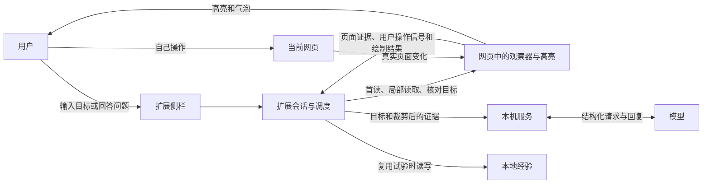

# WebGuide AI 导航 Harness 设计

2026-11-22 · 评审修订稿。自然语言目标、实时视觉引导、由用户自己操作，是已确定的产品方向。本文提出运行层和首轮验收设计。预算、实验顺序和状态处理细节是本稿的建议初值。

## 1. 用户会怎样使用它

组员在陌生网页里知道自己想做什么，却不知道该从哪里开始。比如在 Figma 说「带我找到首页图层的导出设置」。扩展先读眼前的页面。需要选图层时，它指向对应的图层行。用户选中后，扩展根据右侧刚出现的属性重新判断。导出区在视口外时，它提示用户往哪里滚动。看到确切入口后，扩展指给用户看，再自动收起网页上的提示。

这里的 **Harness 是给模型提供观察、补看、显示和结果反馈的运行层**。模型负责理解目标和判断下一步，扩展负责把判断落在仍有效的页面证据上。用户可以照着提示操作，也可以自己换路。组员遇到陌生操作时可以从手头这个页面开始。

| 已确定的方向 | 首轮取舍 |
| --- | --- |
| 用户自由输入目标，模型按眼前页面实时给出提示 | 在桌面 Chrome 和 Edge 的当前标签页内验证。选择有明确可观察终点的任务。 |
| 网页上有高亮和提示，用户自己点击、滚动和输入 | 模型可以读页面、提出高亮、提问和报告结果。点击、输入、导航、提交和下载由用户完成。 |
| 同一套机制跨站点工作 | GitHub 和 Figma 是测试样本。任务、控件关系和布局变化进入测试数据，产品逻辑使用通用观察接口。 |
| 从成功和失败中学习，逐渐减少重复找路 | 先验证从零找路。随后做少量本地经验的对照实验，再决定经验库的投入。 |

固定教程保存在旧分支，可作为同一任务的对照或用于要求统一步骤的课程练习。教程创作工具、文件或 PR 内容核对和公共经验库沿用各自的后续安排。跨源登录、独立新标签页和嵌入式编辑器先验证怎样解释卡点和恢复。

## 2. 方案比较

| 方案 | 能解决什么 | 本项目的取舍 |
| --- | --- | --- |
| 每次发送一份大页面摘要，由模型一步选目标 | 最短路径，适合做一次对照 | 摘要漏掉局部上下文时，模型只能猜或问用户，过长列表也容易淹没目标。 |
| 结构化页面摘要加按需补看 | 模型能先看菜单、区域和选中对象，再扩大范围或读取关联控件 | **推荐作为主线。** 要设计观察接口和循环，但能查清哪段证据被漏读、哪次判断出错。 |
| 从截图直接找按钮 | 能读结构上观察不到的图标、画布和视觉排布 | 作为第二阶段的局部观察实验。要验证图片传输、模型能力、坐标新鲜度和真实控件能否对应。 |

本项目借鉴 Stagehand 把定位单独作为 `observe` 能力的做法，以及 BrowserGym 给同一页面观察中的控件赋编号的做法。两者都能帮助明确模型可以提出哪类请求。这里复用这种边界，页面读取和最终高亮留在当前扩展中。[Stagehand Observe](https://docs.stagehand.dev/v3/basics/observe) · [BrowserGym 观察源码](https://github.com/ServiceNow/BrowserGym/blob/main/browsergym/core/src/browsergym/core/observation.py)

Playwright 把可见、稳定和能接到点击分开检查。本项目借这个区别验证高亮，尤其是图标和实际响应点击的控件分离、按钮被菜单覆盖的情形。Browser Use 给模型循环设置调用次数与时间上限，本文也给每轮补看设置预算，具体数值以实测调整。Driver.js 继续承担绘制。[Playwright 可操作性检查](https://playwright.dev/docs/actionability) · [Browser Use 的运行循环](https://github.com/browser-use/browser-use/blob/main/browser_use/agent/service.py)

## 3. 组件与数据走向

| 部分 | 职责 |
| --- | --- |
| 侧栏 | 输入或修改目标，显示一句当前指引、必要的追问、状态和结果。用户随时可以停止。 |
| 扩展会话 | 侧栏打开时负责观察、调度和清理。后台接收工具栏授权手势并记录绑定的标签页。浏览器会话内另存少量进度，侧栏重开后可以继续。 |
| 网页组件 | 读取可访问的页面结构与局部布局，让元素编号指向当前文档里的目标，核对并绘制高亮。监听用户动作和内容变化，回报能否绘制或目标是否失效。 |
| 本机服务 | 管理模型配置与密钥，拼装请求并验证模型输出。一次请求对应一次模型判断，页面会话和补看循环由扩展管理。 |
| 模型 | 理解自然语言、选择下一步或补看的范围、解释卡点、提出完成判断。模型通过有限的返回类型表达这些决定。 |

复用已测试的元素命名与可见性、`watchPage`、Driver.js 渲染和服务启动。现有 `readPage` 提供了页面摘要与元素编号的起点，它的固定控件列表按下一节改造。旧原型可查登录和 Fork 的实测现象，目标类型、旧接口路径和网站分流留在原型分支。[当前工程基线](WebGuideAI-工程配置与开发方式-v0.1.md) · [旧原型回归记录](WebGuideAI-浏览器导航原型.md#第一轮怎么验证)

## 4. 让模型看到什么

### 4.1 先发一份页面地图

每次判断用四组输入。浏览器根据页面实际可读的内容填字段，并显式标记观察边界。

| 数据 | 内容 |
| --- | --- |
| 用户目标 | 原始目标、用户补充的对象或终点。保留用户原句，避免把「找到」改成「执行」。 |
| 当前页面 | 可分享的站点和页面标题、主要区域、对话框或菜单、当前选中对象，以及视口内优先的标号控件。可滚动区域附上当前能否向上或向下滚。 |
| 控件与关系 | 名称、角色、区域、可见及可用状态、选中／展开／勾选状态、必要的邻近文字与控件关系。例如标签指向哪个输入控件，图层行属于哪个面板，屏外控件在哪个滚动区域。 |
| 近期进展 | 上一条已显示的指引、用户操作是否触发变化、最近相关的几条观察、失败原因和剩余补看额度。经验实验启用时再附少量相关经验。 |

标注 `可见`、`已读到但在视口外`、`当前未读到`、`因权限或页面结构不可读`。例如属性面板只采了顶部时，模型知道观察范围有限，可以查面板下部。页面结构用 DOM 元素和语义属性提取。只有图标、但通过结构仍可识别为按钮的候选，也可以在局部补看时保留，并注明没有读到名称。

有些长列表只把附近几行挂在页面里，滚动后会重用同一批 DOM 节点来显示新条目。「没搜到」只描述本次已读范围。图层栏还可向下滚时，可以提示用户滚动该栏或用页面自身的搜索。方向只说明还有可滚空间。滚动后重读新出现的条目，并重新核对复用节点的名称和所属对象。暂用「能向哪边滚」表达范围，滚动百分比等实际有定位用处再加。[虚拟列表原理](https://web.dev/articles/virtualize-long-lists-react-window)

控制请求大小的方式是限制每次输出的区域、元素数与文字量，把剩余范围标为可补看的区域。控件、区域和可核对的状态都有临时编号。同一轮内多次补看可以追加编号；元素失效后废弃原编号，直到下一轮才重新编号。进入新一轮后，旧编号只随历史给出文字说明，无法用于执行。模型收到裁剪后的证据，扩展保留本地引用和能重查的字段。

例如首读看到「区域 3，属性栏，只采集了视口内的内容」「控件 8，图层行，首页，已选中」。模型可以请求读区域 3 的剩余内容。若看到「控件 21，添加导出设置按钮，在视口下方」，应先告诉用户往哪里滚动。指路时比较同一区域内相邻控件的动作名称和状态，核对哪个控件对应用户想做的事。

### 4.2 缺信息时，模型能请求三种补看

| 补看请求 | 参数和返回 | 例子 |
| --- | --- | --- |
| 查看区域 | 用已有区域编号，返回该区有限的控件和状态；可指定优先看当前视口或包括视口外候选 | 查看属性栏下部，确认是否有 Export。 |
| 查找控件 | 给短关键词，可带已有区域和角色。用页面内可读名称与局部文字检索，返回有限匹配和可继续查看的范围 | 在图层栏找名为「首页」的行，返回同名候选和所在层级。 |
| 检查控件 | 用已有控件编号，返回角色、状态、父区、有限的邻近文字、可见标签与交互控件的关联 | 区分 Export 标题、旁边的加号、以及已配置时的导出按钮。 |

模型一次可以提出 1 到 3 项互不依赖的只读补看，例如同时读图层栏与属性栏。每项使用当时已知的编号或搜索条件。若下一项依赖刚找到的编号，可以再判断一次。扩展合并本地结果后只回给模型一次，整组共享返回大小限制，逐项标记覆盖范围、空结果或失效原因。期间若页面上下文已过期，整组结果丢弃。读取保持页面位置不动。屏外目标由侧栏先说明该滚动哪个区域和方向，确切目标进入可见范围后才画高亮。

首轮读取主文档和可遍历的开放式 Shadow DOM。独立 iframe、纯画布内部和关闭的 Shadow DOM 用可读范围说明和用户提示处理。

### 4.3 何时试带编号的局部截图

至少做过一次有针对性的结构补看。若仍无法区分无名图标、靠位置区分的同名控件，或结构缺失但目标确实在画面上，才有理由试视觉。试验需先确认模型支持图像输入。如果目标尚未滚动出来，先给滚动或搜索指引。

借鉴 Set-of-Mark，在本地裁剪的图上给可定位候选叠加已有编号。截图前后核对已绑定的标签页仍在前台，文档和视口相同。模型选择编号后，扩展再核对页面目标。画布里只有像素、没有可绑定控件时，先用面板入口、侧栏文字或请用户显露对象引导。试验比较同一批可见样本的选对率、耗时和调用成本，再决定常态启用范围。[Set-of-Mark 原论文](https://arxiv.org/abs/2310.11441) · [Chrome 可见标签页截图](https://developer.chrome.com/docs/extensions/reference/api/tabs#method-captureVisibleTab)

## 5. 一次引导循环

### 5.1 模型回复的共同格式

每次只允许一种决定。返回同时带一段供调试的短依据，以及支撑判断的当前证据编号。协议名可以在实现时调整，决定的语义保持一致。

| 决定 | 模型提供 | 扩展怎样处理 |
| --- | --- | --- |
| 补看 | 1 到 3 项互不依赖的读取请求及范围 | 合并结果，记入本轮，再请模型判断。 |
| 指路 | 当前控件编号、一句提示；也可直接给明确方向的文字提示 | 目标通过复查后才绘制，绘制确认后在侧栏显示同一句。目标不可用时回报原因并补看。 |
| 保持 | 当前指引仍适用的依据 | 维持原高亮和措辞。仅在复核已显示指引时使用。 |
| 询问 | 一个会影响下一步的具体问题 | 收起可能误导的旧高亮，等用户答复并刷新当前观察。 |
| 等待 | 可观察的变化，例如等待正在展开的区域出现选项 | 在这一轮安排一次合并观察，出现对应变化再判断。无新变化时暂停并提供手动重试。 |
| 完成 | 终点及对应的对象、结果状态和证据编号。找入口时附该控件编号供最后一次高亮 | 重读证据中的状态和关联，再按目标类型收尾。 |
| 卡住 | 已看到的前置条件、不可读或缺少的证据、可行的下一步 | 侧栏说明卡点。用户处理后可以继续同一目标。 |

模型给的是建议和证据引用。扩展校验返回类型、引用范围和上下文。初版采用普通 JSON 请求/响应，取消信号贯穿扩展到本机服务，任何迟到响应仍按同一套时效检查处理。模型无法调用浏览器的点击、导航、任意脚本或任意网络请求。

### 5.2 什么时候继续、复核或停下

1. **开始。** 用户在已授权标签页填写目标。网页首读等待相关变化短暂收敛，等到上限便用可读部分开始。模型可以连续补看，直到给出可用指引、追问或卡点。
2. **给用户一步。** 检查同一会话、标签页、文档和轮次。高亮目标要仍能解析，名称、角色、所属区域及选中上下文相容。对于要求点击的控件，再检查可用性和主要可点击区域。成功才显示；目标移动到视口外时可以转为侧栏提示。
3. **等待用户。** 同一标签页内，点击、键盘提交等用户操作后重新观察。单纯鼠标经过、焦点装饰和无关的加载动画只检查现有高亮的位置。用户持续输入时等到提交或短暂停顿，采集变化后的页面状态。普通滚动先核对高亮位置。若当前指引请用户滚动某个区域，且滚动后该区出现新证据，则合并成一次下一轮观察。
4. **页面晚到内容。** 先局部检查变化。候选控件出现在当前关注区域，或选中、展开、可用性、遮挡发生变化时，把先前指引和新增或变化的证据提交复核。原路仍成立就维持；只有新证据推翻判断、当前目标已失效或暂行提示现在有了确切目标时才换指引。换提示要能在回放中看到所依据的新证据。
5. **用户主动换路。** 先取消上一轮、撤下旧高亮，再按新页面继续原目标。同源整页跳转按下文接入新文档；同文档路由跳转重新观察。切到另一标签页时暂停，返回原页后重新观察。跨源或需要转到另一标签页时，先让用户在目标页点击工具栏图标授权，再选择「继续这个目标」。
6. **结束或暂停。** 完成、停止、目标换新、侧栏关闭都取消监听和未完成请求，清理高亮。侧栏关闭、暂时缺权限或模型不可用时保留可继续的目标。主动停止、完成或替换目标时清除旧的恢复记录。

会话用「会话 ID、标签页、文档 ID、页面代次、请求序号」关联请求和回执。站内路由、新文档和可能改变页面状态的用户动作一到达，就更新页面代次并取消旧请求，之后才开始等页面变化合并。普通 DOM 变化不动代次，只更新本地观察。回包时对它引用的控件、区域、状态和结果做局部复查。若证据失效，丢弃回包并合并重读。每会话最多一个在途判断，请求以用户刚操作后的上下文为准。扩展自己的气泡和高亮变化从观察中排除。

复核优先看当前指引引用过的对象和区域、页面级对话框或状态提示，以及上次补看后还缺线索的区域。候选用角色、名称、区域和状态比较。顺序、尺寸和坐标变化由高亮检查处理。目标被替换、不可用、被阻挡，或者相同按钮的操作对象已经改变时，先撤下旧高亮，再决定下一步。只给了暂行指引或没有目标时，扩展允许再观察一次新出现的主要区域。

建议初值为新页面和关键用户操作后合并约 200 毫秒，连续变化最多等 650 毫秒再首读。一轮最多 3 次模型判断。最后一次有额度的判断收敛为指路、保持、完成、追问或卡点。在仍有时间和会话额度时，超时或格式错误可单独重试一次同一请求。

现阶段优先确认整条路线能走通。扩展每次最多等 15 秒，一轮补看、判断和重试共用 45 秒。本机服务另设 18 秒的单请求上限，浏览器提前断开时会立即中止上游。会话可发 12 次请求，重试和已发出后取消的请求都计入。等待用户的时间不占用处理时间。触顶后由用户选择「继续尝试」开启下一段额度。

| 触发 | 怎么计入预算 |
| --- | --- |
| 用户开始、主动改变页面状态、回答追问、按指引滚动并看到新条目，或站内跳转 | 开启新一轮，合并相邻的操作和跳转。滚动时等待短暂停顿，同一批条目只触发一次。 |
| 局部补看、普通滚动、晚到内容、技术重试 | 继续当前轮。事件本身不重置次数。重试只用当轮额外的一次机会，其余总限额照常生效。 |
| 旧请求返回或没有新证据 | 丢弃旧回复；重复观察只更新本地位置。额度用完时保留有效指引，需换路时提供手动重试。 |

这些数值用于当前实测版本。先核对四种起点能否完整走通，再按首条指引耗时、错误高亮率和有效补看次数调整。

### 5.3 授权、整页跳转与恢复

首轮通过点击工具栏图标取得 `activeTab`。侧栏按钮负责开始或继续任务，文案直接告诉用户何时要点工具栏。侧栏内也可以通过 `permissions.request` 申请预先声明的可选权限，其授权范围是站点。如果实测中跨源恢复经常打断任务，再比较两种交互。[Chrome activeTab 权限](https://developer.chrome.com/docs/extensions/develop/concepts/activeTab) · [Chrome 可选权限](https://developer.chrome.com/docs/extensions/reference/api/permissions)

同源整页跳转时权限可以保留，新主文档需要重新注入脚本和样式。侧栏调度器监听绑定标签页的 `tabs.onUpdated`，把它当作重新检查和接入的信号。确认标签页仍是当前绑定、授权仍有效，且握手来自新文档 ID 后才恢复。同一文档只保留一套监听和样式。得到新文档的首份可用证据即可开始，图片等资源可以继续加载。同文档路由只更新页面代次。同一地址刷新也要接新文档。断连、页面隐藏和侧栏关闭都能触发清理。[Chrome 标签页更新事件](https://developer.chrome.com/docs/extensions/reference/api/tabs#event-onUpdated) · [Chrome 脚本注入](https://developer.chrome.com/docs/extensions/reference/api/scripting)

用 `storage.session` 在同一个浏览器窗口内保留一份可继续的任务，只记目标、绑定信息、少量进展和已用额度。模型请求发出前先记账，关闭侧栏后重开能恢复已用额度。恢复时由用户确认继续，再核对权限和页面，重新观察。旧编号、在途回复、页面原始快照和截图随当前运行结束而丢弃。扩展重载或浏览器重启后，按新任务开始。[Chrome 会话存储](https://developer.chrome.com/docs/extensions/reference/api/storage#storage-areas)

### 5.4 完成要看目标原句

| 目标 | 什么证明已经完成 | 页面怎样收尾 |
| --- | --- | --- |
| 「帮我找到这个 README 的编辑入口」 | 用户眼前有正确文件对应的实际编辑按钮，扩展确认已经指到它。编辑菜单标题只算中间一步。 | 完成信息与最后一次高亮同时显示，页面气泡和高亮约 4 秒后收起。侧栏保留结果，可点击「再指一次」以当前页面重新核对。 |
| 「带我进入这个 README 的编辑器」 | 页面证据表明正确文件的编辑区已可用。Fork 或登录提示表示仍有前置条件。 | 完成时清掉旧步骤的高亮，侧栏确认已到达。遇到前置条件时解释当前能走的路，用户自行决定。 |
| 「打开仓库活动记录，筛选 PR 合并」 | 已到所指仓库的 Activity，页面显示正确筛选状态。点击菜单或出现下拉项只算进展。 | 核对筛选生效后显示完成并撤下旧提示。 |
| 结果无法观察 | 例如下载发生在浏览器界面，扩展只看得到网页。 | 说明自己看到哪一步，可以请用户确认。用户确认和页面证实分别记录；未经确认则保留为未验证。 |

初始页面已经有终点时可以直接完成。对于「实际到达」或「状态已经生效」，模型要引用目标对象、结果及两者的关联，再指出要复查的字段和预期值。例如「当前文件标识是 README.md」与「同一文件区内有可用编辑器」。选项类任务检查当前已选中或已勾选的状态。收起的选择控件若明确显示当前值，也可引用摘要。网页脚本复查摘要仍然可见、值相同、控件仍收起。当前状态不明确时继续补看。模型仍可能误解证据含义，验收需要用真实终点独立核对。用户对「找入口」还是「实际到达」的意图有歧义且会改变下一步时，只问这一个问题。

#### 下一版试验设计

模型在给出首条引导时，提炼用户需要的结果，并指出每一项来自用户原话的哪一段。例如「确认图层已导出成 PNG，并已下载到电脑」包含「网页显示图层已导出」和「电脑上有文件」两项。会话保留原话和这些条件，沿用户实际走的路线更新证据。只有用户修改目标或澄清了意图时才重订条件。页面控件编号仍随观察轮次更新。

| 结果 | 怎样确认 |
| --- | --- |
| 找到入口 | 网页脚本重新核对当前对象和实际控件。最后一次高亮成功后，将这一项记为已完成。 |
| 到达界面或让状态生效 | 模型引用结果和所属对象的当前证据，网页脚本在收尾前复查。页面缺少关键状态时先补看。 |
| 网页之外的结果 | 侧栏明确询问尚缺的那一项，由用户确认并由会话记录。比如用户可以确认电脑上已经有下载的文件。网页只能报告它看到的导出状态。 |

模型每轮仍可选择补看或给下一步，同时可提交已有证据支持的条件。Harness 复查后更新进度，条件齐全就自动收尾。若还要指向多个入口，侧栏按顺序显示，用户用「查看下一个入口」继续。只余网页之外的一项时，侧栏展示已核对的部分并提供对应确认。侧栏重开可恢复条件、澄清回答、已展示的入口与用户确认。页面发生变化后重新取证，网页证据编号只在当前观察中有效。条件引用须覆盖用户原话，仍由模型理解哪些片段是独立的结果。

首轮试验采用可在当前页面核对的结果和明确的用户确认。接入时复用现有补看循环、控件编号和回包时效校验，先在本机测组合目标、证据过期、复选与筛选状态，再重复跨站验收。重点测模型是否保留了原目标中的每一项，页面是否给得出足够明确的状态，以及正常路径是否需要额外的模型调用。[完成判定回放](导航Harness-真实站点验证-2026-11-23.md#同济恢复后的完成判定回放)

### 5.5 气泡的行为

当前目标优先清晰可见。气泡尽可能放在目标区域外，并避开目标及附近可操作控件，网页照常响应鼠标和键盘。重新布局时复查实际遮挡。没有合适位置时只在网页画高亮，文字留在侧栏。同一目标上的措辞更新复用已有气泡。接入 Driver.js 时，验证高亮保持页面原来的滚动位置和焦点，并跟随用户实际滚动。停止、完成、目标失效和切换标签页都有独立的收尾测试。

## 6. 经验怎样积累

第一阶段用无经验模式建立基准。第二阶段从少量成功或失败的会话提取经验候选。每条包含目标类型、适用情境、可尝试的动作、要看到的结果、常见例外和来源。来源记录试验日期、回归编号以及页面证实还是用户确认。候选被使用时记录复用结果。例如「选中一个可导出的图层后，在属性面板下部查找导出设置。若已有配置，会出现有对象名称的导出按钮」。具体项目名称、页面地址和当时的元素编号留在会话内。现场证据和经验建议一直是不同字段。

少量经验的对照试验直接给模型当前站点的短摘要，最多五条，可标记通用条目。让模型结合用户原话和现场证据选用，例如把「把首页存成 PNG」联系到导出设置。超过规模后先观察遗漏、冲突和成本，再决定是否需要更细的检索。遇到改版、找不到对应控件或经验不适用时，从零找路并记录原因。用户可以在侧栏查看、删除和关闭经验。初版仅从用户允许记录的本地试验会话生成候选。相似任务的复跑验证稳定收益后，再决定自动积累或共享。

站点补充知识可表现为经验或用户允许读到的现场说明。遇到共性缺口先扩充观察能力，例如加入「可见标签与操作控件的关系」。如果结构与经验证的视觉方案仍够不到某类区域，把限制写进能力覆盖和后续实验。测试中允许按网站写独立的验收断言，产品只运行同一套循环。

## 7. 数据、故障与调试

- 侧栏说明配置的模型服务会收到目标和当前标签页的有限页面片段。正常采集仅从选定的标题、短文本和控件关系取值，跳过输入值、表单内容、编辑器正文、完整 URL 查询参数和片段。地址优先只给站点，必要时裁剪路由或用本地引用。控件名称仍可能含项目或人员信息，因此首轮真实模型使用公开或练习材料。页面文字和经验是证据，和系统指令、用户目标分开传递。
- 凭据由本机服务持有。扩展只连本机已配置端点，先核对扩展身份和本机访问凭据。页面可见的「登录」「Fork」等入口可以高亮，账号输入和确认动作由用户完成。
- 平常只记录请求耗时、补看类型、结果类别、拒绝原因和新旧指引变化。测试调试需查看内容时使用公开或练习页面及去标识的固定样本。先能复现「读到了什么、模型选了什么、画出来了什么」，就能区分观察漏读、判断错误、过期回复和渲染失效。
- 本机服务终端的 `[guide]` 记录耗时和结果类别，区分上游 HTTP 错误、输出截断、空白、格式错误、引导决定未通过校验、服务超时和浏览器断开。浏览器侧栏的调试控制台补记单次请求到期、整轮到期或引导中断。两端日志只包含诊断字段与耗时。
- 空观察按原因处理。页面确实空可以等一次，超出当前观察范围就补看，权限不足就提示授权。技术重试用尽后在侧栏说明。过期响应直接丢弃。状态无法重建时重新观察，继续使用用户原目标。

## 8. 怎样验证这套设计

现行分支已经验证基础组件。下表是将来实现后的验收，实测前只作为预期。先做可重复的本机页面和模拟模型验证，再用真实模型和练习页观察行为。所有用例从同一个自然语言输入框开始，后端用同一份模型协议。

| 原型里遇到的问题 | 对应的通用能力 |
| --- | --- |
| 经过 GitHub 的工具按钮时提示闪烁，晚出现的快捷入口突然换掉原提示 | 区分真实用户操作与装饰变化。保留有效指引，有新证据才复核。 |
| README 编辑入口之后可能遇到登录或 Fork，是否继续取决于用户原目标 | 保留目标原句，依据当前页面区分「看到入口」「尚有前置条件」和「实际到达」。 |
| Figma 的图层在眼前，模型却说没看到，或高亮标题而没有指到开关 | 返回可读范围和控件关系。让模型按需扩大局部观察，再指向能操作的目标。 |
| Figma 气泡盖住图层，目标达到后气泡也要手动关闭 | 高亮绘制独立处理避让与点击，完成状态统一清理。 |

| 验证任务 | 起点与扰动 | 达标条件 |
| --- | --- | --- |
| 通用多轮闭环 | 模拟同名控件、虚拟列表和未生效的筛选项 | 一次可以合并多项补看。列表只报告已读范围，用户滚动后能找出新项。仅看到筛选项时保持进行中，生效后才收尾。 |
| GitHub 新任务「打开仓库活动记录，筛选 PR 合并」 | 从公开练习仓库首页开始，再从活动页开始。第二种起点没有首页导航线索 | 引导看到该仓库的 Activity 和已选筛选。测试前核对练习仓库的可见入口和活动数据。这是本稿选的首个 GitHub 新任务，可用同类只读任务替换。[GitHub 活动视图](https://docs.github.com/en/repositories/viewing-activity-and-data-for-your-repository/using-the-activity-view-to-see-changes-to-a-repository) |
| Figma 新任务「找到这个图层的导出设置」 | 在练习稿中从未选中和已选中各开始一次。用需滚动到属性栏底部的情况，并覆盖有无现成配置 | 确认正确图层后，无配置时高亮 Export 区的添加按钮，有配置时高亮现有设置的可操作控件。文字提示滚动属于中间步骤。确实指到入口才完成并自动收起气泡。用户无需真的导出。[Figma 导出说明](https://help.figma.com/hc/en-us/articles/360040028114-Export-static-designs-from-Figma) |
| 旧任务迁移 | GitHub README 的「找到」与「进入」，分别模拟无写权限或已进入编辑器；Figma 自动布局开关用带关联标签的模拟页 | 两类目标有各自的完成证据；说明 Fork 卡点；能指到实际开关。 |
| 稳定性 | 人为延迟图片、菜单和目标控件；同时模拟 hover 提示、目标重建、下一次点击期间迟到的旧回复、窄窗口 | 无关变化不重画；相关变化能复核；失效高亮及时清除；旧回包无法画到新页面；提示不会挡住用户的目标。 |
| 重连、恢复与故障 | 同源整页跳转、刷新及 SPA 路由，切到未授权标签页，关闭和重开侧栏，模拟超时和格式错误 | 新文档接入一次，SPA 不重复安装。侧栏关闭后覆盖层清理，确认继续后重新观察并沿用已用额度。跨源按提示重新授权。技术重试受到轮次和会话限额约束。 |
| 视觉对照 | 结构读到同名候选或无名图标，用结构与带编号截图分别判断 | 核对选中的是实际控件，记录额外耗时和选对率。视口已变时重新观察。 |
| 经验对照 | 同一模型、任务、起点和预算，分别有／无经验，另加相似起点和不同说法 | 记录是否到达、错误指引、模型调用量、总等待时间和经验是否被采用，确认收益及具体失败类型。 |

建议先用模拟用例验证生命周期和补看契约。至少一例故意把关键控件放在首读范围外，只有补看成功才能指对。真实新任务各从两种起点重复至少两次。四种起点各至少有一次完整到达，所有试次均无误报完成，才算拿到跨站可行性证据。每次记录首条可用指引耗时、调用次数、有效补看次数、可见跳闪和错误高亮。速度与成功率目标在取得数据后制定。

## 9. 设计讨论之后的验证顺序

1. 用模拟页面和模型先跑通自然语言目标、局部补看、回包校验、视觉指引和收尾。优先证实局部证据确实能改变模型决定。
2. 用真实模型走两站新任务，顺带回归 GitHub 的权限卡点和 Figma 的选中状态。按观察、模型和显示三处归类问题，决定先改哪一层。
3. 拿确实读不到的样本比较局部视觉辅助能补多少。用有／无经验对照决定本地经验库的首版内容。

技术选型继续采用现有 TypeScript、WXT、Fastify 和测试环境。具体文件名、协议字段、模型配置和预算参数由实现时的验证确定。优先比较跨源恢复的实际摩擦，以及带编号截图在结构化观察之外带来的收益。
