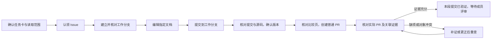

# WebGuide AI 引导交互 v0.1

更新：2026-11-18。T04 交互草案，输入为[整体 SRS](../requirements/WebGuideAI-SRS-v0.2.md)、[SC02 场景规格](../requirements/GitHub协作首场景规格-v0.1.md)及[运行契约](WebGuideAI-运行契约-v0.1.md)。本稿提供结构示意与行为约定，尚非可操作原型或新手试用结果。

首个交付及展示为 GitHub 小组协作入门：认领 Issue → 建工作分支 → 改文档并提交 → 创建普通 PR → 核对并交接。任务与证据字段见[协作适配契约](GitHub协作适配契约-v0.1.md)，下文直接使用 SC02；Pages 专有规则另见[运行契约第 8 节](WebGuideAI-运行契约-v0.1.md#8-本地校验器契约与-pages-终验)。

## 1. 界面组合

采用 **浏览器侧栏承载任务与答疑，真实页面承载目标高亮和一句操作提示**。用户在网页控件上操作，侧栏保持目标与进度可见。

| 方案 | 取舍 |
| --- | --- |
| 侧栏＋页面高亮，当前路线 | 页面不承担长对话布局，跨页保留任务；必须处理侧栏连接与页面失效 |
| 页内 Shadow DOM 悬浮面板 | 自己控制关闭按钮，但更易占住页面、随导航重建；保留作为后续替代 |
| 扩展 popup | 易启动，但点击网页即收起，不适合作为全程引导主界面 |

局部定位和停止证据来自已有实验；这里不再安排新一轮用户手动小验证。具体样式与交互仍可根据正式原型反馈调整。

## 2. 主界面结构示意

以下以“认领 Issue”为例，只表达信息布局；仓库、账号和控件布局均为示意。

```text
真实 GitHub 页面                              浏览器侧栏
┌──────────────────────────────────────┐     ┌──────────────────────────────┐
│ Issue #12 · 补充协作说明              │     │ WebGuide AI       暂停  退出 │
│                                      │     │ 提交第一份修改，交接评审     │
│ Assignees                            │     │ 示例仓库 · Issue #12         │
│ ┌═══════════════════════════════┐     │     ├──────────────────────────────┤
│ ║ assign yourself               ║     │     │ 第 2 / 12 步 · 认领任务      │
│ └═══════════════════════════════┘     │     │                              │
│    ↳ 将这项任务指派给自己             │     │                              │
│                                      │     │ 操作：点击页面中的认领入口。 │
│ 本次修改 docs/practice/first-pr.md    │     │ 原因：让成员知道由谁处理。   │
│ 工作分支 practice/first-pr            │     │ 预期：Assignees 包含你。     │
│                                      │     │                              │
│ 其他页面操作仍然可用                 │     │ [返回查看] [重新核对]        │
│                                      │     ├──────────────────────────────┤
│                                      │     │ 当前步骤答疑                 │
│                                      │     │ [认领后为什么还要建分支？ ] │
│                                      │     │ [发送问题]                   │
│                                      │     │                              │
│                                      │     │ 证据与来源 ▸   反馈问题       │
└──────────────────────────────────────┘     └──────────────────────────────┘
```

侧栏宽度由用户／浏览器调整，内容适应窄屏并纵向滚动；不把主要按钮放到横向滚动区。操作控件保持原位，提示优先出现在不遮住目标的位置，空间不足时只保留轮廓与短标签，完整说明回侧栏。

首轮界面只显示 12 步进度，不另显示阶段进度或折叠分组。[8 阶段与 12 步对照](GitHub协作适配契约-v0.1.md#业务阶段与教程步骤对照)供需求追溯和设计阅读使用。

## 3. 从进入到完成



### 进入任务

确认卡展示仓库、Issue、登录成员、base→head、文档路径、预期小修改、教程版本和来源，并写明终点为“已提交、待评审”。评审者和 Project 可选；缺少它们不阻塞提交段。完整 SHA 由页面证据读取，系统显示修改摘要供用户确认“核对这次修改”，详情可展开 SHA、来源与时间，不要求新手预先填写。

GitHub 主机授权在需要访问时申请，说明本任务涉及的仓库与页面。写权限由任务前提和实际页面能力核对，仓库可打开不代表可提交。拒绝或无法读取时给出重试、改正对象、暂停／退出路径；更改目标需明确确认并重查。

### 正常操作与跨页

页面显示当前需要操作的唯一控件；用户选择或点击后触发重查，规则满足才推进。inspect／wait 步骤也可高亮对应状态区域，但不得把它画成可点击按钮。已满足的步骤在核对后略过；“返回查看”时展示旧步骤并停留，使用“回到当前进度”返回 frontier。

从 Issue 进入仓库、从文档进入编辑器、从比较页进入实际 PR 时，高亮源页面的对应入口。点击后清除旧提示，侧栏显示“正在核对打开的页面”；目的页对象确认后再指示下一步。同页、无刷新跳转、新标签均使用同一任务进度；进入其他仓库只显示偏离说明。

提交对话框先核对“提交到当前工作分支”及分支名；若选了另建分支，先指向更正选项，不继续提示确认提交。文本已输入仍显示“输入尚未提交”；未保存输入存在或读不清时，导航前提醒用户保留。读取不可变版本的 Markdown 时，提示切到 Code 源码视图；渲染预览不能用于精确内容核对，读取缺口给出具体位置，详见协作适配契约第 3 节。

“重新核对”只发检查，不替用户选择、点击或保存。若需要用户明确继续，按钮使用“核对并继续”，依然不能绕过规则。无“跳过并标成功”的按钮。

### 结束与证据

成功卡显示“本段提交已验证，等待成员评审”，列出 Issue 指派、工作分支与确认提交、单文档预期改动、实际 Open 非 Draft PR 及观察时间。评审请求、评审意见、CI 与合并状态独立呈现；有请求修改或检查失败时先提示处理，不显示正常待评审。Issue 和 Project 不自动标 Done。

Draft 显示“已建立草稿，尚未交付评审”，关闭未合并显示“已关闭，未交付”，已合并显示带时间的历史结果。用户自行确认完成标为“用户确认”，关键缺项列出；退出而未完成显示“未完成”。这些标签同时有文字和图标。

完成后停止任务采集，保留本会话可查结果；页面变化不更新成连续监控结论。“重新核对结果”创建新的活动核对上下文，历史结果保留原时间；目标不同则重新开始任务。

## 4. 状态对应的呈现与按钮

| 主状态 | 侧栏说明 | 页面指示／主要操作 |
| --- | --- | --- |
| ready | 目标确认卡、适用条件 | 未开始不采集；开始／取消 |
| checking | 正在核对页面与目标 | 已失效指示先清除；可暂停，不显示虚假的完成勾 |
| guiding | 操作、原因、预期结果 | 唯一目标高亮；返回查看／重新核对／求助 |
| waiting | 提交或创建 PR 正在处理，结果尚未确定 | 指示合法状态区域；核对现有结果／暂停，不要求连续点击提交；超时仍无结果转 pending |
| blocked | 权限不足、错误分支／文件、他人占有冲突、请求修改或检查失败 | 展示具体冲突；更正后重查，或暂停／退出 |
| pending | 缺少源码／完整提交身份、证据过期、目标歧义或结果未知；Draft 尚未交付 | 列补证入口；Draft 的内容已核对且 Ready 入口唯一可用时，由步骤规则转 guiding 指示用户确认转为普通 PR |
| paused | 已暂停，记录当前步骤 | 不采集、不推进；继续前重新核对；停止确认未齐时单列状态 |
| ended | 结果等级、依据与时间、未满足项 | 停止指示；查看历史／重新核对／清空本地记录 |

页面位置变化时先重新判断元素与可见性，再刷新位置。目标不存在、多候选或遮挡不可操作时停止指示并说明实际原因，不选第一个匹配。内容折叠或需要滚动时提供定位提示；“定位目标”仅在用户主动触发时滚动，不持续抢走视口。

## 5. 答疑与反馈

答疑使用侧栏独立区域，支持问题输入、发送中、取消、重试和不可用。界面说明将使用当前步骤与必要页面摘要；普通答疑保留仍有效的高亮。回答按“页面观察／解释与推测／还不确定／建议”区分，并可展开依据。

用户切步骤或换页面时，旧请求不再占据当前回答位置；保留历史时明确显示所属步骤和时间。模型不可用显示“答疑暂不可用，可继续按步骤操作”，不阻塞规则检查。

反馈入口打开预览：教程版本、步骤、文字描述为主要内容；附件可删，允许只提交文字。未实现接收接口时开发演示只提供“保存本地草稿／导出”，不能显示“已提交”。实际首版提交要在反馈可见范围、保留与接口完成后启用；本稿未替 O01／O02 决定共享范围。

## 6. 暂停、关闭、清空与可访问性

- 侧栏始终能暂停或退出；关闭／连接中断保守暂停，重新打开先显示已暂停，不自动恢复页面读取。
- 用户正在选择下拉项或输入时不抢焦点。页面短提示不接管整页键盘；焦点在扩展控件内时 Escape 可暂停，网页输入框内的 Escape 不被全局截获。
- 关键操作有可见文字、键盘焦点与可访问名称；状态用适度的 aria-live 更新，避免每次 DOM 变化反复播报。动画支持 prefers-reduced-motion。
- 清空本地记录先显示范围和实际状态；不把“本地已删除”写成“所有服务端数据已删除”。未确认停止的页面单列待确认，不隐藏失败。
- 向目标页面渲染的说明按纯文本处理，不将网页文字或 AI 文本当作 HTML 插入。

## 7. 原型与检查安排

首轮工程用同一侧栏组件和自有协作模拟页实现可操作闭环，结果标为“开发模拟提交已验证”。自动化覆盖高亮对象、控件可操作、未提交／错误分支／Draft 不通过、条件满足后推进、返回查看、暂停及旧响应拒绝。普通扩展标签页的连接测试不覆盖原生侧栏关闭行为。

接入真实 GitHub 协作后做整体流程检查，并邀请 1–2 位未完成过“认领→分支修改→PR”流程的用户试用。记录独立操作、卡点、帮助和误解；没有受试者不阻塞工程基础建设。T04 完成还需要可操作原型和实际反馈。
