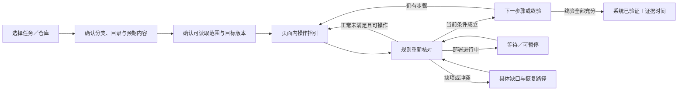

# WebGuide AI 引导交互 v0.1

日期：2026-11-17。T04 交互草案，输入为[整体 SRS](../requirements/WebGuideAI-SRS-v0.2.md)、[Pages 验收清单](../requirements/Pages首版验收清单-2026-11-16.md)及[运行契约](WebGuideAI-运行契约-v0.1.md)。本稿提供结构示意与行为约定，尚非可操作原型或新手试用结果。

## 1. 界面组合

采用 **浏览器侧栏承载任务与答疑，真实页面承载目标高亮和一句操作提示**。用户在网页控件上操作，侧栏保持目标与进度可见。

| 方案 | 取舍 |
| --- | --- |
| 侧栏＋页面高亮，当前路线 | 页面不承担长对话布局，跨页保留任务；必须处理侧栏连接与页面失效 |
| 页内 Shadow DOM 悬浮面板 | 自己控制关闭按钮，但更易占住页面、随导航重建；保留作为后续替代 |
| 扩展 popup | 易启动，但点击网页即收起，不适合作为全程引导主界面 |

局部定位和停止证据来自已有实验；这里不再安排新一轮用户手动小验证。具体样式与交互仍可根据正式原型反馈调整。

## 2. 主界面结构示意

以下是信息布局示意，仓库和分支为示例。页面区域不仿造真实 GitHub 完整界面，也不把示例当作页面证据。

```text
真实 GitHub 页面                              浏览器侧栏
┌──────────────────────────────────────┐     ┌──────────────────────────────┐
│ Build and deployment                 │     │ WebGuide AI       暂停  退出 │
│                                      │     │ 发布并核对 Pages             │
│ Source                               │     │ 示例仓库 · main · /          │
│ ┌═══════════════════════════════┐     │     ├──────────────────────────────┤
│ ║ Deploy from a branch       ▾ ║     │     │ 第 3 / 11 步 · 选择发布方式  │
│ └═══════════════════════════════┘     │     │                              │
│    ↳ 选择 Deploy from a branch       │     │ 操作：选择分支发布。         │
│                                      │     │ 原因：让 Pages 使用已准备的  │
│ Branch                               │     │ 仓库分支与目录。             │
│ [ main ▾ ]  [ / (root) ▾ ] [ Save ]  │     │ 预期：发布方式与目标一致。   │
│                                      │     │                              │
│ 其他页面操作仍然可用                 │     │ [返回查看] [重新核对]        │
│                                      │     ├──────────────────────────────┤
│                                      │     │ 当前步骤答疑                 │
│                                      │     │ [这里为什么要选分支？     ] │
│                                      │     │ [发送问题]                   │
│                                      │     │                              │
│                                      │     │ 证据与来源 ▸   反馈问题       │
└──────────────────────────────────────┘     └──────────────────────────────┘
```

侧栏宽度由用户／浏览器调整，内容适应窄屏并纵向滚动；不把主要按钮放到横向滚动区。操作控件保持原位，提示优先出现在不遮住目标的位置，空间不足时只保留轮廓与短标签，完整说明回侧栏。

## 3. 从进入到完成



### 进入任务

确认卡展示仓库、发布分支／目录、预期内容、核对意图、教程版本和来源。仓库地址及内容可编辑；后台协议、端口或 SHA 输入不作为新手必填项。系统辅助读取版本后以“核对这次读取到的分支版本”确认，详情中可展开完整 SHA、来源与时间。

主机授权在确实需要访问时申请，先说明页面用途；第一次发布可稍后确认站点。拒绝或无法读取时给出重试、改正对象、暂停／退出路径。更改目标需明确确认并重查，不静默迁移成功证据。

### 正常操作与跨页

页面显示当前需要操作的唯一控件；用户选择或点击后触发重查，规则满足才推进。inspect／wait 步骤也可高亮对应状态区域，但不得把它画成可点击按钮。已满足的步骤在核对后略过；“返回查看”时展示旧步骤并停留，使用“回到当前进度”返回 frontier。

从设置页打开部署、从部署打开站点时，高亮的是源页面的链接。点击后清除旧提示，侧栏显示“正在核对打开的页面”；目的页对象与权限确认后再显示下一步。同页、无刷新跳转、新标签均使用同一任务进度；进入其他仓库只显示偏离说明，不更换任务。

“重新核对”只发检查，不替用户选择、点击或保存。若需要用户明确继续，按钮使用“核对并继续”，依然不能绕过规则。无“跳过并标成功”的按钮。

### 结束与证据

系统已验证显示配置、目标提交部署、站点内容三项依据及观察时间。用户自行确认完成使用“用户确认”，关键缺项明确列出；退出而未完成显示“未完成”。这些标签同时有文字和图标，不只使用红绿颜色。

完成后停止任务采集，保留本会话可查结果；页面变化不更新成连续监控结论。“重新核对结果”创建新的活动核对上下文，历史结果保留原时间；目标不同则重新开始任务。

## 4. 状态对应的呈现与按钮

| 主状态 | 侧栏说明 | 页面指示／主要操作 |
| --- | --- | --- |
| ready | 目标确认卡、适用条件 | 未开始不采集；开始／取消 |
| checking | 正在核对页面与目标 | 已失效指示先清除；可暂停，不显示虚假的完成勾 |
| guiding | 操作、原因、预期结果 | 唯一目标高亮；返回查看／重新核对／求助 |
| waiting | 已看到部署排队／运行，显示观察时间 | 合法状态区域可指示，不高亮 Save 要求重复点击；刷新检查／暂停 |
| blocked | 已知阻塞，如部署失败或权限不足 | 不提示继续无效保存；可查看错误、核对权限、反馈或退出 |
| pending | 读不到、证据过期、多个目标或缺少关联 | 清除错误指示；列具体缺口与返回页面／重查路径 |
| paused | 已暂停，记录当前步骤 | 不采集、不推进；继续前重新核对；停止确认未齐时单列状态 |
| ended | 结果等级、依据与时间、未满足项 | 停止指示；查看历史／重新核对／清空本地记录 |

页面位置变化时先重新判断元素与可见性，再刷新位置。目标不存在、多候选或遮挡不可操作时停止指示并说明实际原因，不选第一个匹配。内容折叠或需要滚动时提供定位提示；“定位目标”仅在用户主动触发时滚动，不持续抢走视口。

## 5. 答疑与反馈

答疑使用侧栏独立区域，支持问题输入、发送中、取消、重试和不可用。界面说明将使用当前步骤与必要页面摘要；普通答疑保留仍有效的高亮。回答按“页面观察／解释与推测／还不确定／建议”区分，并可展开依据。

用户切步骤或换页面时，旧请求不再占据当前回答位置；保留历史时明确显示所属步骤和时间。模型不可用显示“答疑暂不可用，可继续按步骤操作”，不阻塞规则检查。

反馈入口打开预览：教程版本、步骤、文字描述为主要内容；附件可删，允许只提交文字。未实现接收接口时开发演示只提供“保存本地草稿／导出”，不能显示“已提交”。实际首版提交要在反馈可见范围、保留与接口完成后启用；本稿未替 O01／O02 决定共享范围。

## 6. 暂停、关闭、清空与可访问性

- 侧栏始终能暂停或退出；关闭／连接中断保守暂停，重新打开先显示已暂停，不自动恢复页面读取。
- 用户正在选择下拉项或输入时不抢焦点。页面短提示不接管整页键盘；焦点在扩展控件内时 Escape 可暂停，网页输入框内的 Escape 不被全局截获。
- 关键操作有可见文字、键盘焦点与可访问名称；状态用适度的 aria-live 更新，避免每次 DOM 变化反复播报。动画支持 prefers-reduced-motion。
- 清空本地记录先显示范围和实际状态；不把“本地已删除”写成“所有服务端数据已删除”。未确认停止的页面单列待确认，不隐藏失败。
- 向目标页面渲染的说明按纯文本处理，不将网页文字或 AI 文本当作 HTML 插入。

## 7. 原型与检查安排

首轮工程用同一侧栏组件和自有模拟页实现可操作闭环；开发演示明确标注，不能呈现为 GitHub 已发布。自动化覆盖高亮对象、真实控件仍可操作、条件满足后推进、未知不推进、返回查看、暂停及旧响应拒绝。普通扩展标签页的连接测试不冒充原生侧栏关闭行为。

后续接真实 Pages 后再作一轮整体流程检查，并邀请 1–2 位未配置过 Pages 的人做形成性试用。记录其独立操作、卡点、帮助和误解；尚未找到受试者不影响工程基础建设，也不预填试用结论。T04 完成还需要可操作原型和实际反馈，本稿只完成设计部分。
