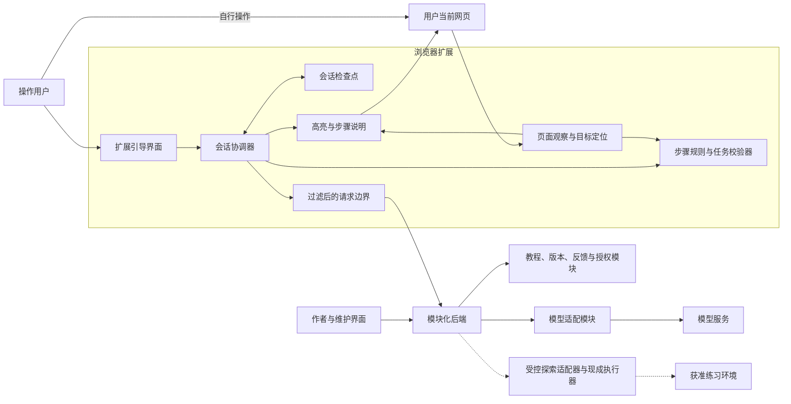
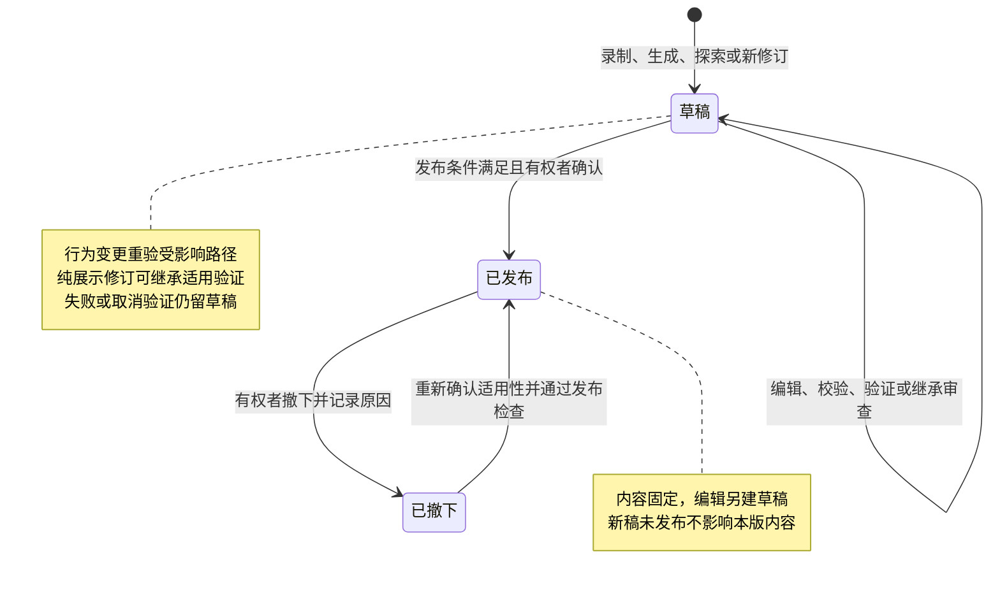
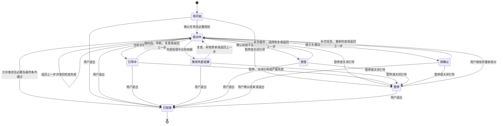

# WebGuide AI 核心设计 v0.1

日期：2026-11-17。状态：T02 首轮设计稿；发起人已选择方案 A“扩展本地运行＋模块化后端”，并接受 TypeScript＋React＋WXT 扩展、Node.js＋Fastify 后端的选型方向。具体模块和状态转换待审阅；[运行契约 v0.1](WebGuideAI-运行契约-v0.1.md)已给出 T03 的教程格式、会话、消息和校验器草案，依赖版本及工程配置仍待落定。

输入：[整体 SRS v0.2](../requirements/WebGuideAI-SRS-v0.2.md)、[交付范围](../requirements/版本交付范围-2026-11-17.md)、[技术约束](第二阶段技术约束核对-2026-11-16.md)与[本地开源调研](../../research/notes/WebGuideAI-开源项目调研.md)。后续直接修订本文件，作为统一核心设计入口。

场景更新（2026-11-18）：首个交付及展示为 [GitHub 小组协作入门](../requirements/首场景调整-GitHub协作-2026-11-17.md)，下文首版模块、跨页原则与用户会话走读已对齐 SC02，Pages 适配仅保留为后续候选。[协作适配契约](GitHub协作适配契约-v0.1.md)与[v2 教程样例](contracts/collaboration.tutorial.json)已形成，真实定位及采集仍待实现验证。

## 1. 设计目标与选择记录

支持教程获取、编辑验证发布、用户现场引导和持续维护的完整产品。首个实现增量调整为 GitHub 协作引导；模块边界为后续作者流程保留接口，首版不要求所有模块同时实现。

目标是让页面指示与确定性检查贴近用户当前页面，模型提供解释及候选建议；已有开源能力优先比较复用，主要开发投入用于适配、状态关联和完整业务闭环。按组长承担主要开发、其余四人交付有明确验收的任务安排，先采用少量部署单元。

| 方案 | 职责与收益 | 代价／取舍 | 结果 |
| --- | --- | --- | --- |
| A 扩展本地运行＋模块化后端 | 扩展观察、定位、高亮、规则与会话；后端提供 AI 接入及后续教程管理；本地规则不依赖模型逐步决策 | 需要约定扩展与后端边界，但后端可先是一个应用 | 发起人已明确选择 |
| B 以扩展为主 | 将首版内容、状态与模型接入尽量放在扩展，起步服务较少 | 用户侧模型凭据／请求配置及后续共享内容、作者权限仍需处理；教程管理加入时会重分工 | 比较后未选择 |
| C 后端集中协调 | 集中掌握主要流程状态，扩展采集和展示 | 每步同步更依赖网络；为满足模型降级和本地交互仍需客户端处理，形成额外一致性工作 | 比较后未选择 |

D12 选择总体分工；后续 D13 接受 TypeScript＋React＋WXT／Node.js＋Fastify 作为选型方向，具体版本、模型和数据库继续细化。后端模块化单体是本稿的具体部署建议，待审阅；受控探索通过适配接口接入现成执行器，其进程可按所选工具需要独立运行。

选型补充输入（2026-11-17）：发起人希望兼顾长期能力与实习要求，目前没有确定求职方向，明确以本项目需要为先。选型比较重点考虑浏览器与 DOM、TypeScript／界面开发、HTTP 与接口、数据建模、测试调试及工程协作等可迁移能力；不单凭招聘关键词选择框架或提前增加组件。实际为 5 人团队，组长承担主要开发，其余四人任务量大致均衡，具体安排见[第二阶段规划](第二阶段整体规划-2026-11-16.md)。

## 2. 总体结构与状态归属

上图是完整系统的逻辑结构。教程／权限等后端模块不要求作为独立服务部署；用户页面和练习环境是不同对象。后端重新打开一个 URL 不替代用户当前网页的观察，也不使用用户个人浏览器配置副本获得其登录状态。

| 信息或决定 | 主要归属 | 其他部分如何使用 |
| --- | --- | --- |
| 发布教程内容与发布／撤下状态 | 后续教程管理后端；首版由维护者提供带版本的打包教程 | 扩展加载固定内容版本并验证格式，运行时不静默换稿；打包教程与服务端教程的来源明确标示 |
| 本次目标、进度、暂停与结果 | 扩展会话协调器及检查点 | 页面脚本、界面和后端响应提交事件或候选信息，由协调器决定是否接纳；后端不逐点击指挥用户会话 |
| 页面目标及其失效 | 当前文档中的页面模块 | 失效时立即撤销本页面错误指示，通知协调器重查；不能等待模型回复才撤销 |
| 步骤／任务的规则结论 | 扩展规则模块和本地任务校验器 | 按匹配当前对象的有效证据评估，协调器接受相容结论；模型回答不是此结论的写入入口 |
| 作者权限、发布、反馈访问 | 后端可信授权边界 | 扩展客户端的成功标签不能授予平台权限，也不替代作者发布授权与验证记录检查 |
| 解释、生成、恢复候选 | 后端模型适配模块返回的非权威结果 | 页面内容先过滤，结果经格式、对象及时效检查后用于展示／建议；恢复后的进度仍重新检查 |
| 探索动作与停止状态 | 独立探索任务及其执行器 | 与普通用户会话隔离，输出过程和候选草稿，经作者检查后进入教程流程 |

## 3. 模块职责与首版落点

| 模块 | 职责 | 首版／后续与 SRS 对应 |
| --- | --- | --- |
| 扩展引导界面 | 目标确认、步骤／证据、答疑、暂停退出、反馈入口；从统一会话快照展示 | 首版采用侧栏＋页面高亮，细节见交互稿；FR01、FR07–FR10、FR18 |
| 会话协调器 | 单任务事件串行处理、目标与版本绑定、跨页关联、恢复、消息过期与状态转移 | 首版提供；FR01、FR03、FR05–FR08 |
| 页面观察／定位 | 在获准任务范围内取得必要 DOM 证据、解析唯一目标、监测目标失效 | 首版实现协作场景的 Issue、分支／文件、编辑／提交、比较与 PR 等角色；目标和文档身份分别核对；FR03、FR04 |
| 高亮展示 | 对当前有效目标渲染高亮和说明，处理滚动与移除，不截断真实操作 | 首版优先验证 Driver.js 适配；不以其默认点击推进替代完成判断；FR04 |
| 通用步骤规则 | 解释已知步骤类型及简单条件，输出通过／等待／失败／未知与依据 | 首版小范围实现；不执行教程下发的任意 JavaScript；FR05、FR06 |
| GitHub 协作适配与校验 | 提取 Issue 指派、分支／文件、提交与 PR 身份和差异摘要，核对同一任务版本 | 首版提供；规则详见 SC02 契约；FR03、FR05 |
| Pages 适配与校验 | 提取发布配置、关联部署与站点内容，按冻结版本关联 | 后续教程候选，现有实验保留；FR03、FR05、Pages Q02 |
| 模型网关 | 凭据保留在后端配置，过滤和校验请求，管理超时／取消、来源及建议格式 | 首版接入当前步骤解释；文档生成和恢复候选后续复用；FR09、FR13 |
| 教程与权限管理 | 草稿、验证、发布、撤下、检索、对象授权与维护记录 | 作者增量实现；首版有固定版本教程不等于已有作者平台；FR12、FR15–FR17、FR19、FR20 |
| 示范录制／资料生成 | 生成同一业务含义的草稿，保留来源、遗漏和待核实项 | 后续实现，复用运行步骤表示而非另建不相容格式；FR11–FR13 |
| 反馈管理 | 预览删减后接收最简反馈，后续补分类、修订关联和处理结论 | 首版需明确实际提交与存储路径，具体存储在后续契约中选择；FR18、FR20 |
| 探索适配器 | 将明确授权、动作边界、预算、停止及轨迹契约对接现成 Agent | 后续独立增量或固定任务验证，不重写完整通用浏览器 Agent；FR14 |

通用运行机制读步骤说明、目标依据和已知条件；专有任务校验器处理多页联合证据。首版不构建任意规则语言。教程的顺序和参数可变，站点专有提取由适配模块承担；本地两份受控样例用于检验边界，不增加正式网站交付承诺。

规则与站点适配接口保持薄：常规步骤优先使用少量已知 DOM 断言，例如在已核对页面和范围内判断元素可见、字段值或状态是否匹配。读取失败、目标歧义与普通条件未满足分别表达；元素存在或文本匹配本身不能证明配置已保存或业务完成。协作适配器负责 Issue／提交／PR 结构化观察；Pages 适配器保留对应发布场景的观察与校验。必要的中间检查和最终跨页关联调用各自注册的 checker／finalVerifier，不能相互替代。

教程只引用支持的规则／校验器标识；类似 `dom_check`、`github_pages_v1` 是待 T03 比较的名称，不是已冻结的 Schema。校验器由随程序交付的实现注册，不执行教程下发代码。第二个网站是否能直接复用，仍取决于其可观察性、前提和结果，不据此承诺平滑适配任意页面。

### 引导界面关闭检测：UI 选型前验证

Chrome 当前官方文档已列出 `sidePanel.onClosed`（Chrome 142+），不能按“没有该事件”排除侧栏。Edge 的 API 总表列出 sidePanel，不等于当前安装版本支持其每个事件；先检查实际版本、事件能力和行为，再决定依赖原生事件还是替代方案。

`runtime.connect`／`port.onDisconnect` 可作为界面连接状态的信号，但连接断开可能来自框架卸载、导航、主动断开或其他端点生命周期变化，不能单独证明用户关闭侧栏；仅打开端口也不保证 service worker 常驻。事件和连接均需关联界面实例、窗口／标签范围和当前任务，避免旧实例断开暂停新实例或另一个任务。必要时保守暂停受影响任务并说明“界面连接中断”，重连先核对，不能伪造关闭原因或自动恢复采集。

侧栏优先进行机制验证，页内 Shadow DOM 面板保留替代候选。页内关闭按钮可由应用控制，但仍需处理整页导航、宿主移除、样式层级和目标遮挡。最小实验覆盖实际关闭、切换标签／窗口、页面导航、面板重建、后台进程重启和重新打开，记录事件、实例与暂停结果。[生命周期实验 E02](../../experiments/extension-lifecycle-spike/准备检查记录-2026-11-17.md)的用户日志与视觉反馈支持本机 Edge 157 单窗口关闭时通过连接断开暂停、撤销蓝框，重开保持暂停；本次未记录原生 onClosed 回调，其他情形仍待验证。

## 4. 教程生命周期状态图

图中每个对象代表**一个内容修订／版本**。已有发布版产生修订时另建草稿，不把原发布内容改回草稿。

发布状态与验证状态是两个维度。验证记录表达未验证、验证中、通过、失败或需复验，并记录范围、依据、时间及系统／人工方式。发布前检查必要内容、权限与有效验证；原验证已失效不能因内容相同就自动继承。

| 事件 | 内容与验证处理 | 已有引导会话 |
| --- | --- | --- |
| 发布新修订 | 新内容得到新版本身份，保留旧版内容及版本关系 | 仍关联原版本，不自动换稿；需切换时用户确认并重查 |
| 修正文案 | 在独立草稿中核对差异；语义、前提、结构、定位和规则均未变且验证仍适用，记录继承依据，保留原实测时间 | 已有会话继续原文案版本 |
| 行为或定位变化 | 重验受影响步骤、后续依赖与最终条件，影响不明则扩大重验 | 发布前仍用原版；发现严重失效时依撤下规则处理 |
| 撤下版本 | 停止新启动，保留历史与原因；确认严重失效时明确受影响步骤 | 收到状态变化后提示，严重问题暂停相应指引；版本和历史不会被偷偷替换 |
| 恢复／回退 | 恢复候选在当前环境重新检查，记录新的发布事件，不改写原内容或原实测时间 | 不强制迁移；切换前重查任务与进度 |

服务端版本状态与扩展缓存需有刷新及过期策略，断网不代表教程仍然可用。模型服务不可用时可继续有效固定引导；教程状态已过有效期而无法核实、或明确被撤下时，不能以“本地可用”绕过相应检查。O04 的状态新鲜度／提示时效将在版本联动实现前落定。首版打包教程不假装具有尚未实现的服务端撤下通知。

## 5. 用户引导会话状态图

这是拟定的业务转换，不是最终代码枚举。核对中表示一次明确的检查过程；AI 答疑是否进行由独立请求状态表示，不把每次提问变成暂停或成功。

进度状态、结果类型及结束原因分开：同样是已结束，可以是系统验证完成、用户确认结束或未完成退出。用户确认关键结果的结束不显示系统已验证。Ended 不接受推进；再核对创建新的活动检查上下文，保留原记录而不把旧响应重新接上。

| 情况 | 必须发生的动作 |
| --- | --- |
| 目标消失、URL／DOM 上下文改变 | 页面侧立即撤销失效指示，协调器使不适用观察失效并进入核对；旧页面迟到消息不得覆盖新状态 |
| 目标仍有效的滚动 | 更新定位，无须全任务退回或重新请求模型 |
| 普通 AI 解释请求 | 维持当前合法步骤与高亮；回答只展示解释，任务变化后旧上下文回答不当当前依据 |
| 用户主动返回上一步 | 先撤销当前指示并使旧请求失效，切换展示步骤，再核对当前页面；显示旧步骤的已完成／待核对情况，返回查看不立即触发自动前进或结束；不会撤销目标网站上已发生的操作 |
| 多候选或关键证据未知 | 核对后进入待确认，给出具体补充路径；关键证据仍缺时不能以“下一步”或跳过变成系统完成 |
| 权限撤销或确认无权限 | 先停止超范围读取和指示，进入受阻；同时使在途检查不再适用 |
| 暂停／关闭引导 | 协调器记录暂停和新请求修订，通知所有关联页面撤下活动指示并停止任务采集，取消可取消请求；其他响应即使返回也不能推进 |
| 页面通知尚未确认 | 显示停止处理中／失败情况，不能仅界面变灰就声称所有页面已停止；重连页面在检查会话状态前不得恢复采集 |
| 后台进程重新启动 | 读检查点；此前暂停／结束的保持原状态，活动任务先重查再恢复指示，不能直接复用内存中的元素引用 |
| 仅显示历史结果 | 保留原观察时间与当时结论，当前页面变化后需重新核对，不声称连续监控结果 |

严重失效、授权撤销和目标不相容可以在任何活动状态中先停止相应指示／采集；图中只列主要业务路径，这些停止动作优先于普通成功返回。

“返回查看”和“重新执行操作”分开。用户返回不清空历史证据，不承诺目标网站回滚，也不重复执行已完成的保存／提交；用户选择继续时再按当前证据推进。暂停或已结束会话中的历史查看仅展示保留信息，不开启页面采集、不离开原状态；重新开始活动核对仍按继续／新上下文规则处理。T03 定义展示步骤与推进意图的具体字段。

## 6. 跨页、状态和消息原则

- 页面模块在任务允许、主机授权有效且页面对象匹配时才读取任务数据。脚本存在不等于任务已开始；暂停状态不因重新注入自动开始采集。
- GitHub 主机权限仍需以应用逻辑约束具体仓库；站点按实际目标主机请求必要授权，不把整个 github.io 作为默认已授权范围。具体权限声明与注入方式在 T03／T05 比较和验证。
- 同一任务可以关联 Issue、分支／文件、编辑／提交、比较与 PR 等页面角色；Pages 适配另使用其设置／部署／站点角色。接收观察时核对任务／修订、教程版本、页面角色、对象、文档／导航身份、请求序号及有效性；同域名或 taskId 独立匹配都不充分。
- 每次 AI 请求绑定任务、教程版本、稳定步骤 ID、任务／步骤上下文修订、页面／文档身份以及独立请求 ID／顺序；返回、前进、导航、暂停和目标重设会使不相容请求失效。数组 stepIndex 只可辅助显示，不能单独标识步骤；返回同一步时旧请求也不能重新变成当前请求。迟到回答可按保留策略作为历史查阅，但不能覆盖当前步骤解释或改变进度，具体字段在 T03 定义。
- 协调器是活动会话的唯一写入入口；单任务事件顺序处理，写入使用修订核对，读写失败有明确失败状态。存储 API 不是天然的跨记录事务，T03 定义检查点的完整性与重启恢复规则。
- 页面侧允许立即做撤销无效高亮等保守停止动作，不能绕过协调器自行宣布任务成功。界面从已确认快照展示，避免一份页面状态、一份后端状态各自推进。
- 本地会话存储优先验证扩展的 `storage.session`，不只放 service worker 全局变量；它适合当前浏览器会话，但扩展重载／禁用／更新也可能清空。缺失检查点须提示重新开始，不承诺扩展重载后无损恢复。
- 模型凭据保留在后端配置，不注入页面或教程；扩展过滤必要上下文，后端再次校验范围与格式。发布或共享后端前必须定义访问控制和请求预算，不能暴露无保护的付费模型代理。
- 首版模型超时不阻断本地规则。教程状态、权限或页面无法确认时仍按各自规则停止／待确认，不能把模型降级当作忽略其他前提的理由。

## 7. 复用候选与接入边界

以下沿用本地固定提交的静态阅读，不是当前上游最新版本推荐或运行验收。版本、文件位置与许可记录见[源码索引](../../research/notes/源码阅读索引.md)和[下载清单](../../research/sources.json)。

| 组件／项目 | 建议的复用形式 | 必须保留的边界或核对 |
| --- | --- | --- |
| Driver.js | 首选直接依赖候选，先验证页面高亮、气泡、滚动与移除处理 | JS／CSS 固定同一版本并打包；其点击推进不承担业务最终判断；核对扩展样式、层级及真实页面表现 |
| OnTheWay | 改造候选：录制、教程编辑、步骤生成及跨页思路 | SDK 的网站接入形态要适配扩展；sessionStorage 恢复不能原样代替跨源会话；MIT 声明与根许可文件缺失需在复制模块前核查 |
| Usertour | 优先借鉴条件监测、元素查找、编辑发布与维护结构；合适模块再比较移植 | 包含 enterprise／权限等许可例外，不能按整仓统一 MIT 搬用 |
| rrweb | 比较录制过滤／输入掩码机制或受控录制模块 | 回放不等于教程；普通输入和页面正文不能因引库就默认已脱敏，避免无必要全量页面录制 |
| Nanobrowser | 借鉴文档绑定的元素引用、精简观察和消息回执 | 首版不因借鉴而自动引入整套 debugger／控制权限 |
| Browser Use／Stagehand／OpenAdapt | 比较探索执行适配器、观察契约、轨迹编译和修复候选机制 | 对接现成执行能力而非从零实现通用 Agent；限定练习任务，核对实际边界、成本和许可；不把远端浏览器当作用户当前页面 |
| Shepherd | 保留为引导方案对照 | 与 Driver.js 比较适配收益；当前本地根许可为 AGPL／商业双许可，实际采用前评估相应义务 |

只接入当前能力需要的组件。复制代码保留来源和许可，直接依赖固定版本，借鉴机制也记录依据。组件是否入选由最小适配样例和维护代价决定，不以“必须自己写”或“必须整套搬入”作为默认方案。

复用评审补充：Driver.js 继续作为首选直接依赖候选；OnTheWay／Usertour 不默认整仓或整模块移植，也不预先决定只学思路、全部重写。对具体模块比较原有可用行为、依赖／接口耦合、适用许可、适配与回归成本；借鉴、小范围移植和直接依赖分别可选。根许可文件缺失的记录是待核查事项，不能直接推导代码不可复用；例外路径也需逐项核对。后续采用 TypeScript 的方向不等于决定将已有能力全部重写。

## 8. 状态走读与风险验证清单

这些是对设计应满足的转换检查，产品运行验证在 T05／实现后开展。

| 样例 | 预期转换／结果 | 需求依据 |
| --- | --- | --- |
| 新草稿内容检查或验证失败 | 保留草稿及失败依据，不发布 | FR12、FR15、BR04、AC12、AC15 |
| 只修正无语义变化错别字 | 差异审阅、记录有效验证继承，保留原实测时间后可发布新版本 | BR04、AC12、AC15 |
| 修改定位器或操作语义 | 影响范围重新验证后才能发布 | BR04、AC12、AC15 |
| 发布期间原稿又被修改 | 原验证不能无检查绑定新稿，提示冲突／重查 | BR12、AC12、AC15 |
| 已发布版被撤下 | 拒绝新启动；关联运行会话依风险提示／暂停，不静默换稿 | BF05、BR05、AC16 |
| 编辑器已有预期文本但未提交 | Guiding／Checking；仅通过输入预览，不通过保存与终验 | FR05、AC05、SC02-AC05 |
| 提交弹窗选择另建分支或去向读不清 | Guiding 指示更正／Pending 列缺项；不指示错误提交、不改任务目标 | FR03–FR06、SC02-AC06 |
| 提交或创建 PR 处理中，结果未知 | Checking → Waiting；超时转 Pending，先查现有结果，不要求连续提交 | FR05、FR06、SC02-AC06–08 |
| 只有 Markdown 预览或源码不完整 | Pending，提示到正确不可变文件的 Code 源码视图补证 | FR05、AC05、SC02-AC06 |
| 实际 PR 分支、版本、作者或文件不符 | Checking → Pending／Blocked；按具体缺项／冲突重查，不复用旧通过 | FR05、AC05、SC02-AC07、10 |
| Draft／正确普通 PR／已合并历史 PR | 分别为未交付／终验充分后提交段通过／历史结果；评审合并另列 | FR05、AC05、SC02-AC08–09 |
| 核对期间用户暂停，旧检查随后成功 | 保持 Paused，旧成功不推进 | BR08、AC07 |
| 任务期间跨标签切入其他仓库 | 角色／对象核对拒绝该观察；原目标不自动更换 | BR01、BR06、AC03、AC05 |
| 当前文档更新但旧模型回复返回 | 拒绝作为当前依据，规则状态不被修改 | FR09、AC09 |
| 用户前进后返回同一步，原答疑刚返回 | 步骤 ID 即使相同，旧上下文修订／请求顺序已不匹配，不覆盖新解释 | FR09、BR08、AC09 |
| 用户主动返回上一步 | 撤销当前高亮、失效旧请求、切换展示步骤并重查；不自动撤销网站操作，不因该步已通过立即跳走 | FR04、FR05、BR06、AC04、AC05 |
| 后台进程终止后再次唤醒 | 由检查点重建且重查；暂停不自动继续，缺失记录重新开始 | FR08、NFR05 |
| 用户关闭引导界面或连接中断 | 区分关闭与连接异常，关联正确界面实例／任务；保守停止并重查。实际 Edge 原生事件与断开行为、页面停止确认仍需验证 | FR07、AC07、Q07 |
| 面板重建且旧实例随后断开 | 旧实例事件不得误暂停已确认的新实例或其他任务；重连不自动恢复采集 | FR07、FR08、NFR05 |

## 9. 已选、拟定与后续工作

| 类别 | 内容 |
| --- | --- |
| 发起人已选 | 方案 A；TypeScript＋React＋WXT／Node.js＋Fastify 的选型方向，先做生命周期实验；完整产品需求与首版范围继续按已确认决定 |
| 本稿具体建议 | 后端先为模块化单体；协调器作为本地会话写入口；发布状态与验证状态分开；两张状态图及停止优先规则；组件复用候选 |
| T02 工程配置已拟案 | [工程配置与开发方式](WebGuideAI-工程配置与开发方式-v0.1.md)给出 workspace、Node／依赖候选、构建、注入、模型访问及限制；安装兼容性与实际模型接入待执行验证 |
| T03 草案已形成 | [运行契约](WebGuideAI-运行契约-v0.1.md)、[协作适配契约](GitHub协作适配契约-v0.1.md)、[v1 Schema](contracts/tutorial.schema.json)、[v2 Schema](contracts/tutorial-v2.schema.json)与[协作样例](contracts/collaboration.tutorial.json)已覆盖教程、目标、状态、消息、校验器和答疑；访问配置、反馈及完整作者平台接口仍按对应实现补齐 |
| T04／T05 验证 | [引导交互稿](WebGuideAI-引导交互-v0.1.md)已给出布局与状态行为；可操作原型、新手反馈、注入／授权及真实跨页行为按实现继续检查 |
| 产品未决项 | SRS O01–O06 仍按受影响设计时点解决；本稿未替发起人冻结匿名访问、数据保留、探索支持矩阵或性能指标 |

发起人已要求结束本轮手动小验证。[生命周期实验 E01–E04](../../experiments/extension-lifecycle-spike/准备检查记录-2026-11-17.md)已汇总，维持侧栏＋页面内指示的设计路线。运行契约、工程配置及交互稿已形成，并给出[首轮工程实施计划](首轮工程实施计划-2026-11-18.md)的 5 项任务；2026-11-18 当前先做文档收尾，核读后再按任务搭建正式工程。后台恢复、多窗口、真实主机授权及 Driver.js 适配等按记录安排到相应设计／实现检查，不再逐项要求本轮用户操作。本轮尚未安装依赖或创建正式工程。

首轮独立审阅（2026-11-17）：在本轮 T02 职责与状态设计范围内，审阅子任务未发现需要先澄清、否则会实质改变后续计划的问题。关闭检测、检查点一致性、版本状态新鲜度及实际 API 行为仍按文中安排细化／验证；此结论不是产品运行验收或发起人对全部设计的批准。

本轮评审修订（2026-11-17）：核正侧栏事件与端口语义，补上主动返回和答疑请求身份，细化通用断言／页面适配／专有校验器分界；保持模块级复用比较，不预设全部移植或全部重写。首轮独立审阅不代表这些新增机制已经在 Edge 运行验证。

## 10. 机制核查来源

核查日期：2026-11-17。官方资料支持浏览器机制，具体设计为本稿建议，API 在 Edge 中仍需实际验证。

- [Chrome content scripts](https://developer.chrome.com/docs/extensions/develop/concepts/content-scripts)：页面 DOM 观察／修改及隔离上下文通信支持页面模块的分工；隔离脚本环境不等于网页 DOM 是可信指令。
- [Chrome service worker 生命周期](https://developer.chrome.com/docs/extensions/develop/concepts/service-workers/lifecycle)：后台进程可终止、全局变量会丢失，因此状态需保存并允许重建。
- [Chrome storage](https://developer.chrome.com/docs/extensions/reference/api/storage)：`storage.session` 的生命周期和默认访问边界支持其作为会话检查点候选；浏览器重启、扩展重载等清空条件必须处理。
- [Microsoft Edge API 支持列表](https://learn.microsoft.com/en-us/microsoft-edge/extensions/developer-guide/api-support)：列出内容执行、存储及桌面侧栏相关 API；本稿未据此认定具体 UI 形式已选或本机已通过测试。
- [Chrome sidePanel 事件](https://developer.chrome.com/docs/extensions/reference/api/sidePanel#event-onClosed)：当前官方标注 `onClosed` 为 Chrome 142+；不是当前 Edge 的逐方法兼容保证。
- [Chrome 消息连接生命周期](https://developer.chrome.com/docs/extensions/develop/concepts/messaging#port-lifetime)：断开有多个原因及多接收端情形，需关联具体端点；生命周期文档同时说明仅打开端口不会重置后台空闲计时。
