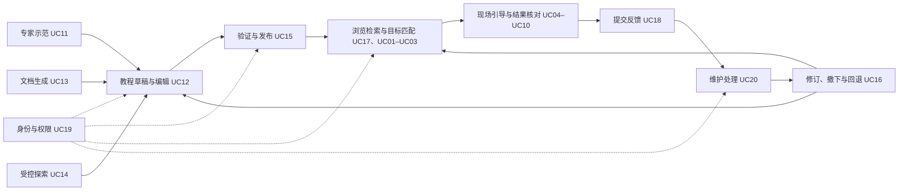

# WebGuide AI 软件需求规格说明书 v0.2

日期：2026-11-17。状态：完整系统 SRS 评审稿，已完成助手一致性自查，待发起人审阅；已确认方向与待定范围分别记录。本文定义系统应提供的业务行为和验收依据，不指定技术架构或宣称产品已实现。

交付范围更新（2026-11-17）：发起人已决定将 GitHub 小组协作入门作为首个交付及优先展示场景，替代 Pages 的首场景位置，详见[调整记录](首场景调整-GitHub协作-2026-11-17.md)与[版本交付范围](版本交付范围-2026-11-17.md)。完整系统 FR／UC 保持原义，Pages 专有规格继续仅适用于 Pages；新场景路径与验收见 [SC02 规格草案](GitHub协作首场景规格-v0.1.md)。

阅读路径：了解产品看第 2–4 节；理解版本和结果规则看第 6 节；查验收看第 9 节；查具体未决项看第 10 节。附录 A 供逐条用例查阅，来源表和追溯编号供核对使用。接口、数据库及正式状态机由后续设计定义。

## 1. 引言

### 1.1 目的与适用读者

WebGuide AI 帮助用户带着具体任务，在真实网页上理解并完成操作；通过文档、受控探索和专家示范积累教程，并持续维护教程的适用性。

本文面向项目发起人、开发者、测试者及课程评审读者，作为总体设计、实现和验收的共同需求输入，覆盖完整系统。先交付哪些能力在[版本交付范围](版本交付范围-2026-11-17.md)中另列；本文各项核心能力采用一致的需求描述标准。

### 1.2 来源与确认口径

| 来源编号 | 材料 | 用途 |
| --- | --- | --- |
| SRC01 | [原始项目提案](../../项目提案-WebGuideAI.md) | 产品方向、教程获取、现场指导和持续维护目标 |
| SRC02 | [完整需求草案 v0.1](WebGuideAI-需求草案-v0.1.md) | 问题 P01–P06、FR01–FR20、UC01–UC20、用户故事 US01–US14、原 NFR 来源 |
| SRC03 | [需求决定 D01–D11](第一阶段需求评审与交付范围-2026-11-16.md)及[整体缺口表第 6 节](整体需求清单与缺口表-2026-11-17.md) | 发起人已确认方向与已接受建议 P01–P06；不重开已接受的方向选择 |
| SRC04 | [完整业务流程与用例工作稿](完整业务流程与用例-2026-11-17.md) | 本版业务细化的形成过程；其流程、规则和详细用例已纳入本文，后续以本文为当前规格入口 |
| SRC05 | [Pages 补充规格 v0.1](WebGuideAI-SRS-v0.1.md)及[场景验收 B01–B12](Pages首版验收清单-2026-11-16.md) | Pages 的目标提交锚定和配置／部署／站点内容关联规则，作为场景专有补充 |
| SRC06 | [首轮公开反馈](../../research/notes/公开用户反馈-首轮调研.md)与[GitHub／Figma 经历线索](../../research/notes/GitHub与Figma-公开使用经历与需求线索.md) | 用户问题的公开证据；不外推为用户占比或本产品效果 |
| SRC07 | [浏览器场景走查](浏览器场景走查-2026-11-16.md)、[扩展实验](Pages扩展可行性实验-2026-11-16.md)、[人工引导体验](Pages首次引导体验-2026-11-16.md) | 已有现场证据和适用边界；不等同于完整产品或新手效果验证 |
| SRC08 | [本地开源项目调研](../../research/notes/WebGuideAI-开源项目调研.md)与[复用方案](../../research/notes/WebGuideAI-实现难度与复用方案.md) | 主动复用的设计输入；具体依赖与许可选择留给设计 |
| SRC09 | [GitHub 协作场景调整](首场景调整-GitHub协作-2026-11-17.md)与[SC02 规格草案](GitHub协作首场景规格-v0.1.md) | 发起人的实际概念提问及首场景决定；首次提交、已有进度和受阻路径，以及 SC02 专有验收草案 |

发起人已确认完整项目目标、分期交付方向、首版页面内可视指引、AI 与规则职责以及 P01–P06 建议基线。本文将这些方向展开为可检查的规格草案；新增细则尚未逐条获批，具体未决范围见第 10 节。需求确认、技术验证和产品验收是不同状态。

### 1.3 术语与编号

| 术语／编号 | 含义 |
| --- | --- |
| 教程 | 面向某类网页任务的目标、适用条件、步骤、检查、异常路径、来源及版本化内容 |
| 草稿／发布版本 | 草稿可编辑；发布版本内容固定。发布状态与验证结论分别保存，发布不代表任意环境都适用 |
| 任务／会话 | 任务表达用户要达成的目标与对象；会话关联本次任务、教程版本、进度和必要观察 |
| 系统验证／用户确认／待确认 | 系统验证需满足明确规则及有效证据；人工补充判断单独标示；关键证据缺失时保持待确认，不能混算自动验证成功 |
| 操作用户／作者／管理员 | 产品角色，可由同一人兼任；其权限独立于目标网站账号权限 |
| 现场引导／受控探索 | 前者由用户操作网站、系统指引；后者由获准探索服务在指定练习环境执行允许动作 |
| FR／UC／BF／BR | 功能需求、用例、端到端业务流程、业务规则；沿用原 FR 和 UC 编号 |
| IN／IF／NFR／AC／NT | 信息需求、外部交互要求、非功能需求、功能验收条件、非功能验证检查 |
| O／Q | 尚未明确的产品需求范围／留给设计解决的技术问题；Pages 原 Q01–Q10 保留原义 |

## 2. 系统概述与范围

### 2.1 产品目标

1. 用户知道当前应做什么、为什么做、操作哪个目标，以及结果是否已有充分依据。
2. 页面变化、操作偏离或前提不足时，系统停止不适用指示，提供基于当前状态的恢复或退出路径。
3. 作者能够从文档、示范或受控探索形成可编辑教程，验证后发布，保留来源、适用条件和验证程度。
4. 维护者能够把反馈关联到版本和步骤，修订、复核、撤下或恢复教程，保持历史和运行会话可追溯。

### 2.2 完整系统能力

系统范围包括任务理解与教程匹配、教程检索与展示、页面内指引、步骤和结果检查、解释答疑及恢复建议、会话管理，以及教程获取、编辑、验证、发布、版本维护、反馈处理和必要权限管理。三种教程获取入口均纳入完整系统需求，不因交付较晚只保留名称。

### 2.3 参与者与边界

| 参与者 | 职责与边界 |
| --- | --- |
| 操作用户 | 确认任务、选择教程、授权必要观察、自行操作目标网站、求助、暂停及反馈 |
| 作者／维护者 | 在获准范围内获取资料或示范、编辑验证并发布教程、维护版本与反馈；不能因作者身份取得用户会话和原始页面内容 |
| 平台管理员 | 执行明确获授的平台管理动作并留痕，不自动拥有目标网站账号或所有原始采集内容 |
| 目标网站与浏览器 | 外部页面、访问授权、账号权限和异步处理过程；系统只能在许可及支持范围内观察与交互 |
| 模型与探索服务 | 提供生成、解释、候选恢复或获准探索；输出必须按相应业务规则处理，不可自行扩大目标和授权 |

### 2.4 运行前提与能力边界

- 产品面向桌面浏览器中的网页操作；整体支持清单按 NFR07 明确，不由单个实验推断全面兼容。
- 用户或作者准备必要的目标网站账号、任务对象和获准环境。平台角色不授予外部网站权限，无法观察的条件明确标为未知。
- 教程来源和页面内容可能不完整、过时或包含指令性文字；系统把它们作为资料，不据此更改授权、系统规则或读取无关内容。
- 普通现场引导不代用户保存、提交、发布目标网站内容；受控探索通过独立目标、环境和动作限制进行授权。
- 暂不覆盖原生桌面应用控制、任意网站通用保证、用户生产环境中的无人值守探索；商业付费模式按发起人要求暂不考虑。
- “抗改版”落实为检测失效、停止错误指示、尝试恢复及维护版本；“零延迟”不作为承诺，响应指标按 NFR02 测量。

## 3. 完整业务流程

### BF01 获取知识并形成可编辑教程

1. 作者确认任务目标、适用网站／环境与获取入口，系统说明采集及处理范围。
2. 专家示范进入 UC11，资料生成进入 UC13，限定环境探索进入 UC14。
3. 系统保留获准的来源与过程依据，形成有序候选步骤，标出未采集、未验证或互相冲突的内容。
4. 作者检查采集内容及生成结果，进入 UC12；不足以形成草稿时保留失败说明和允许保留的部分结果，由作者决定补充或放弃。
5. 草稿具有一致的业务信息，但不同入口的来源和验证程度分别保留；录制发生过不等于教程适用于其他用户。

### BF02 编辑、验证并发布教程

1. 作者打开有权编辑的草稿，补齐目标、前提、步骤、定位依据、结果检查、异常路径和来源。
2. 系统检查必要内容及步骤关系，指出缺项与冲突；作者修正后按 BR04 在声明条件下验证，或确认仍适用验证记录的继承依据。
3. 每个必要步骤及最终结果记录检查结论和依据，区分系统证据、人工确认与未知。
4. 作者查看适用范围、验证时间和结论，确认发布；当前允许获授权作者自查发布，不强制独立审核者。
5. 发布形成可识别的固定版本，进入可检索范围；失败或未完成必要验证的草稿不以已验证教程发布。发布后的修正通过 UC16 创建新修订。

### BF03 找到教程并完成实际任务

1. 用户通过 UC17 浏览检索，或通过 UC01 描述目标后由 UC02 提供候选；两种入口汇合为任务与教程确认。
2. 用户确认目标对象、预期结果及教程版本，UC03 检查前提，建立当前任务。
3. UC04 在页面内指示操作，用户自行执行，UC05 按当前有效证据检查进度和结果。
4. 用户可通过 UC09 求助；偏离转 UC06，阻塞转 UC10，暂停和恢复转 UC07／UC08。
5. 系统显示结果、证据和观察时间；尚缺关键证据时明确缺口。可以提交 UC18 反馈，不把求助或反馈本身当作完成条件。

### BF04 从反馈到修订并再次验证

1. 用户预览附加信息后提交反馈，关联教程版本和步骤；系统接收并说明提交结果。
2. 有权维护者通过 UC20 分类问题，区分教程错误、环境限制、未知原因及重复反馈。
3. 需要修订时通过 UC16 建立关联草稿，UC12 修改，再经 UC15 验证与发布；不需要修订时记录理由。
4. 发布新版本或决定暂不处理后，记录反馈处理结论；尚未解决的问题不能因创建草稿就自动关闭。
5. 新会话选择合适发布版本；已有会话按版本和失效规则处理，不被新版本静默改写。用户通知渠道另行确定。

### BF05 教程失效、撤下与运行中会话处理

1. 维护者核对反馈或测试证据，标明受影响版本、范围和原因；单条未经核实反馈不自动证明教程失效。
2. 有权限者撤下版本，停止其成为新任务的可启动候选，保留必要历史关联。
3. 已有会话保持原版本身份并获知状态变化；已确认会误导关键操作或违反目标权限／范围的步骤应暂停相应指引。
4. 用户可退出，或明确选择其他适用版本；切换前重新检查目标、前提和进度，不迁移旧成功标签代替验证。
5. 回退到历史版本也需要确认其当前适用性并经过发布检查；历史通过不能自动证明现在仍可用。

## 4. 功能需求

以下按业务能力组织，保留已有编号。每项要求的正常／异常流程与结果在附录 A 的同号用例中定义，验收对应第 9 节；适用范围未明确处转第 10 节，不用框架或已有项目功能替代业务需求。

### 4.1 教程获取与整理

| 编号 | 系统应提供的行为 | 用例／验收 |
| --- | --- | --- |
| FR11 录制专家示范 | 接受作者明确的目标与采集范围，支持主动开始、暂停、继续、停止和取消；采集获准动作语义、目标与必要前后变化，过滤敏感内容，标明遗漏；停止后形成可预览编辑的草稿并停止采集 | UC11／AC11 |
| FR13 从文档生成教程 | 接受受支持且获准使用的资料与任务，检查可访问性和相关性；生成包含来源、适用条件、候选步骤及待核实项的草稿，说明冲突和不足；失败或取消不覆盖有效内容 | UC13／AC13 |
| FR14 受控探索流程 | 开始前确认练习环境、任务目标、允许／禁止动作、资源限制和停止条件；限制内探索、记录轨迹与依据并支持人工终止；分别报告结束原因和任务结果，经作者审查后形成可编辑候选草稿 | UC14／AC14 |
| FR12 编辑教程 | 允许有权作者编辑目标、前提、步骤及顺序、定位依据、结果检查、异常路径和来源；检查缺项、引用及不可达路径，允许保存未完成草稿；按 BR04 的变更影响规则决定相关验证失效、重验或可追溯继承 | UC12／AC12 |

### 4.2 验证、发布与维护

| 编号 | 系统应提供的行为 | 用例／验收 |
| --- | --- | --- |
| FR15 验证与发布 | 区分内容结构检查、声明环境内的实际验证和发布；记录当前稿、验证范围、时间、依据及确认方式，检查必要路径与最终结果，可按 BR04 继承仍适用的验证记录；有权作者可自查发布，不强制独立审核者；必要验证失败或未完成时保持草稿 | UC15／AC15 |
| FR16 修订及回退版本 | 创建独立修订，不覆盖发布内容；支持有依据的撤下和历史版本回退，保留历史与变更原因；回退需重新核对当前适用性并经发布检查；按 BR05 处理运行会话，不能静默切换版本 | UC16／AC16 |
| FR18 提交反馈 | 接收预期与实际情况，关联可取得的任务、步骤和教程版本；附加信息提交前可预览删减，允许无附件反馈；明确接收结果与可见范围，关联信息缺失时注明未知 | UC18／AC18 |
| FR20 处理维护与运行情况 | 向有权维护者提供必要的脱敏问题摘要，支持分类、关联重复问题、补充调查、关联修订及处置结论；区分解决、暂缓和无法复现，不能因创建草稿就自动关闭反馈；统计遵循验证等级和来源区分 | UC20／AC20 |

### 4.3 教程发现与任务确认

| 编号 | 系统应提供的行为 | 用例／验收 |
| --- | --- | --- |
| FR17 浏览和检索教程 | 按网站或任务浏览检索可访问教程，展示目标、来源、适用条件、版本与验证信息；公开检索为基本路径，草稿和撤下版本不能作为可启动教程；无结果有明确说明，是否匿名访问见 O01 | UC17／AC17 |
| FR01 提出操作目标 | 接受自然语言目标或教程入口，形成网站、任务对象、预期结果及必要条件；歧义会改变操作／结果时帮助澄清并确认，用户可取消或重设目标 | UC01／AC01 |
| FR02 匹配适用教程 | 在用户可访问且允许启动的发布版本中匹配任务，说明候选适用条件和未知项；用户选择版本，多候选不静默择一，无匹配不伪造教程 | UC02／AC02 |
| FR03 检查前提 | 开始、恢复及上下文变化时核对网站、对象、页面和所需条件，分别表达满足、不满足与未知；用户补充信息注明来源，不以控件缺失断言权限 | UC03／AC03 |

### 4.4 现场引导、检查与求助

| 编号 | 系统应提供的行为 | 用例／验收 |
| --- | --- | --- |
| FR04 页面内操作指引 | 显示本步操作、原因与预期结果，在真实页面指示唯一可确认的目标，操作控件保持可用；处理滚动、导航、目标重建和消失，先撤销失效指示再核对，不能仅靠文字指路满足此要求 | UC04／AC04 |
| FR05 检查进度与结果 | 依据步骤及最终条件检查对象、时效和证据关联，区分未完成、等待、失败、证据不足及通过；显示依据和观察时间；必要结果只由用户确认时，不报告为系统已验证 | UC05／AC05 |
| FR06 偏离和失效恢复 | 停止不适用推进，重新观察并提供有依据的恢复路径；说明不确定性与变更影响，用户自行执行；无路径转阻塞处理，临时修正不自动修改共享教程 | UC06／AC06 |
| FR09 当前步骤答疑 | 根据任务、教程来源和必要页面证据解释控件、前提、操作和结果，区分事实、推测与未知；回答不覆盖规则状态；模型不可用时保留固定步骤和可用检查能力 | UC09／AC09 |
| FR10 无法继续的处理 | 对无教程、前提不足、读取受限、外部失败等分别说明事实与未知，提供具体补充、核对、等待、反馈或退出路径；不循环要求无效操作，转创作流程需明确切换并检查权限 | UC10／AC10 |

### 4.5 会话与权限

| 编号 | 系统应提供的行为 | 用例／验收 |
| --- | --- | --- |
| FR07 暂停、继续和退出 | 明确暂停、关闭引导和退出含义；暂停撤下活动指示并停止约定任务采集／推进，继续前重新核对，退出终止活动会话；不能即时取消的请求也不得应用失效结果；关闭引导按暂停处理是本文拟定细则 | UC07／AC07 |
| FR08 进度与恢复 | 显示目标、教程版本、步骤和历史结果以及实际可恢复范围；恢复核对对象、权限、版本和有效性，不相容部分重新检查；保存失败和无法恢复明确说明，整体跨设备范围见 O02 | UC08／AC08 |
| FR19 身份与权限 | 对教程、资料、会话、反馈及管理对象按身份与实际授权检查读写；编辑、发布、撤下等检查目标权限，授权撤销后重查；拒绝越权不改变对象，平台权限不外推目标网站权限 | UC19／AC19 |

## 5. 信息需求与数据边界

这些是业务信息要求，不规定数据表、字段类型或存储位置。任何必需信息不可得时，应保留“未知”及影响，不生成虚构值补齐。

| 编号 | 信息类别 | 必须表达的内容与边界 |
| --- | --- | --- |
| IN01 | 教程及版本 | 目标、网站、适用条件、来源、步骤关系、最终检查、发布状态、验证范围与结论、版本关系及变更原因；发布内容与草稿分开 |
| IN02 | 步骤 | 操作目的、说明、长期定位依据、前提、预期结果／检查、异常去向、必要或可跳过的说明；录制坐标不能单独等同稳定目标身份 |
| IN03 | 获取／生成记录 | 输入来源与读取时刻、任务、允许范围、示范或探索过程的获准依据、遗漏／失败／冲突、产物及待核实项；不默认公开原始资料 |
| IN04 | 验证及发布记录 | 被验证草稿身份、环境、路径／步骤、结果、证据、实际验证时间和系统／人工确认方式，发布者与发布结果；继承时记录原版本、变更差异与作者确认理由，保留原实测时间 |
| IN05 | 任务与会话 | 目标对象、预期结果、所选版本、步骤位置、暂停／结束原因和必要进度；有关页面角色、目标、文档／导航身份可核对，任务 ID 或域名不能独立证明关联 |
| IN06 | 页面观察与回答 | 任务／页面／对象、来源、采集时间、必要结果、未知／读取失败／失效状态；回答关联当时上下文与来源，不将回答文本当作规则证据 |
| IN07 | 反馈与维护 | 预期与实际、版本／步骤、经用户检查的附件、可见范围、处理分类、理由、修订关联及状态；未知版本明确注明 |
| IN08 | 权限与关键操作 | 身份与目标对象权限、授权变更及必要编辑／发布／撤下／管理记录；记录不得包含凭据和无关页面内容 |

教程和发布历史需支持版本维护所需的保存与关联；这不代表原始页面、录制及会话记录都长期保留。各类数据的期限、清除语义和跨会话恢复范围在 O02 落定。系统应向用户说明采集、发送、实际保存及清空范围，清空本地会话不能冒充删除了服务侧记录。删除与必要历史追溯的关系需一并明确。

## 6. 业务规则与权限

### 6.1 跨流程业务规则

以下 BR 是跨用例约束，供整体 SRS 引用；具体网站的证据字段保留在场景补充规格。

| 编号 | 规则 |
| --- | --- |
| BR01 目标与对象 | 任务目标、对象、教程版本与预期结果可核对；改变目标须明确说明影响并重新检查，旧对象证据不能自动迁入 |
| BR02 验证等级 | 动作发生、页面变化、步骤通过、最终结果分别判断。系统验证、用户确认、失败和未知分别记录；AI 文字或用户点击不能独立充当规则验证证据 |
| BR03 来源与草稿 | 录制、资料生成和探索都先输出草稿；记录来源、适用条件、缺口与验证程度。输入资料和网页内容是待分析信息，不是扩大系统权限的指令 |
| BR04 发布门槛 | 发布须有授权、完整必要内容、与当前稿关联的声明环境及必要步骤／最终结果验证记录；按下述变更影响规则重验或继承仍适用记录，必要验证失败或未完成时保持草稿。人工确认的部分明确标示，不得冒充系统自动验证 |
| BR05 版本不可静默替换 | 已发布内容不被草稿覆盖；会话绑定具体版本。修订、撤下、回退均记录原因及关联；版本变化或撤下后遵循 BF05 |
| BR06 当前证据 | 观察必须匹配当前任务、对象、页面及相容的文档／导航状态，并可核对来源和时间；读取失败、对象变化和过期后重新核验，不沿用旧成功作为当前结果 |
| BR07 有效指示 | 仅对唯一可确认且可见的目标显示指示，需要操作的目标还应可操作；检测到目标或上下文失效后先撤销错误指示，再异步核对。有效滚动可重新定位，普通答疑不必清除仍有效的高亮 |
| BR08 暂停与迟到结果 | 暂停／退出停止相应任务采集和推进；继续前重查。请求无法立即物理取消时也不得应用已失效结果，退出后的迟到结果不推进任务 |
| BR09 恢复建议 | 恢复建议说明依据、不确定性与将改变的任务上下文；目标网站操作由用户执行。临时修正只影响当前会话，长期教程修改另经编辑验证发布 |
| BR10 数据与权限 | 采集限于明确范围，敏感字段在采集／发送边界处理；反馈附加信息可预览删减。公开教程不等于公开原始资料、录制、会话和反馈；每次对象操作检查权限 |
| BR11 探索边界 | 开始前明确环境、目标、允许动作、限制和停止条件；范围外动作在执行前拒绝，未授权环境不得开始。探索结束与任务成功分别记录 |
| BR12 重试与冲突 | 重试不产生重复发布或静默覆盖他人编辑；冲突与保存结果未知明确显示，保留已有有效内容和必要追溯信息 |
| BR13 反馈与维护 | 反馈关联版本及步骤、说明预期与实际；处理分类及关闭有结论。统计区分未知、用户确认、系统验证及教程／外部环境原因 |

教程生命周期需表达草稿、验证结果、发布与撤下，验证结论和发布状态分别保留。BR04 的变更验证规则如下：

| 变更类型 | 验证要求 |
| --- | --- |
| 纯展示性修订 | 仅修正错别字、排版或不改变含义的说明；步骤结构、操作含义、前提、适用范围、定位、校验及安全提醒均未改变，且原验证仍适用时，作者可核对差异并确认发布，无需重新运行全流程 |
| 影响行为或适用性的修订 | 改变步骤、定位、条件、规则、异常路径，或文案改变了应做什么／何时做／怎样判断时，重新验证受影响步骤、相关后续路径和最终条件；影响全局或无法界定时重验完整必要路径 |
| 无法确认影响范围 | 按可能影响行为处理，先定位影响或重验；不能仅凭修改的是文字字段归类为纯展示性修订 |

继承验证需记录原版本、原验证范围与时间、变更差异及作者确认理由；原验证已经失效或不适用时不能继承。继承不刷新实际验证时间，不把作者审阅记录成一次新的系统实测。具体状态字段留给设计。

会话需表达未开始、引导中、等待、受阻、暂停、待确认和结束；结束原因、历史检查结果与当前可验证结果分开。返回已通过步骤可以重新核验，不因“返回”抹除历史，也不把旧通过直接当作现在通过。

### 6.2 权限边界

以下只定义必要业务授权，不决定账号实现；私有分享、团队协作和匿名访问未确认，不自动纳入已承诺能力。

| 对象／行为 | 操作用户 | 作者／维护者 | 管理员 |
| --- | --- | --- | --- |
| 公开教程检索与查看 | 可按公开范围访问；匿名规则待定 | 同左 | 同左 |
| 草稿、来源与原始采集记录 | 仅能访问自己获准的内容，不随公开教程自动公开 | 自己或明确获准的内容 | 仅限明确授予的管理需要，不默认原始内容全可见 |
| 编辑、验证、发布、撤下 | 无作者权限不能执行 | 检查目标教程权限后执行 | 只有相应授权才可执行；管理操作留痕 |
| 任务会话与进度 | 自己获准的会话 | 不因作者身份自动取得用户会话 | 按明确管理权限访问必要摘要 |
| 反馈处理 | 可提交并获知允许查看的结果；他人附件受保护 | 仅处理获授权教程及必要反馈 | 按授权处理；不默认公开私密附件 |
| 目标网站的保存、提交等 | 用户依据目标网站权限自行操作 | 示范／探索也需独立获准的环境与操作范围 | 平台权限不授予网站权限 |

## 7. 外部交互要求

本文规定行为契约，不指定侧边栏形式、传输协议或 API。每项支持范围及失败处理都需有可重复验证样例。

| 编号 | 对外要求 | 验收检查 |
| --- | --- | --- |
| IF01 用户界面 | 提供教程浏览、任务确认、页面内指示、解释、进度／结果、暂停／退出、反馈和作者／维护入口；长任务有等待、取消和实际保存结果；验证等级、来源及未知清晰可辨 | 按三类角色完成主要任务；键盘可达关键控件，指示不阻碍真实页面操作；无权入口不能执行受保护动作 |
| IF02 浏览器与目标网站 | 区分观察授权与页面操作权限，拒绝／撤销时停止超出许可范围的处理；覆盖支持范围内的整页导航、无刷新 URL／DOM 变化、当前或新标签跨源页面；观察须核对任务对象、页面角色及文档／导航身份 | 同域错误仓库、错误标签、旧文档、读取失败、拒绝和撤销授权样例均不能误关联；导航后失效指示撤销并重新核对 |
| IF03 模型服务 | 仅发送获准最小上下文，区分生成、解释和恢复建议；输出关联来源及不确定性，经业务检查后使用；失败、超时、取消和上下文过期有明确处置 | 无效／冲突输出不覆盖状态；页面提示注入不改变权限；请求和日志无禁止敏感字段；模型断开时固定引导与规则可用 |
| IF04 资料与录制输入 | 明确支持形式、可访问条件、采集范围及部分结果含义；保留来源，资料冲突和遗漏可见；拒绝访问或录制停止后不继续采集 | 不可读／范围外／资料不足／录制遗漏可识别，草稿不伪称已验证；具体输入矩阵见 O03 |
| IF05 探索执行环境 | 独立于普通引导确认环境、目标、动作边界和限制；记录执行及停止状态，外部已发生改变如实报告；不以停止冒充撤销或回滚 | 越界前拒绝、预算超限与人工终止停止新动作；环境不可确认不启动；失败和取消仍明确部分结果及待清理状态 |

## 8. 非功能需求

沿用 NFR01–NFR06，新增 NFR07–NFR09 以独立表达兼容性、可维护性和可测试性。以下是待评审的需求与验证口径，NT 为计划检查，不是测试已通过记录。候选性能值由 O06 校准，不能用 AI 超时阈值判断网站部署失败。

| 编号 | 质量要求 | 验证检查 |
| --- | --- | --- |
| NFR01 正确性与可靠性 | 验证预先固定的正反例；未保存、运行中、错误对象／版本、过期、读取失败和目标未知均不得误报系统验证成功；录制遗漏、来源不足、探索失败如实表达；发布及回退结果一致 | NT01：逐项记录预期、实际、证据和误判，覆盖 AC01–AC20；报告样本数及未覆盖范围，不用少量成功推断通用成功率 |
| NFR02 响应、取消与资源限制 | 页面／目标已就绪的本地步骤更新候选 p95 ≤ 500 ms；远端交互候选 1 秒内显示等待，普通答疑候选 30 秒后超时／重试／退出。检测到失效先撤销错误指示，不把 500 ms 作为错误停留宽限；长生成／探索分别设预算、进度、超时及取消规则 | NT02：固定环境、计时起止点，每类交互至少 30 次；分别测失效检测、撤销、新目标就绪后显示、远端等待；外部加载／部署和长任务另计，阈值由 O06 落定 |
| NFR03 安全与隐私 | 明确各入口采集／发送范围；密码、令牌、Cookie 及无关敏感内容不进入默认上下文或日志；过滤在程序边界执行，不能依赖模型自律；资料和网页指令不扩大权限；清空范围及剩余保存信息可知 | NT03：用含测试敏感字段的录制、文档、页面与反馈样例检查载荷、实际存储和日志；验证删减、停止采集、提示注入及清空行为；期限按 O02 |
| NFR04 授权隔离 | 在可信边界检查对象读写和关键操作授权；作者／管理员身份不自动取得用户会话、私密资料或目标网站权限；不同任务和页面对象的证据隔离 | NT04：跨账号／对象读取、编辑、发布、撤下和反馈附件访问被拒且对象不变；撤销授权后旧界面／请求不能绕过；本地任务隔离另测 |
| NFR05 恢复、完整性与追溯 | 任务、版本、步骤、来源、必要观察与变更可关联；失败和重试不重复发布或覆盖历史；并发修改不静默丢失；恢复先重查，退出后迟到结果无效 | NT05：刷新、导航、后台进程重启、并行任务、超时重试、并发编辑、发布响应未知、撤下／回退及迟到消息；跨浏览器／设备恢复不自动承诺 |
| NFR06 易用性与可访问性 | 步骤目标、原因及预期可理解，高亮配文字且不阻挡操作，不仅靠颜色表达状态；关键入口可键盘访问；三类验证标签明确；作者可定位草稿缺项、维护者可理解问题处置状态 | NT06：分别观察操作用户、作者与维护者完成任务，记录结果、定位、误操作、求助和理解；形成性试用目标为 1–2 位未配过 Pages 的用户，不能据此宣称普遍效果提升 |
| NFR07 兼容性 | 每项能力有浏览器、页面语言、网站／页面类型及必要条件的支持矩阵；范围外明确拒绝或降级；不从一个场景外推画布、iframe、Shadow DOM 等均支持 | NT07：对声明支持项做正常／异常样例，包含整页、无刷新变化、跨标签和跨源；首轮 Edge／英文 GitHub 基线另见交付范围，其余组合需独立声明与验证 |
| NFR08 可维护性与扩展性 | 教程内容、任务参数、页面适配与通用规则职责可区分；修订不需改写已发布历史；复用组件的来源、固定版本、许可与改动可追溯；不要求首版实现任意规则 DSL | NT08：用两份控件不同的受控样例及参数变化检查通用机制，核对页面变化影响范围与版本记录；检查依赖来源和许可记录；这不是新增正式网站交付承诺 |
| NFR09 可测试性与诊断 | 关键规则可用受控样例重复检查，外部模型／网站失败可模拟；保留足够的脱敏诊断关联信息，测试结果说明是真实集成还是模拟；使用独立练习数据而非个人浏览器凭据副本 | NT09：同一固定样例产生可解释的一致结果；模拟超时、冲突、旧响应及权限撤销；正式工程能按说明重复运行检查，真实模型／网站效果另记 |

## 9. 验收与双向追溯

### 9.1 通用验收条件

AC01–AC20 对应同号 FR／UC，各条件至少有一个正常和一个关键异常样例。实际实现按适用范围验收；部分实现不能计作整个 FR 已交付。失败／取消／未知与成功分别记录。

| 编号 | 通过条件与关键反例 |
| --- | --- |
| AC01 | 目标可确认后再建立任务；同名对象或关键歧义未消除不能任意开始；更换目标重查对象与证据 |
| AC02 | 候选版本真实、可访问且适用条件可见；多候选由用户选择，无匹配不伪造，已撤下版不能新启动 |
| AC03 | 前提满足、不满足与未知分开；读取不到权限证据不得默认有权，也不得仅凭入口缺失断言无权 |
| AC04 | 明确目标时真实页面有对应高亮和说明，控件可操作；目标消失／多候选／导航时撤销错误指示，滚动重定位；普通答疑保留有效指示 |
| AC05 | 满足定义的有效证据及最终条件才系统验证通过；仅点击、其他对象成功、旧版本／过期证据和关键人工确认均不能冒充系统验证 |
| AC06 | 有依据地恢复并重查；无路径说明受阻；模型建议不直接变成功，不越权、不静默修改共享教程或切换目标 |
| AC07 | 暂停／退出后停止约定采集和推进；继续重查；退出后的回答／检查不回写活动进度，关闭引导的实际含义可知 |
| AC08 | 展示实际保存及恢复范围，恢复核对版本、对象和时效；记录丢失或过期给出重新开始／补查，不把历史通过显示为当前已核验 |
| AC09 | 回答关联当前步骤、必要证据和来源，未知明确；模型失败有降级，冲突输出不覆盖规则，敏感及过期上下文不被错误应用 |
| AC10 | 按事实给出具体受阻说明与去向；无可靠路径允许退出，不重复要求无效操作，不自动转入探索执行 |
| AC11 | 作者主动开始并限定范围，停止后无新采集；正常结束形成可编辑草稿，遗漏标明；敏感值不进产物，取消不误发布 |
| AC12 | 可增删调整步骤并保存草稿，缺项／引用错误可定位；保存失败或冲突不冒充保存成功；编辑不覆盖发布版。纯展示性修订可记录差异审阅并继承仍适用验证；改变操作含义／定位／校验须重验受影响路径；继承保留原实测时间 |
| AC13 | 可读且相关资料生成有来源、条件及待核实项的草稿；不可读／矛盾／不足明确，失败不覆盖有效稿；资料描述不标成网页实测通过 |
| AC14 | 环境与范围不明确不得开始；越界前拒绝、超限／人工终止停止新动作；报告轨迹、外部改变和结果，探索结束不等于目标成功 |
| AC15 | 当前稿完成必要检查与声明范围验证，或按 BR04 有依据地继承仍适用验证后，有权者可确认发布；缺项、必要验证失败／未知或未经关联与继承审查的旧稿证据不允许发布；人工确认明确，重试不重复产生版本 |
| AC16 | 修订不覆盖发布历史；撤下不能新启动；回退核对当前适用性并检查；已有会话收到相关状态提示，严重失效暂停相应指引，不静默换版本 |
| AC17 | 网站／任务检索展示目标、来源、条件、版本及验证信息；无结果明确；无权内容不泄漏，旧检索结果不能绕过撤下检查 |
| AC18 | 用户可预览删减附加信息，允许无附件反馈；提交状态真实，缺少关联注明未知；删减内容不在载荷中，重试不意外重复提交 |
| AC19 | 每次受保护操作核对对象权限，跨用户／对象越权被拒且数据不变；授权撤销后旧请求不可绕过，平台身份不获得外部网站权限 |
| AC20 | 反馈分类、调查和处理结论关联版本／修订；创建草稿不自动算已解决；权限与脱敏有效，统计区分系统验证、用户确认和未知 |

### 9.2 功能来源与验证追溯

FR、UC、AC 同号对应，保留原草案 US 编号；来源中“细化”表示本版助手展开，不表示原材料已提供所有细则。业务规则与 NFR 的额外覆盖在下一小节汇总。

| FR | 方向／细化来源 | 用例／原用户故事 | 主要业务规则 | 相关 NFR | 验收 |
| --- | --- | --- | --- | --- | --- |
| FR01 | SRC01、SRC02、SRC03；SRC04 细化 | UC01；US01 | BR01 | NFR01、NFR06 | AC01 |
| FR02 | SRC01、SRC02、SRC03；SRC04 细化 | UC02；US01 | BR01、BR05 | NFR01、NFR06、NFR07 | AC02 |
| FR03 | SRC02、SRC06、SRC07；SRC04 细化 | UC03；US02 | BR01、BR06、BR10 | NFR01、NFR03、NFR07 | AC03 |
| FR04 | SRC01、SRC03、SRC07；SRC04 细化 | UC04；US03 | BR07、BR09 | NFR02、NFR06、NFR07 | AC04 |
| FR05 | SRC02、SRC03、SRC05；SRC04 细化 | UC05；US04 | BR01、BR02、BR06 | NFR01、NFR05 | AC05 |
| FR06 | SRC01、SRC02、SRC03；SRC04 细化 | UC06；US05 | BR06、BR07、BR09 | NFR01、NFR05、NFR06 | AC06 |
| FR07 | SRC02、SRC03；SRC04 细化 | UC07；US06 | BR08 | NFR02、NFR03、NFR05 | AC07 |
| FR08 | SRC02、SRC03；SRC04 细化 | UC08；US06 | BR05、BR06、BR08 | NFR05、NFR06 | AC08 |
| FR09 | SRC01、SRC02、SRC03；SRC04 细化 | UC09；US03、US05 | BR02、BR03、BR08、BR10 | NFR01、NFR02、NFR03、NFR06 | AC09 |
| FR10 | SRC02、SRC06；SRC04 细化 | UC10；US05 | BR02、BR09 | NFR01、NFR06 | AC10 |
| FR11 | SRC01、SRC02、SRC03；SRC04 细化 | UC11；US07 | BR03、BR10 | NFR01、NFR03、NFR05 | AC11 |
| FR12 | SRC01、SRC02、SRC03；SRC04 细化 | UC12；US08 | BR03、BR04、BR05、BR12 | NFR01、NFR05、NFR06 | AC12 |
| FR13 | SRC01、SRC02、SRC03；SRC04 细化 | UC13；US09 | BR03、BR08、BR10 | NFR01、NFR02、NFR03 | AC13 |
| FR14 | SRC01、SRC02、SRC03；SRC04 细化 | UC14；US10 | BR02、BR03、BR08、BR10、BR11 | NFR01、NFR02、NFR03、NFR09 | AC14 |
| FR15 | SRC01、SRC02、SRC03；SRC04 细化 | UC15；US11 | BR02、BR03、BR04、BR05、BR10、BR12 | NFR01、NFR04、NFR05 | AC15 |
| FR16 | SRC01、SRC02、SRC03；SRC04 细化 | UC16；US12 | BR04、BR05、BR12、BR13 | NFR01、NFR05、NFR08 | AC16 |
| FR17 | SRC01、SRC02、SRC03；SRC04 细化 | UC17；US01 | BR05、BR10 | NFR04、NFR06、NFR07 | AC17 |
| FR18 | SRC01、SRC02、SRC03；SRC04 细化 | UC18；US13 | BR10、BR12、BR13 | NFR03、NFR04、NFR05 | AC18 |
| FR19 | SRC02、SRC03；SRC04 细化 | UC19；US14 | BR10 | NFR04、NFR05 | AC19 |
| FR20 | SRC01、SRC02、SRC03；SRC04 细化 | UC20；US13、US14 | BR10、BR13 | NFR03、NFR04、NFR05、NFR08 | AC20 |

### 9.3 跨功能追溯与验收材料

| 对象 | 需求与用例覆盖 | 验证依据 |
| --- | --- | --- |
| IN01–IN04 教程、来源与发布记录 | FR11–FR16、FR17、FR19；UC11–UC17、UC19 | AC11–AC17、AC19；NT01、NT03–NT05 |
| IN05–IN06 任务、观察与回答 | FR01–FR10；UC01–UC10 | AC01–AC10；NT01–NT07 |
| IN07–IN08 反馈、权限与关键记录 | FR16、FR18–FR20；同号 UC | AC16、AC18–AC20；NT03–NT05 |
| IF01 界面 | FR01–FR20 对应角色入口，IF01 自身要求 | IF01 检查；NT06 |
| IF02 网站与浏览器 | FR03–FR08、FR11、FR14、FR19 | IF02 检查；NT01、NT03–NT05、NT07 |
| IF03 模型 | FR06、FR09、FR13、FR14 | IF03 检查；NT01–NT03、NT09 |
| IF04 输入 | FR11–FR13 | IF04 检查；NT01、NT03、NT07 |
| IF05 探索环境 | FR14 | IF05 检查；NT01–NT03、NT09 |
| NFR01–NFR09 | 第 8 节质量要求；第 9.2 节相关功能映射，NFR09 为所有关键规则提供验证机制 | 同号 NT01–NT09；以预先固定样例、环境、实际结果与证据检查 |

原缺口表 G01–G10 的补齐位置如下。已写入规格不等于未决的支持范围已解决。

| 缺口 | 本文落点 | 验收／剩余待定项 |
| --- | --- | --- |
| G01 获取产物统一含义 | BF01、FR11–FR15、IN01–IN04、BR03 | AC11–AC15；输入范围 O03 |
| G02 教程生命周期 | BF02、BF04、BF05、FR12、FR15、FR16、BR04–BR05 | AC12、AC15、AC16；复验 O05 |
| G03 匹配适用性 | BF03、FR01–FR03、FR10、FR17 | AC01–AC03、AC10、AC17；访问范围 O01 |
| G04 引导与证据 | FR03–FR08、IN05–IN06、BR01–BR02、BR06–BR07 | AC03–AC08；Pages 专有证据见 SRC05，GitHub 协作见 SRC09 |
| G05 版本与运行会话 | BF05、FR07、FR08、FR16、BR05、BR08 | AC07、AC08、AC16；严重失效 O04 |
| G06 AI 职责 | FR05、FR06、FR09、FR13、FR14、BR02–BR03、BR09、BR11 | AC05、AC06、AC09、AC13、AC14；探索范围 O03 |
| G07 反馈维护闭环 | BF04、FR16、FR18、FR20、IN07、BR13 | AC16、AC18、AC20；反馈可见范围 O01 |
| G08 身份可见性 | FR19、第 6.2 节、BR10、NFR04 | AC19、NT04；访问范围 O01 |
| G09 数据恢复 | 第 5 节、FR07、FR08、NFR03、NFR05 | AC07、AC08、NT03、NT05；保留／清除 O02 |
| G10 外部依赖 | IF01–IF05、NFR02、NFR07、NFR09 | 各 IF 检查、NT02、NT07、NT09；矩阵 O03、阈值 O06 |

Pages 额外按 B01–B12 验收，与本文 FR／UC／AC 的关系在版本交付范围中说明；其固定练习仓库、15 分钟观察期和手动 popup 操作是既有实验设置，不是整体系统约束。GitHub 协作已调整为首场景，专有条件及追溯见 SRC09；Figma 仍为后续候选。存在规格不等于已经支持相应场景。

## 10. 未决范围与设计输入

### 10.1 产品需求待定项

O01–O05 沿用业务流程稿，新增 O06 汇总待校准指标。不重复询问是否接受 P01–P06；以下是其未明确的具体边界，由助手拟案、发起人审阅影响范围的决定。

| 编号 | 具体未决项 | 影响需求 | 处理时点与暂行边界 |
| --- | --- | --- | --- |
| O01 | 匿名浏览、私有／协作教程、反馈结果可见范围 | FR17–FR20、NFR04 | 权限及信息访问设计前明确；公开检索为基本路径，不默认完整组织管理；在范围确定前非公开对象不得无授权展示 |
| O02 | 教程、原始来源、页面／会话、反馈与日志各自保留期限、清除语义、跨设备恢复范围 | FR07、FR08、FR11–FR20、NFR03、NFR05 | 相关存储和恢复契约确定前明确；首版仍仅同一浏览器会话恢复，不能默认为跨设备或全部长期保存 |
| O03 | 资料输入类型、示范页面范围、探索环境／动作、预算及清理规则的具体支持矩阵 | FR11、FR13、FR14、IF04、IF05、NFR07 | 每种入口实现与授权设计前列明；不在明确允许范围内不得开始采集或探索，不承诺任意网站学习 |
| O04 | 严重失效的分类、证据和判定权限，以及状态发现与提示时效 | FR06、FR08、FR16、FR19、FR20 | 撤下／运行会话联动实现前明确；已确认误导关键操作或违反权限／范围的步骤暂停相应指引，不能依赖无限期旧状态 |
| O05 | 教程验证样例覆盖、环境适用期与复验触发条件 | FR12、FR15、FR16、NFR01 | 发布验收设计前明确覆盖及适用期；变更分级、重验与继承按 BR04 执行，纯展示性修订无需重跑全流程；具体影响判定和记录方式在设计中细化 |
| O06 | 本地检测／撤销／显示、远端等待／超时及长任务资源指标的阈值和测量环境 | NFR02、NFR07、NFR09 | 风险实验校准后、性能验收前落定；保留已有候选值，长探索／生成不强套普通答疑 30 秒规则 |

O01–O06 未定不阻止比较总体架构，但不能在受影响模块实现、发布或最终验收时继续以未定标准声称完成。

### 10.2 留给总体设计的选择

- 总体架构分工已由发起人选择“扩展本地运行＋模块化后端”，具体职责与状态初稿见[核心设计](../design/WebGuideAI-核心设计-v0.1.md)；已接受 TypeScript／React／WXT 与 Node.js／Fastify 的选型方向。模型和实际依赖接入仍待落定，SC02 需补齐新的适配契约。
- 定义最小步骤骨架、定位与规则能力，允许专有任务校验器表达联合证据；不预先要求大而全 DSL。
- 选择浏览器授权、注入、导航／DOM 监测、跨标签与文档身份机制；遵循本文 IF02，实际 Edge 支持需验证。
- 定义会话及数据存储、可信授权边界、请求取消／过期、反馈提交流程与模型契约；补齐 O01–O06 的影响。
- Pages 原 Q01–Q10 的必要约束和仍待选择的机制在下表汇总，详细场景定义保留于补充规格；这些问题尚未全部得出技术结论。
- 主动比较直接引库、改造已有模块、借鉴机制及自行实现。SRC08 的 9 个本地候选继续使用；选择需记录固定版本、许可、适配及维护代价，不能仅因与现有项目功能重合而舍弃需求。

当前交付摘要：首个版本在桌面 Edge、英文 GitHub 页面提供中文 GitHub 协作入门引导；提交段草案面向已有仓库写权限的成员，完成认领 Issue、独立分支上的文档修改与可供评审的 PR，终点为提交段通过、等待成员评审。页面高亮、规则核对、AI 答疑、同一浏览器会话内暂停恢复与最简反馈继续保留，随后建设教程创建维护。新场景验收为 SRC09 草案，Pages 继续作为专有样例和后续候选；版本计划独立维护，不改变整体能力范围。

| 原问题 | 本文已明确的约束 | 待设计／验证的机制 |
| --- | --- | --- |
| Q01、Q03 | 通用步骤骨架与任务专有校验可分工，避免大而全 DSL；主动复用已有项目 | 模块职责、技术栈、组件、最小教程表达与存储边界 |
| Q02 | 系统辅助确认目标提交，保留来源／确认时间并冻结，重设目标要明确；结果须关联配置、目标部署与预期内容 | 目标分支快照的取得、指定部署与最新修改的区分、读取失败路径和联合校验 |
| Q04、Q05 | 覆盖整页、无刷新变化、当前／新标签及跨源；任务、页面角色、对象和文档身份须相符，旧消息失效 | 按任务授权与注入、导航／DOM 监测、跨标签关联及观察有效期 |
| Q06、Q09 | 最小上下文、可核对来源、对象鉴权、取消和迟到处理，数据保存／清除范围明确 | 模型提供方与凭据、请求路径、会话／附件存储及保留方式；产品范围见 O01–O02 |
| Q07、Q08、Q10 | 有效高亮、键盘操作、模型降级及独立测试环境；失效撤销和新目标显示分开计时 | 教程／会话状态图、交互原型、模拟与真实实测分工，以及风险实验校准阈值 |

## 11. 本版自查与修订记录

| 检查项 | 本版处理 |
| --- | --- |
| 系统全景 | 包含三种教程获取、编辑验证发布、现场引导、反馈维护及权限；交付顺序独立记录 |
| 业务完整性 | 5 条端到端流程、20 条同号用例、13 项业务规则；来源到草稿、发布到使用、反馈到修订及撤下到会话的连接可走读 |
| 可验证性 | 20 项功能验收、9 项非功能检查、信息／外部交互映射；候选阈值与产品未决项显式列明 |
| 证据边界 | 已有实验与人工反馈仅支持其记录范围；本文为规格，不把未实现能力或文档自查当成产品测试通过 |
| 评审状态 | 助手已完成编号、覆盖、引用与规则一致性自查；发起人尚未审阅本版全部细则，整体需求未冻结 |

| 版本 | 日期 | 修订 |
| --- | --- | --- |
| v0.1 Pages 规格 | 2026-11-16 | Pages 首版场景需求、三条详细流程、B01–B12 追溯；继续作为场景补充保存 |
| v0.2 整体评审稿 | 2026-11-17 | 按完整产品组织需求，纳入整体流程、用例与规则，新增信息／交互要求和 NFR07–NFR09，建立整体验收追溯并单列交付范围 |
| v0.2 评审澄清 | 2026-11-17 | 增加阅读路径；明确展示性修订与行为变更的差异验证；在本稿汇总已确认交付摘要和 Pages 设计问题，未宣布冻结需求或拍板未决项 |
| v0.2 场景更新 | 2026-11-17 | GitHub 协作替代 Pages 为首场景；新增 SRC09 关联 SC02 路径与 14 项验收草案，更新交付摘要，整体 FR／UC 编号保持原义 |

## 附录 A：完整用例规格

以下用例是本版规格的组成部分，沿用原 UC 编号。验收检查与第 9 节同号 AC 共同使用，异常不得被正常路径掩盖。

### UC01 提出操作目标

**参与者／关联**：操作用户；FR01，BR01。

**前提与触发**：用户进入任务入口并描述想完成的操作，或从教程详情开始任务。

**正常流程**：

1. 系统提取目标网站、任务对象、预期结果及影响操作的条件。
2. 缺失或歧义会改变流程时，用可理解的问题帮助确认，不要求用户先理解内部标识。
3. 用户确认任务说明，转 UC02；若已有教程，转 UC03 核对。

**异常**：输入不足则指出具体缺项；不支持的目标转 UC10；取消不建立活动任务；更改目标重新确认并使不适用证据失效。

**结果**：形成可确认的任务目标，或说明未能形成任务的原因。

**验收检查**：同名对象存在时须消歧；取消或未解决歧义时不得按任意对象开始引导。

### UC02 匹配适用教程

**参与者／关联**：操作用户；FR02，BR01、BR05。

**前提与触发**：已形成任务目标，用户请求适用教程。

**正常流程**：

1. 系统在用户可访问且允许启动的发布版本中匹配任务与环境条件。
2. 展示候选的目标、来源、版本、适用条件、验证信息及尚未确认的条件。
3. 用户选择，系统记录选择并进入 UC03；多个候选不能静默择一。

**异常**：没有匹配项转 UC10；条件未知则补充或标待确认；选择期间版本被撤下则停止启动并重新提供候选。

**结果**：选定候选版本，不等于已确认所有运行前提。

**验收检查**：已撤下版本不能作为可启动结果；模型不得编造不存在的教程或验证记录。

### UC03 检查操作前提

**参与者／关联**：操作用户；FR03，BR01、BR06、BR10。

**前提与触发**：已选择教程并同意必要观察范围，开始、恢复或上下文改变时触发检查。

**正常流程**：

1. 核对网站、任务对象、页面状态与教程所需条件。
2. 分别呈现满足、不满足和无法确认；用户补充信息注明来源。
3. 满足当前步骤条件时进入 UC04；不能满足时转 UC10，未知时给出补充路径。

**异常**：授权拒绝、登录失效、范围外页面或读取失败时说明限制，不根据控件缺失断言账号权限。

**结果**：留下当前前提检查结论及可继续范围。

**验收检查**：没有读取到必要权限证据时不能自动标为有权；错误对象不得借用另一页面的通过结论。

### UC04 跟随步骤操作

**参与者／关联**：操作用户；FR04，BR07、BR09。

**前提与触发**：任务活动中，当前步骤允许执行，用户进入步骤。

**正常流程**：

1. 系统说明操作、原因和预期结果，解析当前页面目标。
2. 唯一确认目标后显示页面内高亮，保持真实控件可操作。
3. 用户自行执行；系统转 UC05 检查，不以点击直接推进为成功。

**异常**：目标暂不可用则等待并说明；多个候选、消失或页面变化先撤销不适用指示，再转 UC06／UC03。用户请求返回时展示历史并重新核对；跳过不能替代必要步骤验证。

**结果**：用户完成一次操作尝试，或明确停在等待／需要重新定位状态。

**验收检查**：滚动和目标重建后指示应重新核对；不唯一目标不能任意高亮首个匹配。

### UC05 检查进度与结果

**参与者／关联**：操作用户；FR05，BR01、BR02、BR06。

**前提与触发**：步骤操作后、用户请求核对或可观察状态变化时触发。

**正常流程**：

1. 系统按步骤和任务的完成条件取得必要证据，检查对象、时效及关联。
2. 判断未完成、等待、失败、证据不足或通过，并说明依据。
3. 必要步骤与最终条件充分时展示验证结果和观察时间；否则指出缺口并进入相应路径。

**异常**：读取失败不沿用旧成功；仅人工确认的关键结果明确标为用户确认；外部处理未结束则等待，不反复要求提交。

**结果**：更新本次检查结论；历史观察保留来源，不代表持续监控成功。

**验收检查**：仅点击、其他对象成功、旧版本结果及单项证据不足不得产生系统已验证标签；Pages 的联合证据规则见场景补充规格。

### UC06 处理偏离与失效

**参与者／关联**：操作用户；FR06，BR06、BR07、BR09。

**前提与触发**：目标无法确认、用户走偏或反馈指示与页面不符。

**正常流程**：

1. 停止不适用推进并撤销错误指示，重新核对当前页面和任务对象。
2. 系统基于已有教程和页面证据提出返回、重试或临时恢复建议，说明依据与影响。
3. 用户选择并自行操作，系统重查前提与结果，恢复已知步骤。

**异常**：无有效路径转 UC10；模型建议与证据冲突则不应用；涉及目标或版本切换先明确确认；反馈到共享教程需另走 UC18／UC16。

**结果**：恢复当前任务，或以有说明的受阻／待确认状态结束恢复尝试。

**验收检查**：恢复不能悄悄改写教程、越权操作或把建议本身记录为验证通过。

### UC07 暂停继续与退出

**参与者／关联**：操作用户；FR07，BR08。

**前提与触发**：已有会话，用户暂停、关闭引导、继续或退出。

**正常流程**：

1. 系统展示操作含义；本稿建议关闭引导按暂停处理，显式退出则结束当前活动会话。
2. 暂停撤下活动指示并停止约定的任务采集／推进，保留允许保存的进度；退出同时使当前请求结果不再适用。
3. 用户继续时转 UC08，再经 UC03／UC05 重查。

**异常**：网络请求不能即时取消时阻止应用迟到结果；保存失败提示实际保留范围；暂停不停止目标网站自身的部署等外部任务。

**结果**：会话暂停、重新进入核对或结束，不把退出当作任务成功。

**验收检查**：暂停后不继续采集任务页面内容；退出后旧回答与检查响应不得推进会话。

### UC08 查看和恢复进度

**参与者／关联**：操作用户；FR08，BR05、BR06、BR08。

**前提与触发**：存在允许保留的记录，用户查看或恢复；首版限定同一浏览器会话。

**正常流程**：

1. 显示目标、教程版本、已记录步骤、历史结论和当前可恢复范围。
2. 核对任务对象、权限、版本状态、当前页面与观察有效性。
3. 只恢复相容进度，过期或变更部分重查，返回合适步骤。

**异常**：记录不存在／已清除则说明重新开始；版本撤下按 BF05；目标变化先重新确认；整体跨设备恢复仍为未确定能力，不在此承诺。

**结果**：恢复活动任务，或清楚说明为何不能恢复以及历史结果的含义。

**验收检查**：刷新后不能直接显示未经重查的当前成功；只显示历史记录不等于已恢复现场状态。

### UC09 在当前步骤求助

**参与者／关联**：操作用户、模型服务；FR09，BR02、BR03、BR08、BR10。

**前提与触发**：用户在步骤中提出问题并允许所需的最小上下文处理。

**正常流程**：

1. 系统组合任务、当前步骤、教程来源与必要页面证据，过滤无关及敏感信息。
2. 给出中文解释，区分已观察事实、推测和未知，说明与当前操作的关系。
3. 若问题涉及恢复，转 UC06；普通答疑保留仍有效的指示。

**异常**：模型超时／不可用时给出固定说明和可用检查入口；上下文已变化的回答不当作当前依据；页面指令不扩大权限。

**结果**：提供回答或说明无法回答的原因，不直接改变完成状态。

**验收检查**：回答与规则冲突不覆盖规则结果；用户已退出时不回写活动状态；发送内容不包含无关敏感字段。

### UC10 处理无法继续的任务

**参与者／关联**：操作用户；FR10，BR02、BR09。

**前提与触发**：无适用教程、必要条件不足、无法观察、外部失败或恢复无效。

**正常流程**：

1. 展示已知事实、未知项和受阻位置，不编造根因。
2. 根据具体情况提供补充信息、核对权限、等待、重新选择教程、反馈或退出路径。
3. 用户选择后进入对应流程；提出创作需求时另检查作者资格并明确切换，不自动开始录制或探索。

**异常**：没有可靠下一步时允许停止；重复失败不循环要求同一无效保存／操作；模型失败不阻断仍可用的本地检查。

**结果**：阻塞有明确说明和去向，未满足结果保持未验证。

**验收检查**：无教程不伪造教程；权限未知不声称权限不足；普通求助不自动授权 Agent 操作。

### UC11 录制专家示范

**参与者／关联**：作者；FR11，BR03、BR10。

**前提与触发**：作者有创建权限，明确目标、获准页面范围和采集方式后主动开始。

**正常流程**：

1. 系统说明采集内容，作者确认后开始示范，并可明确暂停、继续或停止。
2. 在范围内记录必要的动作语义、目标和前后变化，采集边界过滤敏感输入；未捕获部分标为遗漏。
3. 停止后整理为有序草稿，作者预览并选择保存或放弃，转 UC12 补充结果检查。

**异常**：范围外导航停止相应页面采集并提示；权限撤销／中断保留允许保留的部分与缺口；取消不自动保留为已发布内容；无法确认过滤有效时不采集对应敏感内容。

**结果**：草稿与获准来源记录，或明确取消／失败。录制结束后不继续采集。

**验收检查**：暂停／停止后无新增示范记录；密码等值不进入产物；缺失操作不能被模型补成已观察事实。

### UC12 编辑教程步骤

**参与者／关联**：作者／维护者；FR12，BR03–BR05、BR12。

**前提与触发**：有目标草稿的编辑权限，作者打开新草稿或修订草稿。

**正常流程**：

1. 查看来源、适用条件、步骤与缺口，编辑目标、步骤顺序、定位依据、前提、结果检查和异常路径。
2. 系统检查必填内容、步骤引用及路径可达性，定位错误并允许保存未完成草稿。
3. 保存形成可识别草稿修订，按 BR04 判断验证影响；展示性修订可记录差异审阅并继承仍适用记录，行为变化重验相关路径，准备进入 UC15。

**异常**：无权拒绝；保存失败不显示已保存；并发编辑或旧稿覆盖产生冲突提示，不静默丢失修改；已发布版只能创建修订。

**结果**：保存草稿及变更关系，或说明未保存／冲突状态。

**验收检查**：删除被引用步骤应指出无效引用；修改草稿不改变运行会话中的发布内容；修正无语义变化的错别字可继承适用验证，修改操作含义或定位规则则须重验受影响路径。

### UC13 从文档生成教程

**参与者／关联**：作者、模型服务；FR13，BR03、BR08、BR10。

**前提与触发**：作者确认任务和有权使用的资料，在支持的输入范围内发起生成。

**正常流程**：

1. 系统检查资料可访问性、任务相关性和处理范围，记录来源及读取时刻。
2. 提取候选前提、步骤、检查和异常，对来源冲突、缺漏及待页面验证内容明确标记。
3. 作者预览结果，保存为新草稿或当前草稿的明确修订，进入 UC12。

**异常**：资料不可读、无关、过时或互相矛盾时说明缺口；模型失败／取消不覆盖有效草稿；资料中的指令不能触发额外网站操作或读取秘密。

**结果**：带来源和待核实项的草稿，或可解释的失败／部分结果。

**验收检查**：不存在的来源不能冒充引用；文档描述的步骤不能标成已在网页验证；输入形式的具体支持列表仍需确定。

### UC14 在练习环境探索流程

**参与者／关联**：作者、探索服务；FR14，BR02、BR03、BR08、BR10、BR11。

**前提与触发**：作者明确获准练习环境、目标、允许／禁止动作、资源限制与停止条件，主动开始探索。

**正常流程**：

1. 系统检查授权范围和环境条件；不能确认时不开始。
2. 探索在限制内执行并记录获准动作、前后状态、证据和异常，持续提供停止入口。
3. 达到目标、限制或停止条件后结束，分别报告执行结束原因与目标验证结果。
4. 作者审查允许保留的轨迹，选择生成候选草稿，进入 UC12；成功轨迹仍需教程验证发布。

**异常**：范围外请求在执行前拒绝；预算耗尽、权限撤销、失败或人工停止时不继续派发动作；已派发且无法撤回的动作说明状态，不把停止解释为回滚。

**结果**：过程记录、失败／成功依据和可选草稿，明确外部环境是否已改变。

**验收检查**：越界与超限停止、未达目标不得报成功、迟到响应不恢复已停止探索；练习环境重置与清理规则待明确。

### UC15 验证与发布教程

**参与者／关联**：获授权作者／维护者；FR15，BR02–BR05、BR10、BR12。

**前提与触发**：可编辑草稿准备就绪，作者请求检查或发布。

**正常流程**：

1. 系统进行必要内容与步骤关系检查，作者明确适用条件、验证环境和验证范围。
2. 在声明条件下验证必要路径、步骤及最终结果，或按 BR04 记录仍适用验证的继承依据；记录当前草稿身份、原／本次实际验证时间、范围和确认方式。
3. 作者检查结果并确认发布；系统核对权限及 BR04，形成固定发布版本和发布记录。

**异常**：结构错误、必要验证失败／未知、旧稿验证未经有效继承审查或权限不足时不发布；发布响应未知时先核对结果，不盲目重复；不要求额外独立审核者。

**结果**：新发布版本，或保留草稿和明确失败／待补项。

**验收检查**：只有结构检查或模型生成结论不能冒充实际验证；手动确认明确标示；重复发布不产生无意重复版本。

### UC16 修订及回退教程版本

**参与者／关联**：有权维护者；FR16，BR04、BR05、BR12、BR13。

**前提与触发**：存在可访问的发布版本或历史版本，需要修订、撤下或恢复。

**正常流程**：

1. 维护者查看版本、关联反馈、适用范围和原因，选择创建修订、撤下或提出回退。
2. 修订生成独立草稿，经 UC12／UC15；撤下停止新启动并按 BF05 处理已有会话。
3. 回退候选重新核对当前适用性与必要验证，经发布流程恢复可用性，保留本次变更与历史关系。

**异常**：无权拒绝；不能确认旧版适用则不直接恢复；新修订失败不覆盖有效发布版；运行用户不得被静默切换。

**结果**：发布关系或可启动状态明确改变，并有原因与会话影响记录。

**验收检查**：撤下后不可新启动；旧版历史记录保留关联；切换版本需明确选择并重查进度。

### UC17 浏览和检索教程

**参与者／关联**：操作用户、作者；FR17，BR05、BR10。

**前提与触发**：进入教程浏览／检索入口；公开检索为基本路径，匿名访问规则尚未确定。

**正常流程**：

1. 用户按网站或任务查找，系统只返回其可访问内容及可理解的状态。
2. 查看教程目标、来源、适用条件、版本及验证信息，选择后转 UC01／UC03。
3. 作者进入有权限的编辑入口，草稿不作为普通可启动教程呈现。

**异常**：无结果给出修改条件或 UC10 入口；版本被撤下说明不可启动，可显示允许公开的状态；无权内容不通过检索片段泄露。

**结果**：找到候选或明确无结果，不自动开始页面采集。

**验收检查**：公开教程正文不连带公开源资料和用户记录；失效版本不能用旧检索结果绕过启动检查。

### UC18 反馈错误或失效

**参与者／关联**：操作用户、作者；FR18，BR10、BR12、BR13。

**前提与触发**：用户报告步骤、结果或教程问题，可从会话或教程详情发起。

**正常流程**：

1. 系统关联允许取得的教程版本、步骤及任务信息，用户填写预期与实际情况。
2. 展示将附加的信息，用户删减并确认提交；无附件也可提交有效文字反馈。
3. 系统说明是否接收及记录标识，交由 UC20 处理；可见范围受权限约束。

**异常**：提交失败不显示接收成功；重复请求不无意重复创建；缺失版本等信息注明未知，不伪造关联；取消不提交附加内容。

**结果**：反馈被接收或明确未提交，原始附件不默认公开。

**验收检查**：用户删减的内容不进入提交载荷；无权用户不能读取其他人的私密反馈附件。

### UC19 管理身份与权限

**参与者／关联**：操作用户、作者／维护者、管理员；FR19，BR10。

**前提与触发**：访问受保护内容或执行编辑、发布、撤下、反馈处理及管理动作。

**正常流程**：

1. 系统识别当前身份、目标对象及所需权限；需要身份信息时明确要求。
2. 在可信授权边界检查实际权限，允许获授权操作并记录必要的关键变更。
3. 权限变更或撤销后，后续访问及尚未生效的操作重新检查。

**异常**：身份失效或权限不足拒绝，不改变目标数据；修改请求中的对象标识不能绕过检查；平台角色不传递目标网站权限。

**结果**：操作获准执行或被拒，身份验证方式和部署位置留给设计。

**验收检查**：绕过界面直接访问他人对象仍被拒；撤销权限后旧界面不能继续发布；管理员不能无条件获取原始采集内容。

### UC20 处理维护记录与运行情况

**参与者／关联**：有权维护者、管理员；FR20，BR10、BR13。

**前提与触发**：接收反馈或需要查看自己获准范围内的维护／运行情况。

**正常流程**：

1. 查看脱敏的反馈及失败摘要，关联教程版本、步骤与必要观察，不默认展示完整页面记录。
2. 分类并记录证据，决定补充信息、关联重复问题、创建修订、撤下或说明无需修改。
3. 将处理记录与 UC16／UC15 的结果关联，记录解决、暂缓或无法复现及理由。
4. 汇总状态时分别展示验证方式、未知及外部原因，保留必要管理留痕。

**异常**：信息不足不强判教程错误；创建修订草稿不等于问题已解决；无权反馈不可读取；记录处理失败不伪报已关闭。

**结果**：问题有可追溯处置及关联，或保留明确的待处理原因。

**验收检查**：未解决反馈不自动计作解决；相同问题关联与关闭保留依据；用户确认不得混算系统验证成功。
