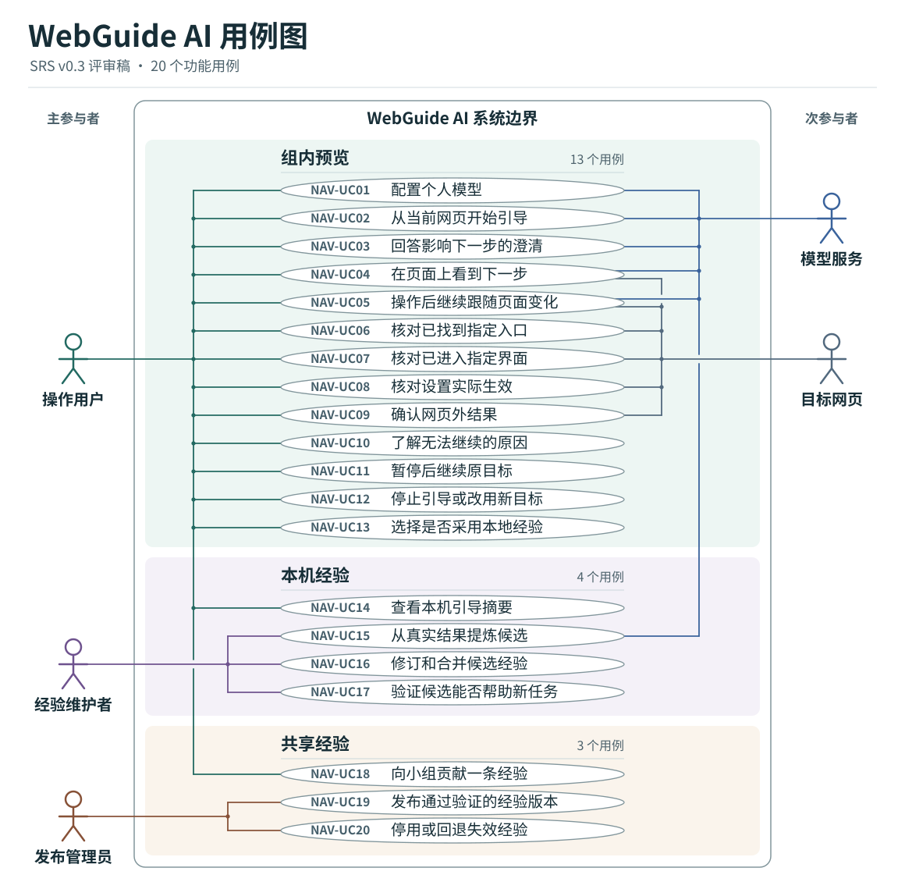
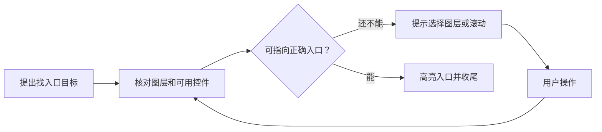
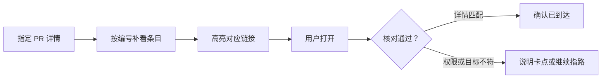
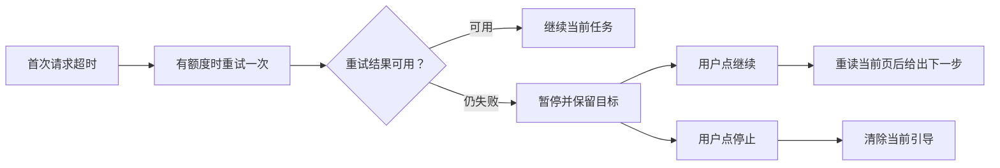

# WebGuide AI 软件需求规格说明书 v0.3

2026-11-26 · 第 11 周评审草稿。原 [SRS v0.2](WebGuideAI-SRS-v0.2.md)保留固定教程方案。此稿描述当前的实时引导，以及本机和共享经验的后续范围。[用户故事](../course/week11/用户故事.md) · [追溯矩阵 v0](../course/week11/追溯矩阵-v0.md) · [需求变更记录](需求变更记录.md)

## 1. 目标与需求来源

第一次用 GitHub 等工具协作的组员，往往知道自己要达成什么，却不知道当前界面该从哪里开始。WebGuide AI 让用户用一句话提出目标，在网页上指出可操作的位置，并在用户完成操作后核对结果。目标是让组员能从手头的页面独立继续任务。

调研材料包括公开资料、竞品研究和发起人体验。GitHub、Figma、维基百科的工程走查提供了错指、页面变化和误报完成的案例。独立干系人访谈仍待补，经验模块的阶段边界依据已有的产品决定和对照实验拟定。[调研报告](../course/week10/调研报告.md) · [发起人体验](../course/week10/发起人体验记录.md) · [真实站点验证](../design/导航Harness-真实站点验证-2026-11-23.md)

## 2. 系统边界与参与者

| 参与者 | 目标与权限 |
| --- | --- |
| 操作用户 · 主参与者 | 使用自己的模型 API 密钥和网页权限。可以开始、继续、停止引导，自愿开启本机记录或贡献自己的候选经验。网页上的点击、输入、提交和下载由用户完成。 |
| 经验维护者 · 主参与者 | 有权限时整理、修订和验证候选经验。其作用域是经验及其来源摘要。 |
| 发布管理员 · 主参与者 | 核对已验证的修订和发布条件，控制共享经验的试用、发布、停用和回退。共享阶段由系统检查发布权限。 |
| 目标网页 · 次参与者 | 在用户授权的标签页提供可读状态，身份及业务权限由目标网站管理。 |
| 模型服务 · 次参与者 | 使用用户提供的配置返回引导判断，或在后续经验阶段生成候选。它收到与任务有关的摘要，结果须由程序按当前证据校验。 |

组内预览使用桌面 Chrome／Edge、授权的当前页和支持 HTTPS Chat Completions 与 JSON 回复的模型服务。跨站点或新标签页按浏览器授权边界重新进入。网页中观察不到的结果由用户确认，并保留证据来源。目标界面的权限与共享经验的权限分别管理。[导航设计](../design/WebGuideAI-导航-Harness-设计.md) · [工程配置](../design/WebGuideAI-工程配置与开发方式-v0.1.md#6-扩展直连与模型配置)

## 3. 功能范围与用例

[用例图 PlantUML 源文件](../../models/WebGuideAI-用例图.puml)

组内预览已有实时引导和静态经验开关。先用独立组员试用验证覆盖范围。本机经验与共享经验按验证结果展开。用例编号采用 NAV 前缀，以便同历史方案的需求编号一起追溯。

功能用例清单和验收条件见[用户故事](../course/week11/用户故事.md)。每一行的 FR 对应同号 UC，三个非功能需求另有 NT 验收用例。

| 用例 | 目标 | 主参与者 | 交付阶段 |
| --- | --- | --- | --- |
| NAV-UC01 | 配置个人模型 | 操作用户 | 组内预览 |
| NAV-UC02 | 从当前网页开始引导 | 操作用户 | 组内预览 |
| NAV-UC03 | 回答影响下一步的澄清 | 操作用户 | 组内预览 |
| NAV-UC04 | 在页面上看到下一步 | 操作用户 | 组内预览 |
| NAV-UC05 | 操作后继续跟随页面变化 | 操作用户 | 组内预览 |
| NAV-UC06 | 核对已找到指定入口 | 操作用户 | 组内预览 |
| NAV-UC07 | 核对已进入指定界面 | 操作用户 | 组内预览 |
| NAV-UC08 | 核对设置实际生效 | 操作用户 | 组内预览 |
| NAV-UC09 | 确认网页外结果 | 操作用户 | 组内预览 |
| NAV-UC10 | 了解无法继续的原因 | 操作用户 | 组内预览 |
| NAV-UC11 | 暂停后继续原目标 | 操作用户 | 组内预览 |
| NAV-UC12 | 停止引导或改用新目标 | 操作用户 | 组内预览 |
| NAV-UC13 | 选择是否采用本地经验 | 操作用户 | 组内预览 |
| NAV-UC14 | 查看本机引导摘要 | 操作用户 | 本机经验 |
| NAV-UC15 | 从真实结果提炼候选 | 经验维护者 | 本机经验 |
| NAV-UC16 | 修订和合并候选经验 | 经验维护者 | 本机经验 |
| NAV-UC17 | 验证候选能否帮助新任务 | 经验维护者 | 本机经验 |
| NAV-UC18 | 向小组贡献一条经验 | 操作用户 | 共享经验 |
| NAV-UC19 | 发布通过验证的经验版本 | 发布管理员 | 共享经验 |
| NAV-UC20 | 停用或回退失效经验 | 发布管理员 | 共享经验 |

## 4. 三个细化场景

### 4.1 找到指定图层的导出入口 · NAV-UC06

操作用户在已授权的 Figma 练习稿里说「帮我找到 Frame 1 的导出设置入口」。扩展先区分图层和页面级的同名出口，提示用户选中 Frame 1。入口在视口外时，提示用户滚动到 Export 区。每次操作后重新观察。控件进入视口且归属明确时，实际画出蓝框，侧栏报告找到入口，然后自动收起网页指示。此场景的终点是指到入口。

异常路径包括选错图层、控件不可用、只能看到区域标题。系统保留进行中，先请求局部补看或说明缺少的条件。测试同时保留错误对象上的同名按钮，检查蓝框的最后落点。[真实场景与对照](../design/导航Harness-真实站点验证-2026-11-23.md#2026-11-25-最终指引真实站点复测)

### 4.2 进入指定 PR 详情 · NAV-UC07

操作用户在 GitHub PR 列表指定一个编号。扩展补看列表条目及关联链接，标出入口，等待用户打开。到达后复查详情标识与同区内容，再确认完成。列表标题、点击动作、跳转动画或权限提示都只能解释当前进度。

异常路径包括跳转后是登录提示，或者进入另一个 PR。系统说明登录等前置条件，或根据新页面继续定位。验收要比较从列表开始与已在详情页这两个起点。[真实 PR 到达实测](../design/导航Harness-真实站点验证-2026-11-23.md#从列表打开-pr-详情)

### 4.3 模型失败后继续原任务 · NAV-UC11／NAV-NT03

操作用户正在引导中。首次模型请求超时且仍有预算时，扩展自动重试一次。重试也失败后显示暂停。用户点继续，扩展保留原目标并读取当下的页面，即使页面内容刚变过也用新的观察重新判断。用户也可结束任务，清除提示及继续入口。

验收让第一次请求实际等到超时，再模拟一次无效回复，暂停期间改变网页控件，确认继续后的引导确实使用新页面状态。[Chromium 故障恢复用例](../../tests/e2e/guide.spec.ts#L4)

## 5. 非功能需求

| 编号 | 质量要求 | 验收方式 |
| --- | --- | --- |
| NAV-NFR01 · 性能 | 页面就绪并可开始时，1 秒内显示连接或观察状态。单次模型请求等待上限 15 秒，一轮处理总等待预算 45 秒。 | NAV-NT01。用可控模型延迟测开始反馈、单次到期和连续请求，记录页面与模型时间。1 秒为本稿的验收目标，待独立计时。 |
| NAV-NFR02 · 安全 | 在当前授权范围内读取必要线索。页面秘密、表单值和 Cookie 不进入模型上下文或日志。API 密钥只作为用户所配置模型服务的凭据。 | NAV-NT02。使用带敏感测试字段及注入文本的模拟页，核对权限、请求正文、授权凭据用途和日志。组合检查待执行。 |
| NAV-NFR03 · 可用性 | 自动重试失败后可以继续原目标。恢复时按当下页面判断，后台页面变化不会自行开启新的模型请求。 | NAV-NT03。复现超时、无效回复、暂停、页面更新、手动恢复与实际收尾。已有模拟浏览器回归。 |

## 6. 数据、外部交互与验收边界

- 模型 API 地址和模型名称存于本地。个人密钥仅在浏览器会话内使用。引导的临时进度用于同一浏览器会话的恢复。
- 输入给模型的是当前任务及裁剪后的网页线索。模型返回补看、指路、追问、卡点和完成判断。扩展在应用输出前核对引用的控件、所属区域和页面状态。
- 本机经验阶段拟使用用户授权的最小记录、候选修订和对照结果。共享阶段维护发布权限、目录版本、发布与回退证据，以及可撤回的来源。历史记录和实验数据按实际验证范围使用。[经验模块设计](../design/WebGuideAI-经验模块设计.md)
- 课程列举的外部集成类型是否接受模型 API 作为等价项，待教师确认。浏览器原型目前使用真实模型 API。

## 7. 评审与发布

评审核对需求的完整性、可测试性、阶段范围与证据。组内预览先复现入口、到达和状态生效三类终点。经验阶段另行对照实际收益。故事 Issue 用于需求跟踪，原型通过测试和课程正式验收分别记录。

评审前待确认完整方案范围、非功能验收指标、后续分析模型和共享经验权限。评审签字后通过 Release 发布 SRS v1.0，附[需求变更记录](需求变更记录.md)和[需求追溯矩阵 v0](../course/week11/追溯矩阵-v0.md)。正式评审记录按成员和教师的实际意见填写。
