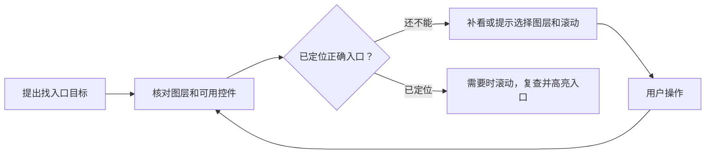
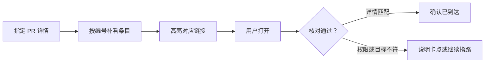
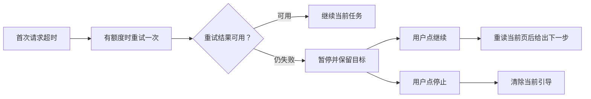
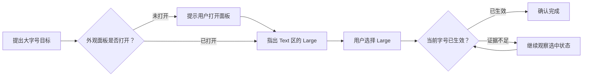

# WebGuide AI 软件需求规格说明书 v0.3

2026-11-26 · 第 11 周评审草稿 · [提交 PR #37](https://github.com/chuzhitairan/webguide-ai/pull/37)

WebGuide AI 是一款网页操作引导扩展。用户说出目标，扩展结合当前页面指出下一步，用户操作后再核对结果。当前交付先验证组员能否独立使用这套引导。本机经验整理和团队共享列为后续范围。

[用例图与分期](#3-功能范围与用例) · [典型场景](#4-典型场景) · [非功能需求](#5-非功能需求) · [逐项用例与验收](#附录-a-功能用例规格)

[评审材料总览](../course/week11/评审材料.md) · [23 条用户故事](../course/week11/用户故事.md) · [追溯矩阵 v0](../course/week11/追溯矩阵-v0.md) · [历史方案 v0.2](WebGuideAI-SRS-v0.2.md)

## 1. 目标与需求来源

第一次用 GitHub 等工具协作的组员，往往知道自己要达成什么，却不知道当前界面该从哪里开始。WebGuide AI 让用户用一句话提出目标，在网页上指出可操作的位置，并在用户完成操作后核对结果。目标是让组员能从手头的页面独立继续任务。

| 已有发现 | 对规格的影响 | 证据来源 |
| --- | --- | --- |
| 发起人使用 GitHub 和 Figma 时遇到过不知道从哪里操作的情况，希望指引直接出现在页面上。 | 接受自然语言目标，指向当前页面中可见可用的控件。对应 NAV-FR02 至 NAV-FR04。 | [发起人体验](../course/week10/发起人体验记录.md) · [调研报告](../course/week10/调研报告.md) |
| Figma 导出区标题和旁边的加号都能被观察到。GitHub 列表也会出现和详情页相同的标题。 | 找入口时核对按钮所属对象。确认到达时独立核对打开的详情。对应 NAV-FR06 和 NAV-FR07。 | [真实站点验证](../design/导航Harness-真实站点验证-2026-11-23.md) |
| 早期复测中模型调用有过超时和截断。恢复前，用户眼前的页面可能已改变。 | 暂停时保留目标，继续时重新观察。对应 NAV-FR11 和 NAV-NFR03。 | [放宽时限复测](../design/导航Harness-真实站点验证-2026-11-23.md#2026-11-24-放宽时限后的真实站点复测) |
| 经验对照已有个别成功案例，两组结果尚未显示稳定收益。 | 先保留可开关的实验入口，按同条件对照后再评审本机积累和共享。对应 NAV-FR13 至 NAV-FR20。 | [首轮经验对照](../design/导航Harness-经验对照-2026-11-24.md) |

下次组员独立试用记录目标、实际操作、最终状态及卡点。现有证据来自发起人体验、公开调研和工程走查。独立干系人访谈及组员试用报告待补。

## 2. 系统边界与参与者

| 参与者 | 目标与权限 |
| --- | --- |
| 操作用户 · 主参与者 | 使用自己的模型 API 密钥和网页权限。可以开始、继续、停止引导，自愿开启本机记录或贡献自己的候选经验。网页上的点击、输入、提交和下载由用户完成。 |
| 经验维护者 · 主参与者 | 有权限时整理、修订和验证候选经验。其作用域是经验及其来源摘要。 |
| 发布管理员 · 主参与者 | 核对已验证的修订和发布条件，控制共享经验的试用、发布、停用和回退。共享阶段由系统检查发布权限。 |
| 目标网页 · 次参与者 | 在用户授权的标签页提供可读状态，身份及业务权限由目标网站管理。 |
| 模型服务 · 次参与者 | 使用用户提供的配置返回引导判断，或在后续经验阶段生成候选。它收到与任务有关的摘要，结果须由程序按当前证据校验。 |

| 约束 | 适用规则 |
| --- | --- |
| 浏览器与运行条件 | 组内预览使用桌面 Chrome 或 Edge、用户授权的标签页，以及兼容 HTTPS Chat Completions 和 JSON 回复的模型服务。模型由扩展直连，组员自行配置密钥。 |
| 操作权与权限 | 扩展负责观察、高亮和提示，可把已定位的控件滚到眼前。目标网站管理账号和业务权限。用户自己登录、点击、输入和提交。跨站点或换标签页时，按浏览器提示授权后继续。 |
| 可观察范围 | 扩展依据可读取的网页结构核对。画布、独立嵌入页或浏览器下载界面无法取得足够证据时，提示当前能确认的部分，必要时请用户补充或确认。 |
| 任务结束 | 用户可随时停止。停止后清理网页提示。重新开始一个目标后，上一任务的迟到回复不能出现在新页面提示里。 |

[导航 Harness 设计](../design/WebGuideAI-导航-Harness-设计.md) · [工程配置](../design/WebGuideAI-工程配置与开发方式-v0.1.md#6-扩展直连与模型配置)

## 3. 功能范围与用例

两侧分别排列主参与者和次参与者。沿参与者的连线可找到对应的用例，圆点表示分支。[打开 SVG 全图](../../models/WebGuideAI-用例图.svg) · [PlantUML 用例模型](../../models/WebGuideAI-用例图.puml)

| 交付阶段 | 交付内容 | 阶段完成时的检查 |
| --- | --- | --- |
| 组内预览 · 本轮范围 | NAV-UC01 至 NAV-UC13。扩展直连个人配置的模型，实时引导覆盖找入口、到达界面、状态生效和用户确认。随包静态经验可选启用。 | 组员从安装开始独立试用。按三类网页终点和故障恢复用例核对，并记录误指、误报或无法继续的情况。 |
| 本机经验 · 后续 | NAV-UC14 至 NAV-UC17。在用户自愿授权后查看最小记录，产生候选、修订并在未见任务上复验。 | 能从候选查到授权来源、修订和对照结果。优先判断是否提高完成率，或稳定减少找路耗时。 |
| 共享经验 · 后续 | NAV-UC18 至 NAV-UC20。小组贡献脱敏候选，由有权限的角色发布、停用和回退。 | 验证贡献撤回、发布权限、版本可追溯和失效回退。何时需要共享服务按小组实际使用情况决定。 |

公共经验库、自动发布、教程编辑工具、文件内容核对都在本轮组内预览范围之外。静态经验开关供实验使用，默认关闭。阶段范围依据当前方案拟定，作为本周评审的确认事项。

用例编号 `NAV-UC` 描述用户和系统怎样交互，需求编号 `NAV-FR` 对应系统应提供的行为。例如 NAV-FR07 由 NAV-UC07 说明，并由 NAV-US07 给出 Given/When/Then 验收。下表可查全貌，[附录 A](#附录-a-功能用例规格)逐条写明触发、正常或分支行为及通过条件。

| 用例 | 目标 | 主参与者 | 交付阶段 |
| --- | --- | --- | --- |
| NAV-UC01 | 配置个人模型 | 操作用户 | 组内预览 |
| NAV-UC02 | 从当前网页开始引导 | 操作用户 | 组内预览 |
| NAV-UC03 | 回答影响下一步的澄清 | 操作用户 | 组内预览 |
| NAV-UC04 | 在页面上看到下一步 | 操作用户 | 组内预览 |
| NAV-UC05 | 操作后继续跟随页面变化 | 操作用户 | 组内预览 |
| NAV-UC06 | 核对已找到指定入口 | 操作用户 | 组内预览 |
| NAV-UC07 | 核对已进入指定界面 | 操作用户 | 组内预览 |
| NAV-UC08 | 核对设置实际生效 | 操作用户 | 组内预览 |
| NAV-UC09 | 确认网页外结果 | 操作用户 | 组内预览 |
| NAV-UC10 | 了解无法继续的原因 | 操作用户 | 组内预览 |
| NAV-UC11 | 暂停后继续原目标 | 操作用户 | 组内预览 |
| NAV-UC12 | 停止引导或改用新目标 | 操作用户 | 组内预览 |
| NAV-UC13 | 选择是否采用本地经验 | 操作用户 | 组内预览 |
| NAV-UC14 | 查看本机引导摘要 | 操作用户 | 本机经验 |
| NAV-UC15 | 从真实结果提炼候选 | 经验维护者 | 本机经验 |
| NAV-UC16 | 修订和合并候选经验 | 经验维护者 | 本机经验 |
| NAV-UC17 | 验证候选能否帮助新任务 | 经验维护者 | 本机经验 |
| NAV-UC18 | 向小组贡献一条经验 | 操作用户 | 共享经验 |
| NAV-UC19 | 发布通过验证的经验版本 | 发布管理员 | 共享经验 |
| NAV-UC20 | 停用或回退失效经验 | 发布管理员 | 共享经验 |

## 4. 典型场景

| 用户说的目标 | 核对成功时应该看到什么 | 容易误判的中间状态 |
| --- | --- | --- |
| 找到某处入口 | 本页突出正确对象的实际控件，侧栏报告已找到。 | 只找到区域标题，或者高亮了另一个对象的同名按钮。 |
| 进入指定界面 | 真实界面已打开，详情标识和同一内容区的证据一致。 | 只看到列表中的对象名、点击过链接或遇到了登录页。 |
| 使设置生效 | 当前选项、所属对象和结果都与目标吻合。 | 菜单已展开，或者选项出现但尚未选中。 |
| 确认网页外结果 | 用户检查网页外的结果后主动确认，侧栏注明来源。 | 网页显示导出成功，但用户尚未确认文件已收到。 |

### 4.1 找到指定图层的导出入口 · NAV-UC06

操作用户在已授权的 Figma 练习稿里说「帮我找到 Frame 1 的导出设置入口」。扩展先区分图层和页面级入口，提示用户选中 Frame 1。归属明确的屏外加号可以自动滚到眼前，复查后高亮。还缺线索时，扩展补看或提示用户滚动到 Export 区。指到入口后，侧栏报告找到，网页指示随后收起。

异常路径包括选错图层、控件不可用、只能看到区域标题。系统保留进行中，先补看局部或说明缺少的条件。测试样页同时保留错误对象上的同名按钮，检查蓝框的最后落点。真实站点曾出现「指对后未收尾」，因此高亮位置和侧栏收尾分别记录。[真实场景与对照](../design/导航Harness-真实站点验证-2026-11-23.md#2026-11-25-最终指引真实站点复测) · [同名入口回归](../../tests/e2e/guide.spec.ts#L283)

### 4.2 进入指定 PR 详情 · NAV-UC07

操作用户在 GitHub PR 列表指定一个编号。扩展补看列表条目及关联链接，标出入口，等待用户打开。到达后复查详情标识与同区内容，再确认完成。列表标题、点击动作、跳转动画或权限提示都只能解释当前进度。

遇到登录提示时，保留原目标并提示用户先完成登录。遇到另一个 PR 时，根据新页面继续定位。如果用户一开始就在正确详情页，可直接核对终点。验收覆盖这两种有效起点，并另用样页检查列表标题不能触发提前收尾。已有真实 GitHub 复测在同一个 PR 上从列表、详情两个起点分别通过 2/2 次。[真实 PR 到达实测](../design/导航Harness-真实站点验证-2026-11-23.md#从列表打开-pr-详情) · [列表误报回归](../../tests/e2e/guide.spec.ts#L247)

### 4.3 模型失败后继续原任务 · NAV-UC11／NAV-NT03

操作用户正在引导中。首次模型请求超时且仍有预算时，扩展自动重试一次。重试也失败后显示暂停。用户点继续，扩展保留原目标并读取当下的页面，即使页面内容刚变过也用新的观察重新判断。用户也可结束任务，清除提示及继续入口。

验收让第一次请求实际等到超时，再模拟一次无效回复，暂停期间改变网页控件，确认继续后的引导确实使用新页面状态。[Chromium 故障恢复用例](../../tests/e2e/guide.spec.ts#L4)

### 4.4 让正文字号实际生效 · NAV-UC08

操作用户在维基百科文章页说「把正文调成大字号」。外观面板可能收起，也可能已固定。扩展应根据起点提示打开面板或直接指出 Text 区的 Large。用户选中后，扩展重新核对 Large 已选中及其所属区域，然后显示完成。展开菜单或文字变大但所属控件未确认时，继续观察或保留未完成。

验收分别检查面板收起和已打开的起点。人为保留一个含 Large 字样的菜单或提示作为干扰。记录用户是否选对、正文是否实际改变、扩展何时收尾。实测有指对并收尾的样本，也有固定面板找不到选项的样本。[维基百科验证](../design/导航Harness-真实站点验证-2026-11-23.md#第三站验证维基百科字号) · [选项复查回归](../../tests/e2e/guide.spec.ts#L380)

## 5. 非功能需求

| 编号 | 质量要求 | 验收方式 |
| --- | --- | --- |
| NAV-NFR01 · 性能 | 页面就绪且授权已完成，从按下「开始引导」到侧栏显示连接或观察状态不超过 1 秒。单次模型请求等待上限 15 秒，一轮处理总等待预算 45 秒。 | [NAV-NT01](../course/week11/验收与证据.md#nav-nt01-性能)使用可控模型延迟，分别核对反馈和截止时间。预算已有实现依据，一秒反馈待独立计时。 |
| NAV-NFR02 · 安全 | 扩展只读取授权范围内的必要线索。页面秘密、表单值和 Cookie 不进入模型正文或日志。API 密钥只作为所配置模型的请求凭据。 | [NAV-NT02](../course/week11/验收与证据.md#nav-nt02-安全)核对权限、模拟服务收到的请求正文、凭据去向和日志。组合样页待测。 |
| NAV-NFR03 · 可用性 | 模型超时且自动重试失败后，可以继续原目标。暂停期间仅有页面变化时不自行发起模型请求。恢复时按当下页面重新观察。 | [NAV-NT03](../course/week11/验收与证据.md#nav-nt03-可用性)检查失败、暂停、页面更新、手动继续和正常收尾。已有模拟浏览器回归。 |

## 6. 数据、外部交互与验收边界

| 数据或系统接口 | 提供与使用方式 | 生命周期与约束 |
| --- | --- | --- |
| 模型配置 | 用户在侧栏填写地址、名称和密钥，扩展向获授权的模型端点发起 HTTPS 请求。 | 地址与名称存本地，密钥只在浏览器会话中使用。用户拒绝授权时提示如何处理。 |
| 浏览器与目标网页 | 用户通过浏览器授予当前页面访问权限。网页提供控件、区域与选择状态，扩展显示提示并观察后续变化。 | 会话状态用于继续原任务。观察随页面状态更新。旧页面引用失效后须重新观察。 |
| 模型输入和输出 | 模型收到用户目标及裁剪的网页线索，返回补看、指路、澄清、卡点或完成判断。 | 扩展使用前复查所引用的控件、区域和页面状态。超时或无效回复按 NAV-UC11 恢复。 |
| 经验与验证记录 · 后续 | 本机保存用户自愿保留的最小记录和候选修订。共享阶段提交用户确认过的脱敏摘要。 | 用户可删除本机记录或撤回贡献。共享目录保留版本及来源关系，供复验和回退。 |

浏览器原型已接入真实模型 API。该外部接口是否满足课程总要求中的外部集成类型，由课堂评审确认。[经验模块设计](../design/WebGuideAI-经验模块设计.md) · [模型接口和数据边界](../design/WebGuideAI-导航-Harness-设计.md#7-数据故障与调试)

## 7. 评审与发布

评审先沿用例图核对角色与范围，再抽查「需求编号 → 用例 → 验收 → 证据」是否一致。可以从 NAV-FR07 走到 NAV-UC07、故事 #19 和详情页复测。[验收与验证证据](../course/week11/验收与证据.md) · [追溯矩阵 v0](../course/week11/追溯矩阵-v0.md)

本次要确认的决定包括三阶段范围、性能验收口径、外部模型 API 的课程认定。评审意见记入 [Issue #36](https://github.com/chuzhitairan/webguide-ai/issues/36)，通过后发布 SRS v1.0，附变更记录和追溯矩阵。基线之后仍可用 Issue 提出变更，经评审后由关联 PR 修订规格和验收。[需求变更记录](需求变更记录.md)

## 附录 A 功能用例规格

每条用例写明系统要提供的行为和可观察的通过条件。组内预览对应当前原型的验收范围，后续两阶段对应拟交付行为。责任人和 Given/When/Then 见[故事清单](../course/week11/用户故事.md)。

### A.1 组内预览

#### NAV-UC01 配置个人模型

- **NAV-FR01**　扩展允许操作用户填写模型地址、名称和密钥，并申请对应域名的访问权限。
- **流程**　安装后填自己的合法配置并授权，侧栏可发起模型请求。拒绝授权时说明缺少权限。凭据无效时保留可修改的设置。
- **通过条件**　合成模型正常回复后可继续引导。拒绝授权时该请求不发出，凭据错误有可恢复的提示。

#### NAV-UC02 从当前网页开始引导

- **NAV-FR02**　扩展允许操作用户从当前已授权网页输入自然语言目标，启动围绕该目标的观察和指引。
- **流程**　用户输入目标并开始，侧栏先显示状态。扩展观察当前页，用目标和网页线索取得下一步。页面未获授权时提示如何取得权限。
- **通过条件**　从已授权网页输入一条此前未预设的目标，能看到对应状态和基于当前页的提示。切到无权限页时提示授权。

#### NAV-UC03 回答影响下一步的澄清

- **NAV-FR03**　当目标对象或终点存在影响下一步的歧义时，扩展在侧栏向用户提出具体问题。
- **流程**　例如区分「找编辑入口」与「进入编辑器」。等待期间保留原目标。用户回复后，用原目标与回答重新判断。
- **通过条件**　给出足以区分两种意图的回答后，下一条指引朝用户明确的终点推进，并沿用原目标的其他条件。

#### NAV-UC04 在页面上看到下一步

- **NAV-FR04**　扩展复查候选控件后绘制高亮，并说明用户接下来可做什么。
- **流程**　核对控件可见、可用、属于当前页面及目标区域。有歧义或控件位于视口外时，补看或用侧栏提示说明如何到达。
- **通过条件**　高亮圈住能接收操作的实际控件，提示不会挡住它，测试者能自行点击。普通鼠标经过旁边的按钮时，高亮保持稳定。

#### NAV-UC05 操作后继续跟随页面变化

- **NAV-FR05**　扩展在用户改变选中对象、按提示滚动或进入下一页后，按新状态继续同一目标。
- **流程**　需要时撤下已失效的提示并重新观察。跨站点或无授权时提示用户授权。只有装饰变化时保持仍有效的指引。
- **通过条件**　切换对象或同源跳转后，指引对应新页面。人为延迟的上一页面模型回复不能覆盖当前提示。

#### NAV-UC06 核对已找到指定入口

- **NAV-FR06**　用户目标是找入口时，扩展在核对正确对象的真实入口并实际高亮后报告找到。
- **流程**　先核对选中的 Frame 1，再查 Export 区右侧的加号。确认具体控件的归属后，可把它滚到眼前再核对。仅看到区域标题或另一个对象的按钮时继续找。
- **通过条件**　样页存在两个同名入口、正确按钮在屏外时，扩展只滚动目标面板，蓝框落在指定图层的加号上。侧栏报告已找到。点击加号时原网页照常响应，页面提示立即收起。未点击时约 4 秒后自动收起。

#### NAV-UC07 核对已进入指定界面

- **NAV-FR07**　用户要求到达指定界面时，扩展在确认目标标识及同一内容区域的证据后报告已到达。
- **流程**　从列表开始时先标出入口，用户进入后检查详情。已在正确详情页时直接核对。登录、错页或只有列表链接时沿当前状态继续处理。
- **通过条件**　同一 PR 从列表进入及从详情页开始皆可通过。列表中只有同名标题、跳到登录页或打开其他 PR 时都应保持未完成。

#### NAV-UC08 核对设置实际生效

- **NAV-FR08**　设置任务只有在当前选项及其所属对象的状态满足目标后才完成。
- **流程**　以文章字号为例，扩展提示用户选 Large，操作后核对对应面板的选中状态。仅见菜单或旧选择时继续观察。
- **通过条件**　展开菜单时仍显示进行中。选择 Large 且页面状态生效后，以当前证据完成。

#### NAV-UC09 确认网页外结果

- **NAV-FR09**　目标还包含浏览器网页之外的结果时，扩展显示已观察部分，并请求用户确认该项。
- **流程**　网页显示导出成功后，侧栏请用户检查文件是否已下载。用户点击确认后标注「用户确认」。
- **通过条件**　网页成功提示出现时，文件仍待确认。用户确认前后在侧栏可区分结果与来源。

#### NAV-UC10 了解无法继续的原因

- **NAV-FR10**　权限、页面证据或处理预算不足时，扩展说明当前缺少的条件或可尝试的动作。
- **流程**　例如目标藏在不可读的嵌入页中时，提示用户打开相应页面。补看仍无法确定现状时，保留原任务及已知进展。
- **通过条件**　故意去掉可操作目标或访问权限，侧栏给出对应限制，且未把缺少证据的目标判成完成。

#### NAV-UC11 暂停后继续原目标

- **NAV-FR11**　浏览器会话仍在时，用户可以主动恢复因故暂停的任务。
- **流程**　超时有剩余预算时自动重试一次。仍失败则暂停。用户点继续，或重开侧栏后确认继续，扩展结合原目标重读当前页。
- **通过条件**　暂停后替换目标控件。继续时原目标还在，使用新控件完成指引。具体故障验收见 [NAV-NT03](../course/week11/验收与证据.md#nav-nt03-可用性)。

#### NAV-UC12 停止引导或改用新目标

- **NAV-FR12**　操作用户可停止引导或以新目标开始，扩展清理旧提示和可恢复状态。
- **流程**　停止时撤下高亮和继续入口。新目标按当前页面重新开始，旧请求的迟到结果失效。
- **通过条件**　在模型回复前点停止或换目标。等待旧回复返回后，旧提示仍未出现在页面或侧栏。

#### NAV-UC13 选择是否采用本地经验

- **NAV-FR13**　操作用户可控制引导是否参考随包试验经验。
- **流程**　开关默认关闭。启用后选择当前站点候选；停用、缺少匹配或现状冲突时按当前页面继续。
- **通过条件**　固定起点和目标分别开启、关闭。输入模型的经验摘要按开关和站点变化，两组都按当前页复查结果。

### A.2 本机经验

#### NAV-UC14 查看本机引导摘要

- **NAV-FR14**　用户自愿开启记录后，可以查看和删除本机引导摘要。
- **流程**　结束任务后保存目标、关键步骤和结果来源的最小记录。用户打开或删除摘要。
- **通过条件**　可区分已核对、用户确认和未知结果。删除后再次提炼时，已删除记录不再作为输入。

#### NAV-UC15 从真实结果提炼候选

- **NAV-FR15**　经验维护者可用已授权记录提炼可复用的查找建议。
- **流程**　比较成功、卡住和未知样本，产生含适用条件、查找建议、核对信号和来源的候选。
- **通过条件**　从候选能追溯授权来源。未知样本仍标为未知，生成的候选处于待验证状态。

#### NAV-UC16 修订和合并候选经验

- **NAV-FR16**　经验维护者可以根据来源证据修订、合并候选，或为冲突条件保留分支。
- **流程**　查看两条相似经验的起点、建议和结果，按适用条件提交修订。
- **通过条件**　能读取新的修订及其来源。冲突尚未解决时，仍可查到原候选和待验证原因。

#### NAV-UC17 验证候选能否帮助新任务

- **NAV-FR17**　经验维护者可把候选与无经验模式做同条件对照，并把结果挂到具体修订。
- **流程**　选择未用于提炼的任务，固定模型、起点和预算。记录两组完成、误指、误报及耗时。
- **通过条件**　从结果能重建候选版本和对照条件，分别看见页面实际结果及扩展收尾。样本不足时保留待验证状态。

### A.3 共享经验

#### NAV-UC18 向小组贡献一条经验

- **NAV-FR18**　操作用户可审阅脱敏摘要后贡献给小组，并查询或撤回自己的贡献。
- **流程**　用户从本机候选打开预览，确认后提交。共享目录保存候选及可回溯的来源关系。
- **通过条件**　确认前不上传，提交后可看到状态。撤回后可识别受影响的候选，供重新复验。

#### NAV-UC19 发布通过验证的经验版本

- **NAV-FR19**　有发布权限的管理员可选择已经验证的具体修订，试用或发布到指定范围。
- **流程**　检查权限及该修订的验证记录，保存目录版本、适用范围及发布记录。缺少条件时保留候选。
- **通过条件**　有权限和证据时可发布并回查版本。无发布权限或没有验证记录时，客户端仍读到原目录。

#### NAV-UC20 停用或回退失效经验

- **NAV-FR20**　发布管理员可以停用失效修订，或回退到上一可用目录。
- **流程**　依据复验结果执行停用或回退，保留原因、证据和版本关系。
- **通过条件**　新会话不再采用失效版本，使用上一可用版本或按当前页面继续。维护者可以追溯停用前后的记录。
