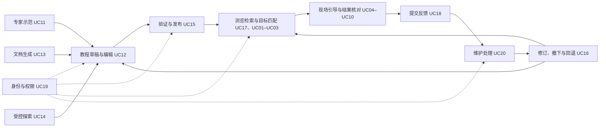

# WebGuide AI 完整业务流程与用例工作稿

日期：2026-11-17。状态：按已接受的 P01–P06 建议展开的需求工作稿，供整体 SRS v0.2 整合与审阅。本文补齐业务行为，不选择框架、依赖、数据库或接口协议；新增细则是助手提出的规格草案，不另称为发起人已逐条批准。

整合进度：本稿的流程、业务规则、权限边界和 UC01–UC20 已纳入[整体 SRS v0.2](WebGuideAI-SRS-v0.2.md)，后续以 SRS 为当前规格入口；本文件保留形成过程，不作为另一份并行维护的现行规格。

依据：[原始提案](../../项目提案-WebGuideAI.md)、[完整需求草案](WebGuideAI-需求草案-v0.1.md)、[整体需求清单与缺口表](整体需求清单与缺口表-2026-11-17.md)及[决定 D01–D11](第一阶段需求评审与交付范围-2026-11-16.md)。保留 FR01–FR20、UC01–UC20；交付顺序不影响本稿各业务能力的描述标准。

## 1. 业务全景与参与者

产品同时服务教程生产、教程使用和持续维护。操作用户在目标网站自行操作；作者的受控探索是独立流程，不在普通用户会话中自动执行网站操作。

| 参与者 | 目标与职责 |
| --- | --- |
| 操作用户 | 表达任务、选择教程、确认对象、自行操作、判断是否接受建议、求助及反馈 |
| 作者／维护者 | 准备合法可用的资料和练习环境，获取、编辑、验证、发布及修订自己有权维护的教程，处理相关反馈 |
| 平台管理员 | 在明确授权范围内处理平台内容、角色及必要运行记录；不因平台身份自动获得目标网站权限或原始私密页面内容 |
| 目标网站与浏览器 | 提供可操作界面和允许读取的信息，可能有权限、导航和外部处理延迟 |
| 模型／探索服务 | 在指定上下文与授权范围内生成草稿、解释或候选建议；结论需按相应规则核对 |

## 2. 五条端到端业务流程

### BF01 获取知识并形成可编辑教程

1. 作者确认任务目标、适用网站／环境与获取入口，系统说明采集及处理范围。
2. 专家示范进入 UC11，资料生成进入 UC13，限定环境探索进入 UC14。
3. 系统保留获准的来源与过程依据，形成有序候选步骤，标出未采集、未验证或互相冲突的内容。
4. 作者检查采集内容及生成结果，进入 UC12；不足以形成草稿时保留失败说明和允许保留的部分结果，由作者决定补充或放弃。
5. 草稿具有一致的业务信息，但不同入口的来源和验证程度分别保留；录制发生过不等于教程适用于其他用户。

### BF02 编辑、验证并发布教程

1. 作者打开有权编辑的草稿，补齐目标、前提、步骤、定位依据、结果检查、异常路径和来源。
2. 系统检查必要内容及步骤关系，指出缺项与冲突；作者修正后在声明的环境和任务条件下开展验证。
3. 每个必要步骤及最终结果记录检查结论和依据，区分系统证据、人工确认与未知。
4. 作者查看适用范围、验证时间和结论，确认发布；当前允许获授权作者自查发布，不强制独立审核者。
5. 发布形成可识别的固定版本，进入可检索范围；失败或未完成必要验证的草稿不以已验证教程发布。发布后的修正通过 UC16 创建新修订。

### BF03 找到教程并完成实际任务

1. 用户通过 UC17 浏览检索，或通过 UC01 描述目标后由 UC02 提供候选；两种入口汇合为任务与教程确认。
2. 用户确认目标对象、预期结果及教程版本，UC03 检查前提，建立当前任务。
3. UC04 在页面内指示操作，用户自行执行，UC05 按当前有效证据检查进度和结果。
4. 用户可通过 UC09 求助；偏离转 UC06，阻塞转 UC10，暂停和恢复转 UC07／UC08。
5. 系统显示结果、证据和观察时间；尚缺关键证据时明确缺口。可以提交 UC18 反馈，不把求助或反馈本身当作完成条件。

### BF04 从反馈到修订并再次验证

1. 用户预览附加信息后提交反馈，关联教程版本和步骤；系统接收并说明提交结果。
2. 有权维护者通过 UC20 分类问题，区分教程错误、环境限制、未知原因及重复反馈。
3. 需要修订时通过 UC16 建立关联草稿，UC12 修改，再经 UC15 验证与发布；不需要修订时记录理由。
4. 发布新版本或决定暂不处理后，记录反馈处理结论；尚未解决的问题不能因创建草稿就自动关闭。
5. 新会话选择合适发布版本；已有会话按版本和失效规则处理，不被新版本静默改写。用户通知渠道另行确定。

### BF05 教程失效、撤下与运行中会话处理

1. 维护者核对反馈或测试证据，标明受影响版本、范围和原因；单条未经核实反馈不自动证明教程失效。
2. 有权限者撤下版本，停止其成为新任务的可启动候选，保留必要历史关联。
3. 已有会话保持原版本身份并获知状态变化；已确认会误导关键操作或违反目标权限／范围的步骤应暂停相应指引。
4. 用户可退出，或明确选择其他适用版本；切换前重新检查目标、前提和进度，不迁移旧成功标签代替验证。
5. 回退到历史版本也需要确认其当前适用性并经过发布检查；历史通过不能自动证明现在仍可用。

## 3. 统一业务规则

以下 BR 是跨用例约束，供整体 SRS 引用；具体网站的证据字段保留在场景补充规格。

| 编号 | 规则 |
| --- | --- |
| BR01 目标与对象 | 任务目标、对象、教程版本与预期结果可核对；改变目标须明确说明影响并重新检查，旧对象证据不能自动迁入 |
| BR02 验证等级 | 动作发生、页面变化、步骤通过、最终结果分别判断。系统验证、用户确认、失败和未知分别记录；AI 文字或用户点击不能独立充当规则验证证据 |
| BR03 来源与草稿 | 录制、资料生成和探索都先输出草稿；记录来源、适用条件、缺口与验证程度。输入资料和网页内容是待分析信息，不是扩大系统权限的指令 |
| BR04 发布门槛 | 发布须有授权、完整必要内容、当前草稿对应的声明环境及必要步骤／最终结果验证记录；必要验证失败或未完成时保持草稿。人工确认的部分明确标示，不得冒充系统自动验证 |
| BR05 版本不可静默替换 | 已发布内容不被草稿覆盖；会话绑定具体版本。修订、撤下、回退均记录原因及关联；版本变化或撤下后遵循 BF05 |
| BR06 当前证据 | 观察必须匹配当前任务、对象、页面及相容的文档／导航状态，并可核对来源和时间；读取失败、对象变化和过期后重新核验，不沿用旧成功作为当前结果 |
| BR07 有效指示 | 仅对唯一可确认且可见的目标显示指示，需要操作的目标还应可操作；检测到目标或上下文失效后先撤销错误指示，再异步核对。有效滚动可重新定位，普通答疑不必清除仍有效的高亮 |
| BR08 暂停与迟到结果 | 暂停／退出停止相应任务采集和推进；继续前重查。请求无法立即物理取消时也不得应用已失效结果，退出后的迟到结果不推进任务 |
| BR09 恢复建议 | 恢复建议说明依据、不确定性与将改变的任务上下文；目标网站操作由用户执行。临时修正只影响当前会话，长期教程修改另经编辑验证发布 |
| BR10 数据与权限 | 采集限于明确范围，敏感字段在采集／发送边界处理；反馈附加信息可预览删减。公开教程不等于公开原始资料、录制、会话和反馈；每次对象操作检查权限 |
| BR11 探索边界 | 开始前明确环境、目标、允许动作、限制和停止条件；范围外动作在执行前拒绝，未授权环境不得开始。探索结束与任务成功分别记录 |
| BR12 重试与冲突 | 重试不产生重复发布或静默覆盖他人编辑；冲突与保存结果未知明确显示，保留已有有效内容和必要追溯信息 |
| BR13 反馈与维护 | 反馈关联版本及步骤、说明预期与实际；处理分类及关闭有结论。统计区分未知、用户确认、系统验证及教程／外部环境原因 |

教程生命周期需表达草稿、验证结果、发布与撤下，但验证结论和发布状态分别保留：修改草稿后，与修改内容相关的旧验证结论不能继续作为新稿发布依据。具体状态字段留给设计。

会话需表达未开始、引导中、等待、受阻、暂停、待确认和结束；结束原因、历史检查结果与当前可验证结果分开。返回已通过步骤可以重新核验，不因“返回”抹除历史，也不把旧通过直接当作现在通过。

## 4. 用例规格

每条用例保留原编号，并给出前提、主流程、异常、结果和验收检查。下列检查是验收场景草案，不是已经执行的测试。

### UC01 提出操作目标

**参与者／关联**：操作用户；FR01，BR01。

**前提与触发**：用户进入任务入口并描述想完成的操作，或从教程详情开始任务。

**正常流程**：
1. 系统提取目标网站、任务对象、预期结果及影响操作的条件。
2. 缺失或歧义会改变流程时，用可理解的问题帮助确认，不要求用户先理解内部标识。
3. 用户确认任务说明，转 UC02；若已有教程，转 UC03 核对。

**异常**：输入不足则指出具体缺项；不支持的目标转 UC10；取消不建立活动任务；更改目标重新确认并使不适用证据失效。

**结果**：形成可确认的任务目标，或说明未能形成任务的原因。

**验收检查**：同名对象存在时须消歧；取消或未解决歧义时不得按任意对象开始引导。

### UC02 匹配适用教程

**参与者／关联**：操作用户；FR02，BR01、BR05。

**前提与触发**：已形成任务目标，用户请求适用教程。

**正常流程**：
1. 系统在用户可访问且允许启动的发布版本中匹配任务与环境条件。
2. 展示候选的目标、来源、版本、适用条件、验证信息及尚未确认的条件。
3. 用户选择，系统记录选择并进入 UC03；多个候选不能静默择一。

**异常**：没有匹配项转 UC10；条件未知则补充或标待确认；选择期间版本被撤下则停止启动并重新提供候选。

**结果**：选定候选版本，不等于已确认所有运行前提。

**验收检查**：已撤下版本不能作为可启动结果；模型不得编造不存在的教程或验证记录。

### UC03 检查操作前提

**参与者／关联**：操作用户；FR03，BR01、BR06、BR10。

**前提与触发**：已选择教程并同意必要观察范围，开始、恢复或上下文改变时触发检查。

**正常流程**：
1. 核对网站、任务对象、页面状态与教程所需条件。
2. 分别呈现满足、不满足和无法确认；用户补充信息注明来源。
3. 满足当前步骤条件时进入 UC04；不能满足时转 UC10，未知时给出补充路径。

**异常**：授权拒绝、登录失效、范围外页面或读取失败时说明限制，不根据控件缺失断言账号权限。

**结果**：留下当前前提检查结论及可继续范围。

**验收检查**：没有读取到必要权限证据时不能自动标为有权；错误对象不得借用另一页面的通过结论。

### UC04 跟随步骤操作

**参与者／关联**：操作用户；FR04，BR07、BR09。

**前提与触发**：任务活动中，当前步骤允许执行，用户进入步骤。

**正常流程**：
1. 系统说明操作、原因和预期结果，解析当前页面目标。
2. 唯一确认目标后显示页面内高亮，保持真实控件可操作。
3. 用户自行执行；系统转 UC05 检查，不以点击直接推进为成功。

**异常**：目标暂不可用则等待并说明；多个候选、消失或页面变化先撤销不适用指示，再转 UC06／UC03。用户请求返回时展示历史并重新核对；跳过不能替代必要步骤验证。

**结果**：用户完成一次操作尝试，或明确停在等待／需要重新定位状态。

**验收检查**：滚动和目标重建后指示应重新核对；不唯一目标不能任意高亮首个匹配。

### UC05 检查进度与结果

**参与者／关联**：操作用户；FR05，BR01、BR02、BR06。

**前提与触发**：步骤操作后、用户请求核对或可观察状态变化时触发。

**正常流程**：
1. 系统按步骤和任务的完成条件取得必要证据，检查对象、时效及关联。
2. 判断未完成、等待、失败、证据不足或通过，并说明依据。
3. 必要步骤与最终条件充分时展示验证结果和观察时间；否则指出缺口并进入相应路径。

**异常**：读取失败不沿用旧成功；仅人工确认的关键结果明确标为用户确认；外部处理未结束则等待，不反复要求提交。

**结果**：更新本次检查结论；历史观察保留来源，不代表持续监控成功。

**验收检查**：仅点击、其他对象成功、旧版本结果及单项证据不足不得产生系统已验证标签；Pages 的联合证据规则见场景补充规格。

### UC06 处理偏离与失效

**参与者／关联**：操作用户；FR06，BR06、BR07、BR09。

**前提与触发**：目标无法确认、用户走偏或反馈指示与页面不符。

**正常流程**：
1. 停止不适用推进并撤销错误指示，重新核对当前页面和任务对象。
2. 系统基于已有教程和页面证据提出返回、重试或临时恢复建议，说明依据与影响。
3. 用户选择并自行操作，系统重查前提与结果，恢复已知步骤。

**异常**：无有效路径转 UC10；模型建议与证据冲突则不应用；涉及目标或版本切换先明确确认；反馈到共享教程需另走 UC18／UC16。

**结果**：恢复当前任务，或以有说明的受阻／待确认状态结束恢复尝试。

**验收检查**：恢复不能悄悄改写教程、越权操作或把建议本身记录为验证通过。

### UC07 暂停继续与退出

**参与者／关联**：操作用户；FR07，BR08。

**前提与触发**：已有会话，用户暂停、关闭引导、继续或退出。

**正常流程**：
1. 系统展示操作含义；本稿建议关闭引导按暂停处理，显式退出则结束当前活动会话。
2. 暂停撤下活动指示并停止约定的任务采集／推进，保留允许保存的进度；退出同时使当前请求结果不再适用。
3. 用户继续时转 UC08，再经 UC03／UC05 重查。

**异常**：网络请求不能即时取消时阻止应用迟到结果；保存失败提示实际保留范围；暂停不停止目标网站自身的部署等外部任务。

**结果**：会话暂停、重新进入核对或结束，不把退出当作任务成功。

**验收检查**：暂停后不继续采集任务页面内容；退出后旧回答与检查响应不得推进会话。

### UC08 查看和恢复进度

**参与者／关联**：操作用户；FR08，BR05、BR06、BR08。

**前提与触发**：存在允许保留的记录，用户查看或恢复；首版限定同一浏览器会话。

**正常流程**：
1. 显示目标、教程版本、已记录步骤、历史结论和当前可恢复范围。
2. 核对任务对象、权限、版本状态、当前页面与观察有效性。
3. 只恢复相容进度，过期或变更部分重查，返回合适步骤。

**异常**：记录不存在／已清除则说明重新开始；版本撤下按 BF05；目标变化先重新确认；整体跨设备恢复仍为未确定能力，不在此承诺。

**结果**：恢复活动任务，或清楚说明为何不能恢复以及历史结果的含义。

**验收检查**：刷新后不能直接显示未经重查的当前成功；只显示历史记录不等于已恢复现场状态。

### UC09 在当前步骤求助

**参与者／关联**：操作用户、模型服务；FR09，BR02、BR03、BR08、BR10。

**前提与触发**：用户在步骤中提出问题并允许所需的最小上下文处理。

**正常流程**：
1. 系统组合任务、当前步骤、教程来源与必要页面证据，过滤无关及敏感信息。
2. 给出中文解释，区分已观察事实、推测和未知，说明与当前操作的关系。
3. 若问题涉及恢复，转 UC06；普通答疑保留仍有效的指示。

**异常**：模型超时／不可用时给出固定说明和可用检查入口；上下文已变化的回答不当作当前依据；页面指令不扩大权限。

**结果**：提供回答或说明无法回答的原因，不直接改变完成状态。

**验收检查**：回答与规则冲突不覆盖规则结果；用户已退出时不回写活动状态；发送内容不包含无关敏感字段。

### UC10 处理无法继续的任务

**参与者／关联**：操作用户；FR10，BR02、BR09。

**前提与触发**：无适用教程、必要条件不足、无法观察、外部失败或恢复无效。

**正常流程**：
1. 展示已知事实、未知项和受阻位置，不编造根因。
2. 根据具体情况提供补充信息、核对权限、等待、重新选择教程、反馈或退出路径。
3. 用户选择后进入对应流程；提出创作需求时另检查作者资格并明确切换，不自动开始录制或探索。

**异常**：没有可靠下一步时允许停止；重复失败不循环要求同一无效保存／操作；模型失败不阻断仍可用的本地检查。

**结果**：阻塞有明确说明和去向，未满足结果保持未验证。

**验收检查**：无教程不伪造教程；权限未知不声称权限不足；普通求助不自动授权 Agent 操作。

### UC11 录制专家示范

**参与者／关联**：作者；FR11，BR03、BR10。

**前提与触发**：作者有创建权限，明确目标、获准页面范围和采集方式后主动开始。

**正常流程**：
1. 系统说明采集内容，作者确认后开始示范，并可明确暂停、继续或停止。
2. 在范围内记录必要的动作语义、目标和前后变化，采集边界过滤敏感输入；未捕获部分标为遗漏。
3. 停止后整理为有序草稿，作者预览并选择保存或放弃，转 UC12 补充结果检查。

**异常**：范围外导航停止相应页面采集并提示；权限撤销／中断保留允许保留的部分与缺口；取消不自动保留为已发布内容；无法确认过滤有效时不采集对应敏感内容。

**结果**：草稿与获准来源记录，或明确取消／失败。录制结束后不继续采集。

**验收检查**：暂停／停止后无新增示范记录；密码等值不进入产物；缺失操作不能被模型补成已观察事实。

### UC12 编辑教程步骤

**参与者／关联**：作者／维护者；FR12，BR03–BR05、BR12。

**前提与触发**：有目标草稿的编辑权限，作者打开新草稿或修订草稿。

**正常流程**：
1. 查看来源、适用条件、步骤与缺口，编辑目标、步骤顺序、定位依据、前提、结果检查和异常路径。
2. 系统检查必填内容、步骤引用及路径可达性，定位错误并允许保存未完成草稿。
3. 保存形成可识别草稿修订；与变更相关的旧验证结论不再作为当前验证依据，准备进入 UC15。

**异常**：无权拒绝；保存失败不显示已保存；并发编辑或旧稿覆盖产生冲突提示，不静默丢失修改；已发布版只能创建修订。

**结果**：保存草稿及变更关系，或说明未保存／冲突状态。

**验收检查**：删除被引用步骤应指出无效引用；修改草稿不改变运行会话中的发布内容。

### UC13 从文档生成教程

**参与者／关联**：作者、模型服务；FR13，BR03、BR08、BR10。

**前提与触发**：作者确认任务和有权使用的资料，在支持的输入范围内发起生成。

**正常流程**：
1. 系统检查资料可访问性、任务相关性和处理范围，记录来源及读取时刻。
2. 提取候选前提、步骤、检查和异常，对来源冲突、缺漏及待页面验证内容明确标记。
3. 作者预览结果，保存为新草稿或当前草稿的明确修订，进入 UC12。

**异常**：资料不可读、无关、过时或互相矛盾时说明缺口；模型失败／取消不覆盖有效草稿；资料中的指令不能触发额外网站操作或读取秘密。

**结果**：带来源和待核实项的草稿，或可解释的失败／部分结果。

**验收检查**：不存在的来源不能冒充引用；文档描述的步骤不能标成已在网页验证；输入形式的具体支持列表仍需确定。

### UC14 在练习环境探索流程

**参与者／关联**：作者、探索服务；FR14，BR02、BR03、BR08、BR10、BR11。

**前提与触发**：作者明确获准练习环境、目标、允许／禁止动作、资源限制与停止条件，主动开始探索。

**正常流程**：
1. 系统检查授权范围和环境条件；不能确认时不开始。
2. 探索在限制内执行并记录获准动作、前后状态、证据和异常，持续提供停止入口。
3. 达到目标、限制或停止条件后结束，分别报告执行结束原因与目标验证结果。
4. 作者审查允许保留的轨迹，选择生成候选草稿，进入 UC12；成功轨迹仍需教程验证发布。

**异常**：范围外请求在执行前拒绝；预算耗尽、权限撤销、失败或人工停止时不继续派发动作；已派发且无法撤回的动作说明状态，不把停止解释为回滚。

**结果**：过程记录、失败／成功依据和可选草稿，明确外部环境是否已改变。

**验收检查**：越界与超限停止、未达目标不得报成功、迟到响应不恢复已停止探索；练习环境重置与清理规则待明确。

### UC15 验证与发布教程

**参与者／关联**：获授权作者／维护者；FR15，BR02–BR05、BR10、BR12。

**前提与触发**：可编辑草稿准备就绪，作者请求检查或发布。

**正常流程**：
1. 系统进行必要内容与步骤关系检查，作者明确适用条件、验证环境和验证范围。
2. 在声明条件下验证必要路径、步骤及最终结果，记录当前草稿身份、时间、依据和确认方式。
3. 作者检查结果并确认发布；系统核对权限及 BR04，形成固定发布版本和发布记录。

**异常**：结构错误、必要验证失败／未知、验证对应旧稿或权限不足时不发布；发布响应未知时先核对结果，不盲目重复；不要求额外独立审核者。

**结果**：新发布版本，或保留草稿和明确失败／待补项。

**验收检查**：只有结构检查或模型生成结论不能冒充实际验证；手动确认明确标示；重复发布不产生无意重复版本。

### UC16 修订及回退教程版本

**参与者／关联**：有权维护者；FR16，BR04、BR05、BR12、BR13。

**前提与触发**：存在可访问的发布版本或历史版本，需要修订、撤下或恢复。

**正常流程**：
1. 维护者查看版本、关联反馈、适用范围和原因，选择创建修订、撤下或提出回退。
2. 修订生成独立草稿，经 UC12／UC15；撤下停止新启动并按 BF05 处理已有会话。
3. 回退候选重新核对当前适用性与必要验证，经发布流程恢复可用性，保留本次变更与历史关系。

**异常**：无权拒绝；不能确认旧版适用则不直接恢复；新修订失败不覆盖有效发布版；运行用户不得被静默切换。

**结果**：发布关系或可启动状态明确改变，并有原因与会话影响记录。

**验收检查**：撤下后不可新启动；旧版历史记录保留关联；切换版本需明确选择并重查进度。

### UC17 浏览和检索教程

**参与者／关联**：操作用户、作者；FR17，BR05、BR10。

**前提与触发**：进入教程浏览／检索入口；公开检索为基本路径，匿名访问规则尚未确定。

**正常流程**：
1. 用户按网站或任务查找，系统只返回其可访问内容及可理解的状态。
2. 查看教程目标、来源、适用条件、版本及验证信息，选择后转 UC01／UC03。
3. 作者进入有权限的编辑入口，草稿不作为普通可启动教程呈现。

**异常**：无结果给出修改条件或 UC10 入口；版本被撤下说明不可启动，可显示允许公开的状态；无权内容不通过检索片段泄露。

**结果**：找到候选或明确无结果，不自动开始页面采集。

**验收检查**：公开教程正文不连带公开源资料和用户记录；失效版本不能用旧检索结果绕过启动检查。

### UC18 反馈错误或失效

**参与者／关联**：操作用户、作者；FR18，BR10、BR12、BR13。

**前提与触发**：用户报告步骤、结果或教程问题，可从会话或教程详情发起。

**正常流程**：
1. 系统关联允许取得的教程版本、步骤及任务信息，用户填写预期与实际情况。
2. 展示将附加的信息，用户删减并确认提交；无附件也可提交有效文字反馈。
3. 系统说明是否接收及记录标识，交由 UC20 处理；可见范围受权限约束。

**异常**：提交失败不显示接收成功；重复请求不无意重复创建；缺失版本等信息注明未知，不伪造关联；取消不提交附加内容。

**结果**：反馈被接收或明确未提交，原始附件不默认公开。

**验收检查**：用户删减的内容不进入提交载荷；无权用户不能读取其他人的私密反馈附件。

### UC19 管理身份与权限

**参与者／关联**：操作用户、作者／维护者、管理员；FR19，BR10。

**前提与触发**：访问受保护内容或执行编辑、发布、撤下、反馈处理及管理动作。

**正常流程**：
1. 系统识别当前身份、目标对象及所需权限；需要身份信息时明确要求。
2. 在可信授权边界检查实际权限，允许获授权操作并记录必要的关键变更。
3. 权限变更或撤销后，后续访问及尚未生效的操作重新检查。

**异常**：身份失效或权限不足拒绝，不改变目标数据；修改请求中的对象标识不能绕过检查；平台角色不传递目标网站权限。

**结果**：操作获准执行或被拒，身份验证方式和部署位置留给设计。

**验收检查**：绕过界面直接访问他人对象仍被拒；撤销权限后旧界面不能继续发布；管理员不能无条件获取原始采集内容。

### UC20 处理维护记录与运行情况

**参与者／关联**：有权维护者、管理员；FR20，BR10、BR13。

**前提与触发**：接收反馈或需要查看自己获准范围内的维护／运行情况。

**正常流程**：
1. 查看脱敏的反馈及失败摘要，关联教程版本、步骤与必要观察，不默认展示完整页面记录。
2. 分类并记录证据，决定补充信息、关联重复问题、创建修订、撤下或说明无需修改。
3. 将处理记录与 UC16／UC15 的结果关联，记录解决、暂缓或无法复现及理由。
4. 汇总状态时分别展示验证方式、未知及外部原因，保留必要管理留痕。

**异常**：信息不足不强判教程错误；创建修订草稿不等于问题已解决；无权反馈不可读取；记录处理失败不伪报已关闭。

**结果**：问题有可追溯处置及关联，或保留明确的待处理原因。

**验收检查**：未解决反馈不自动计作解决；相同问题关联与关闭保留依据；用户确认不得混算系统验证成功。

## 5. 权限与信息边界草案

以下只定义必要业务授权，不决定账号实现；私有分享、团队协作和匿名访问未确认，不自动纳入已承诺能力。

| 对象／行为 | 操作用户 | 作者／维护者 | 管理员 |
| --- | --- | --- | --- |
| 公开教程检索与查看 | 可按公开范围访问；匿名规则待定 | 同左 | 同左 |
| 草稿、来源与原始采集记录 | 仅能访问自己获准的内容，不随公开教程自动公开 | 自己或明确获准的内容 | 仅限明确授予的管理需要，不默认原始内容全可见 |
| 编辑、验证、发布、撤下 | 无作者权限不能执行 | 检查目标教程权限后执行 | 只有相应授权才可执行；管理操作留痕 |
| 任务会话与进度 | 自己获准的会话 | 不因作者身份自动取得用户会话 | 按明确管理权限访问必要摘要 |
| 反馈处理 | 可提交并获知允许查看的结果；他人附件受保护 | 仅处理获授权教程及必要反馈 | 按授权处理；不默认公开私密附件 |
| 目标网站的保存、提交等 | 用户依据目标网站权限自行操作 | 示范／探索也需独立获准的环境与操作范围 | 平台权限不授予网站权限 |

## 6. 覆盖与场景关系

| 业务流程 | 用例与功能 | 主要跨流程缺口 | 验收重点 |
| --- | --- | --- | --- |
| BF01 三入口获取教程 | UC11–UC14；FR11–FR14 | G01、G06、G09、G10 | 草稿来源、遗漏与失败、采集范围、探索停止 |
| BF02 编辑验证发布 | UC12、UC15、UC19；FR12、FR15、FR19 | G01、G02、G08 | 发布门槛、验证等级、权限、重试一致性 |
| BF03 任务现场引导 | UC01–UC10、UC17；FR01–FR10、FR17 | G03–G06、G09、G10 | 适用性、有效高亮、证据关联、求助降级、暂停恢复 |
| BF04 反馈修订维护 | UC12、UC15、UC16、UC18–UC20；对应 FR 同号 | G02、G07–G09 | 反馈隐私、处置结论、修订复核、状态统计 |
| BF05 撤下与会话处理 | UC03、UC05–UC08、UC16、UC19；对应 FR 同号 | G02、G04、G05、G08 | 不新启用撤下版、不静默切换、严重失效暂停与重查 |

全部 FR01–FR20 均由同号 UC 覆盖；G01–G10 在上表均有业务流程承接。NFR 的整体指标、外部接口要求和正式验收编号仍需在 SRS v0.2 中整合，本稿不据此宣布整体 SRS 已完成。

Pages 的 SC01-A／B／C 作为 UC01–UC10、UC18 的具体场景展开，保留其提交版本锚定和配置／部署／内容联合验证细则，见[Pages 补充规格](WebGuideAI-SRS-v0.1.md)。PR 评论提交与 Figma 自动布局仍是场景候选和已有走查依据，不能因通用用例存在就声称产品已经支持。

## 7. 继续细化的边界与复用输入

| 编号 | 尚未明确的具体范围 | 当前处理 |
| --- | --- | --- |
| O01 | 匿名访问、私有／协作教程及反馈结果可见范围 | 保留公开检索基本路径；正文不承诺组织管理或私有分享；需形成具体访问规则 |
| O02 | 各信息类别的保留期限、清除语义及跨设备恢复 | 区分长期教程和短期页面／会话记录；整体范围及期限待明确，首版仍只承诺同一浏览器会话恢复 |
| O03 | 文档输入类型、示范页面与探索环境的具体支持列表 | 在三入口用例中写清共同流程；支持矩阵、动作边界、限制与环境清理尚需列明 |
| O04 | 严重失效的证据、判定权限及处置时效 | 本稿建议以已确认误导关键操作或违反权限／范围为暂停相应指引的条件；具体分类和发现／提示时效待细化 |
| O05 | 教程验证样例与环境有效期 | 本稿要求对应当前稿和声明范围、修改后重查相关结论；样例覆盖标准及复验触发条件需在 SRS 验收中明确 |

主动复用作为后续设计输入：高亮展示参考 Driver.js；录制、编辑发布与条件监测参考 OnTheWay／Usertour；录制过滤参考 rrweb；页面感知、探索和修复参考 Nanobrowser、Browser Use、Stagehand、OpenAdapt。沿用[本地调研](../../research/notes/WebGuideAI-开源项目调研.md)的静态阅读结论，具体复用形式、许可、版本与运行验证在设计中比较，不把候选写成已选技术方案。

后续工作：将本稿整合为整体 SRS v0.2，补齐信息与外部交互要求、整体 NFR、正式验收及来源追溯；把 O01–O05 作为有明确影响的待决项，而非重新询问 P01–P06 是否接受。
