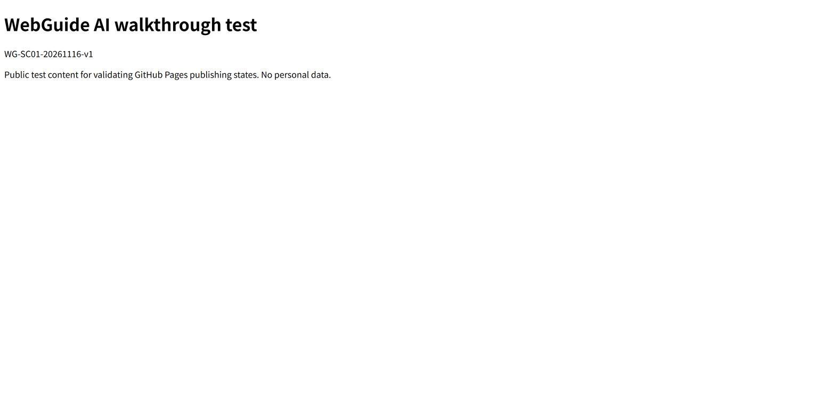
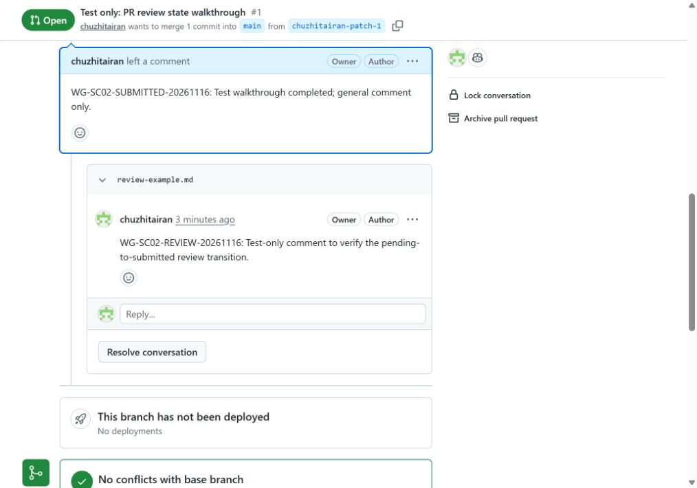
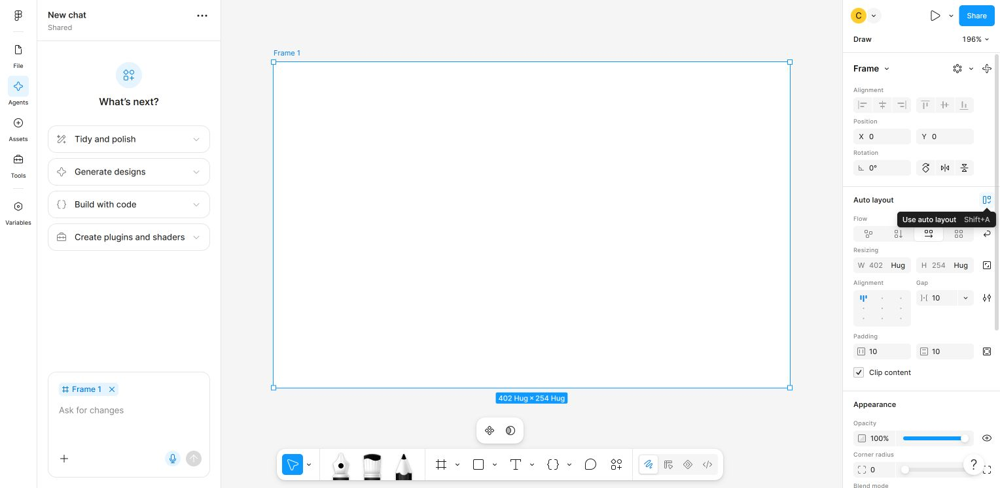

# WebGuide AI 浏览器场景走查

日期：2026-11-16。环境：Windows、Edge、已登录的 GitHub 与 Figma 网页、英文界面。目的：核对需求草案中三个场景的真实入口、未完成状态和完成证据，修订错误假设。本次由助手操作练习材料，不是真实用户可用性测试，也不是 WebGuide AI 扩展测试。

## 1. 结论与覆盖范围

| 场景 | 本次观察到的结果 | 未完成／受限状态 | 对需求的影响 |
| --- | --- | --- | --- |
| SC01 GitHub Pages | 保存发布源、部署成功、访问站点并核对测试标记 | 文件已有但 Pages 仍禁用；选好分支尚未保存；保存后正在构建 | 至少区分文件、表单、已保存配置、部署和最终页面五层证据 |
| SC02 PR review | 草稿评论刷新后仍为 Pending；提交后出现 review 记录及评论 | Pending 不是已发布；PR 作者不能批准或请求变更自己的 PR | 检查对应 review 的结果；不能用评论数量或通用“reviewed”文字判断完成 |
| SC03 Figma 自动布局 | 在 Draw 中为 Frame 成功启用自动布局，切回 Design 仍显示已启用 | 取消选择后只显示 Page 面板；旧的“Draw 中没有自动布局”现象本次未复现 | 删除强制切回 Design 的规则；先查能力、选择对象与现有布局状态 |

正常关键路径均有现场证据，但异常覆盖仍不完整：没有制造 Pages 构建失败、权限不足、旧内容缓存或网络提交失败；没有用第二个账号核验 PR 评论；没有验证 Figma 只读文件、复杂层级和绝对定位。不能将本次结果解释为整个产品已通过验收。

## 2. 练习材料与留存状态

| 材料 | 地址／标识 | 最终状态 |
| --- | --- | --- |
| GitHub 公开练习仓库 | [webguide-ai-walkthrough-20261116](https://github.com/chuzhitairan/webguide-ai-walkthrough-20261116) | 保留；仅测试内容 |
| Pages 首页 | [测试站点](https://chuzhitairan.github.io/webguide-ai-walkthrough-20261116/) | 可访问，标记为 `WG-SC01-20261116-v1` |
| 部署工作流 | [run 43801722077](https://github.com/chuzhitairan/webguide-ai-walkthrough-20261116/actions/runs/43801722077) | Success，关联首页提交 `0b5600a` |
| PR #1 | [Test only: PR review state walkthrough](https://github.com/chuzhitairan/webguide-ai-walkthrough-20261116/pull/1) | Open，未合并；测试分支 `chuzhitairan-patch-1` |
| 已提交 review | [review 5914964159](https://github.com/chuzhitairan/webguide-ai-walkthrough-20261116/pull/1#pullrequestreview-5914964159) | Comment 类型；保留测试评论 |
| Figma 独立练习文件 | [WebGuide AI - SC03 walkthrough - 20261116](https://www.figma.com/design/SYWCHn3kLHDHGBM8AggRv9/WebGuide-AI---SC03-walkthrough---20261116?node-id=1-2) | 保留；Page 1 / Frame 1，自动布局已启用，最终为 Design 模式 |

用户已明确批准创建这个公开练习仓库，并允许在其中的测试提交使用当前邮箱。未修改既有业务仓库或既有 Figma 文件。Figma 新文件位于当前团队的 Team folder，没有改变文件分享设置，也未创建公开分享链接。

## 3. SC01：从文件存在到网站发布

### 起点、动作与实际信号

| 步骤 | 动作／条件 | 观察到的页面信号 | 能证明什么 |
| --- | --- | --- | --- |
| 1 | 打开新建仓库的 Settings → Pages | Source 为 Deploy from a branch；Branch 为 None；提示 currently disabled | 发布源未启用 |
| 2 | 在 main 添加 `index.html` | 提交 `0b5600ab1d044ee3e8ff9dbb10afe6f74cbeb1b0`；回到 Pages 仍为 None / disabled | 有首页文件，仍未配置发布 |
| 3 | 选择 main 和 `/ (root)`，尚未保存 | 表单已有选中值，但页面仍提示未启用 | 选中值不等于持久化配置 |
| 4 | 点击 Save | “GitHub Pages source saved.”；“currently being built from the main branch” | 配置已保存；后一句不能独立证明实时构建中，仍须查工作流 |
| 5 | 查看 Actions 结果 | pages-build-deployment #1；Status Success；总计 48 秒；commit `0b5600a` | 对应提交部署成功；48 秒仅为该次工作流耗时 |
| 6 | 打开部署给出的站点 URL | 标题 WebGuide AI walkthrough test，正文含 `WG-SC01-20261116-v1` | 实际访问到本次预期页面内容 |

工作流还显示 Node.js 版本迁移等警告，但最终状态为 Success。警告不能直接当作本次部署失败。页面验证使用独立标签页，属于真实跨页面观察；尚未证明未来浏览器扩展具有跨域读取权限。

**后续核对修正（同日）**：在站点已上线且工作流 Success 后，Pages 分支段落仍显示“currently being built from”。因此先前把这句话直接解释为“构建中”的证据不足；实时状态需来自具体工作流。详见[扩展可行性实验进度](Pages扩展可行性实验-2026-11-16.md)。

建议的完成判定：目标仓库、发布源、提交与成功部署相匹配，站点可访问，且预期内容标记一致。任何关键证据缺失时保持待确认。用户只选择了分支或只按了 Save，都不足以完成任务。

### 证据

- [初始禁用状态截图](evidence/2026-11-16/sc01-pages-disabled.jpg)
- [保存后构建中截图](evidence/2026-11-16/sc01-source-saved-building.jpg)
- [成功部署截图](evidence/2026-11-16/sc01-deployment-success.jpg)
- [实际站点截图](evidence/2026-11-16/sc01-site-verified.jpg)、[站点完整状态文本](evidence/2026-11-16/sc01-site-verified.txt)

## 4. SC02：Pending review 到正式提交

### 起点、动作与实际信号

1. 新建 `review-example.md`，在独立分支提交 `eb6a244d7834ea042352cc7a380be11141cbf10d`，创建练习 PR #1。
2. 进入 Files changed。当前为升级后的界面，顶部按钮叫 **Submit review**，不能只按旧文档中的 **Review changes** 文本定位。
3. 使用文件级 **Comment on this file** 添加测试评论，点击 **Start a review**。评论标记为 **Pending**，顶部为 **Submit review (1)**。
4. 刷新后仍能看到该评论及 Pending，说明刷新后保留草稿并不等于已发布。
5. 打开 Finish your review，选择已默认选中的 **Comment**，添加测试总结并点击 **Submit review**。
6. 页面跳转到 Conversation 的 [review 5914964159](https://github.com/chuzhitairan/webguide-ai-walkthrough-20261116/pull/1#pullrequestreview-5914964159)。出现总结 `WG-SC02-SUBMITTED-20261116` 和原评论 `WG-SC02-REVIEW-20261116`；原评论不再标记 Pending。

**本次覆盖的是文件级 review 评论。** 草案最初以行级评论描述场景，二者的 review 提交状态相关，但不能因此声称行级入口已走查；行级评论操作还需补测。

### 两个容易混淆的信号

- **角色限制**：提交弹窗明确禁用 Approve、Request changes，并说明 PR 作者不能对自己的 PR 执行这两种 review。Comment 路径可用。系统应解释角色条件，不能反复让作者点击禁用选项。
- **自动化产生的记录**：账号既有设置自动请求了 Copilot review；它留下“剩余额度不足，无法 review”的说明。未主动再次请求或调整设置。这条记录与本次用户测试 review 不同，不能把任意“reviewed”记录或 Conversation 数量当成目标评审已完成。

本次只观察同一账号的草稿与提交结果，未独立证明第二个账号确实看到了评论。产品可以报告“已观察到对应 review 提交记录”，不能报告“对方已经阅读”。

### 证据

- [Pending 评论截图](evidence/2026-11-16/sc02-review-pending.jpg)、[完整状态](evidence/2026-11-16/sc02-review-pending.txt)
- [刷新后仍 Pending 的完整状态](evidence/2026-11-16/sc02-pending-after-reload.txt)
- [正式提交截图](evidence/2026-11-16/sc02-review-submitted.jpg)、[完整状态](evidence/2026-11-16/sc02-review-submitted.txt)

## 5. SC03：模式假设修正与选择对象检查

### 起点与操作

在独立新文件中创建 Frame 1。选中 Frame 时，Design 的属性面板有 Layout、Toggle auto layout 和 Freeform / Vertical / Horizontal / Grid。切到 Draw 后，同一 Frame 的面板仍有这些操作。

在 **Draw 模式**点击 Toggle auto layout 后，现场观察到：

- 标题从 Layout 变为 **Auto layout**。
- Toggle auto layout 值从 0 变为 **1**。
- Horizontal 被选中，出现 Gap、Padding 等布局设置。
- 切回 Design 后同一 Frame 仍为自动布局。

随后点击画布空白区域，右侧变为 **Page**，自动布局设置不再显示。通过左侧 Layers 再选 Frame 1，Auto layout 面板和已启用状态重新出现。这是本次实际复现的“目标选择影响可用操作”路径。

### 修正原假设

公开研究 N03 记录了过去某位用户通过 Draw → Design 找回入口的经历；该反馈仍保留其历史意义。但在本次账号与界面中，**Draw 并未阻止为 Frame 添加自动布局**，不能推导出“Draw 一律不可用”或“必须切回 Design”。本次也不能解释这种差异究竟来自版本、灰度、对象类型还是其他条件。

修订后的引导顺序：确认目标对象 → 读取当前可用能力与布局状态 → 已启用则定位设置；有可用入口则直接指导；入口缺失时再检查选择、编辑权限、模式与界面差异。模式切换是有条件的候选恢复动作，而非固定必经步骤。

### 操作环境问题与边界

原 Figma 标签页可读取页面，但点击和截图反复超时。重新绑定、重载未解决，在新标签页打开同一地址后恢复。随后完成新文件创建与布局操作。这是本次浏览器操作通道的问题，根因未明，不能归因为 Figma 权限不足，也不算应用内业务失败样本。

当前浏览器工具能看到模式、选中的 Frame 名称和属性面板状态；画布本身提示屏幕阅读器支持未启用。本次没有开启该设置，也未使用 Figma API。能读取面板不代表普通扩展能可靠取得所有画布对象或对象树。

本次只验证一个空 Frame 的布局属性设置，没有验证多个子对象的排列效果、只读文件、分组转换、嵌套布局或绝对定位。

### 证据

- [Draw 中入口可用截图](evidence/2026-11-16/sc03-draw-frame-auto-layout-available.jpg)、[完整状态](evidence/2026-11-16/sc03-draw-frame-auto-layout-available.txt)
- [Draw 中启用后的截图](evidence/2026-11-16/sc03-draw-auto-layout-enabled.jpg)、[完整状态](evidence/2026-11-16/sc03-draw-auto-layout-enabled.txt)
- [Design 中保持已启用的完整状态](evidence/2026-11-16/sc03-design-auto-layout-enabled.txt)
- [取消选择后的截图](evidence/2026-11-16/sc03-no-selection-page-panel.jpg)、[完整状态](evidence/2026-11-16/sc03-no-selection-page-panel.txt)
- [重新选中 Frame 的最终截图](evidence/2026-11-16/sc03-frame-reselected-final.jpg)、[完整状态](evidence/2026-11-16/sc03-frame-reselected-final.txt)

## 6. 回写需求的决定

| 对应需求 | 本次补充／修正 | 验收时应增加的检查 |
| --- | --- | --- |
| FR03 前提检查 | 检查对象、角色和当前能力；不把模式名称直接等同于能力 | Draw 可执行时不强制切换；无选中对象时不指向不存在的布局操作 |
| FR04 步骤引导 | 入口名称和位置可能随界面更新 | 兼容经过核对的入口差异；旧定位失效时重新观察 |
| FR05 进度与结果 | 保存、Pending、构建中与完成必须分开；结果需关联具体目标 | 不用按钮点击、评论总数或其他 review 代替目标结果 |
| FR06 偏离与失效 | 旧教程可能与当前能力不符 | 保留实际观察，跳过不必要动作，记录修订依据 |
| FR08 恢复进度 | 持久化 Pending 是应用草稿，不是任务完成 | 恢复时重新读取业务状态，而非仅恢复步骤编号 |
| FR15／FR16 教程验证与版本 | 历史用户反馈不自动成为现行操作规则 | 保存验证日期、对象和界面条件；有反证时更新草稿 |
| NFR01 可靠性 | 对“入口可用但旧教程认为不可用”也要检验 | 防止误诊断和多余恢复操作，同时检查误报完成 |

## 7. 下一项工作与剩余缺口

建议先以 **SC01 Pages** 做最小浏览器可行性实验：它有清楚的未完成、等待和最终内容信号。**SC02** 作为第二个状态判断样本；**SC03** 保留为对象与界面变化的挑战样本。此顺序是本次证据支持的建议，尚不是冻结范围或完整架构决定。

下一项实验只回答一个问题：用实际拟采用的浏览器扩展权限和页面读取方式，能否取得所需状态并向用户呈现可信的下一步。至少对照“发布源为空、保存后构建中、目标内容验证成功”三个状态；跨域站点结果无法取得时，应显示待确认。先记录读得到什么、读不到什么，再选择完整技术方案。

另需补充：SC02 行级评论与另一账号可见性；SC01 权限／失败等阻塞样例；SC03 有子对象的实际布局与只读样例。真人干系人访谈、用户试用、正式用例与课程评审仍未完成。本次练习 PR 不替代项目需求 PR 或团队成员 Review。

## 8. 证据使用说明

截图和状态文本位于 [evidence/2026-11-16](evidence/2026-11-16/README.md)。SC01 早期文本是工具的增量快照，有的只写“没有变化”，不能独立还原页面；对应截图及本次现场观察记录是主要依据。SC02、SC03 的关键状态与 SC01 站点结果保存了完整文本。快照中的数字仅为当时工具的元素编号，不能当作产品可复用选择器。

这些证据只描述采集时刻，在线地址未来可能变化。材料没有采集密码、令牌或 Cookie；含公开测试账号名和练习资源地址。未将本地研究材料上传到练习仓库。
